# BUG — Corregir desbordamiento, solapamiento y controles inaccesibles en QAgent

**Informe de lo realizado** · 11 de octubre de 2026 · Responsable: Rodríguez Malca, Rodrigo Abel

## Ítem del Backlog

| Campo | Valor |
|---|---|
| Nombre | BUG — Corregir desbordamiento, solapamiento y controles inaccesibles en QAgent |
| Responsable | Rodríguez Malca, Rodrigo Abel |
| Tipo de cambio | Corrección de defectos de interfaz y experiencia de usuario |
| Estado final | Implementado y verificado en Chromium y en la ventana nativa |

El equipo no confirmó para este trabajo un identificador numérico, épica, sprint, prioridad ni estimación. Por eso no se agregaron esos datos.

## Resumen

QAgent permitía reducir su ventana hasta 960×600, pero algunas pantallas no se acomodaban a ese tamaño. En Inicio se cortaban las acciones principales y no se podía recorrer toda la lista de proyectos; en Historial quedaban fuera los botones para abrir reportes y descargar specs; Configuración escondía su parte inferior; y en Vista previa el pie cubría parte del botón «Reintentar». También aparecía «Guía de uso» como una navegación funcional aunque no existía una guía implementada. Durante la prueba en la ventana nativa se encontró además que el resumen final del Monitor generaba un scroll horizontal y dejaba «Ver reporte de auditoría» fuera de la ventana.

Se corrigió el comportamiento de los contenedores desplazables sin cambiar el diseño general. Historial mantiene las funciones de HU-24 y ahora desplaza cada tabla horizontalmente cuando no cabe. Inicio y Configuración tienen desplazamiento vertical real. Vista previa se compacta solamente cuando la ventana tiene poca altura, «Guía de uso» queda identificada como no disponible y el Monitor acomoda el mensaje final y sus botones sin ampliar el ancho de la pantalla.

## Tipo de cambio

- [x] Corrección de defectos de interfaz.
- [x] Corrección de accesibilidad de botones y contenido.
- [x] Pruebas de regresión del frontend.
- [x] Evidencias visuales antes y después.
- [ ] Nuevo diseño o cambio de identidad visual.
- [ ] Nueva funcionalidad.
- [ ] Pausa real de «LIVE AGENTS».

## Diagnóstico inicial

| Defecto | Problema encontrado | Efecto para el usuario |
|---|---|---|
| UI-01 · Historial | Las tablas aumentaban el ancho de la pantalla y la vista tampoco tenía desplazamiento vertical efectivo. | «Ver reporte» y las descargas individuales de specs quedaban fuera de alcance en 960×600. |
| UI-02 · Inicio / Proyectos | El contenido completo se centraba dentro de una altura fija, aunque fuera más alto que la ventana. | «Abrir proyecto» y «Abrir repositorio» quedaban cortados y no se podía recorrer toda la lista. |
| UI-03 · Configuración | La sección crecía más que el espacio disponible, mientras el documento principal bloqueaba el scroll. | La parte inferior no podía leerse en 960×600 ni en 1400×900. |
| UI-04 · Vista previa | En una ventana baja, el bloque Entorno terminaba debajo del pie de navegación. | El centro de «Reintentar» recibía el clic del pie o del botón «Continuar». |
| UI-05 · Guía de uso | La opción tenía la apariencia de las navegaciones activas, pero no tenía destino ni evento. | Parecía que la aplicación ignoraba el clic. |
| UI-06 · Monitor en Vivo | El mensaje final, las rutas largas y los dos botones compartían una sola fila rígida. | Aparecía un scroll horizontal general y «Ver reporte de auditoría» quedaba cortado incluso en 1366×723. |

## Archivos modificados

| Archivo | Por qué cambió |
|---|---|
| `frontend/css/layout.css` | Permite que las vistas con scroll se reduzcan dentro del contenedor principal y desplacen su propio contenido. |
| `frontend/css/componentes.css` | Agrega un contenedor horizontal reutilizable para tablas anchas. |
| `frontend/componentes/inicio/inicio.css` | Evita que el centrado vertical empuje las acciones fuera de la ventana cuando hay muchos proyectos. |
| `frontend/componentes/historial/historial.js` | Envuelve las dos tablas en contenedores horizontales sin cambiar sus datos ni acciones de HU-24. |
| `frontend/componentes/vista-previa/vista-previa.css` | Compacta espacios y tarjetas en ventanas de hasta 700 px de altura para separar «Reintentar» del pie. |
| `frontend/componentes/sidebar/sidebar.js` | Marca «Guía de uso» como no disponible porque no existe una guía implementada. |
| `frontend/componentes/monitor/monitor.css` | Permite envolver rutas, mensajes y acciones del resumen final sin desbordar la pantalla. |
| `frontend/componentes/monitor/monitor.js` | Deja la alineación de las acciones a cargo del componente adaptable, sin márgenes inline rígidos. |
| `frontend/componentes/barra-corrida/barra-corrida.css` | Adapta la barra superior y recorta visualmente rutas largas cuando no caben. |
| `frontend/componentes/ejecucion/ejecucion.css` | Retira la regla de `nextbox` que pertenecía al Monitor y la deja junto a su componente real. |
| `tests/frontend/test_fix_interfaces.py` | Agrega seis regresiones estructurales, una por cada defecto del FIX. |
| `evidencias/FIX_INTERFACES/` | Guarda capturas antes/después y las mediciones de la verificación visual. |
| `FIX_INTERFACES_INFORME_NOTION.md` | Documenta el trabajo, las pruebas y las evidencias para Notion. |

No se modificaron Planner, Generator, Reviewer, el analizador, el sandbox, el almacenamiento, la exportación de reportes ni el backend de HU-24.

## Correcciones implementadas

### UI-01 · Historial

Las dos tablas ahora viven dentro de un contenedor con desplazamiento horizontal. La pantalla también puede reducir su altura dentro de `main` y desplazarse verticalmente. En 960×600 se pudo llevar «Ver reporte» y el botón de descarga de la última spec al área visible; sus centros correspondieron al botón correcto y no a otro componente.

### UI-02 · Inicio / Proyectos

Inicio conserva el centrado cuando hay poco contenido, pero usa una altura mínima en lugar de imponer una altura fija. Cuando aparecen diez proyectos recientes, la pantalla crece dentro de su contenedor desplazable: las dos acciones quedan completas al inicio y se puede llegar hasta el último proyecto.

### UI-03 · Configuración

La clase compartida de las pantallas desplazables ahora puede contraerse dentro del diseño flex. Configuración alcanzó un desplazamiento real de 588 px en 960×600 y de 186 px en 1400×900, suficiente para mostrar el último bloque y el ejemplo completo de `config.toml`.

### UI-04 · Vista previa

En ventanas con una altura de hasta 700 px se redujeron únicamente los espacios verticales de Vista previa. En 960×600 el botón «Reintentar» queda completo antes del pie. La comprobación del punto central devolvió `envReintentar`, en vez del pie o de «Continuar».

### UI-05 · Guía de uso

No se encontró una guía implementada que pudiera conectarse sin ampliar el alcance. La opción ahora utiliza el estado deshabilitado, `aria-disabled="true"`, el texto «No disponible» y un mensaje explicativo. No se creó una pantalla nueva.

### UI-06 · Monitor en Vivo

El resumen de una corrida terminada ahora divide el mensaje y las acciones en filas flexibles. Las rutas y los errores extensos pueden partirse, los dos botones permanecen dentro de la tarjeta y el Monitor deja de aumentar el ancho total. La barra superior también puede pasar a una segunda fila; la ruta del repositorio se muestra con puntos suspensivos cuando no cabe. En 1366×723 el ancho del Monitor pasó de 1210 px a 1130 px, exactamente el espacio disponible; en 960×600 se mantuvo en 724 px de 724 px disponibles.

## Criterios de aceptación

| Criterio | Estado | Implementación realizada | Prueba y evidencia |
|---|---|---|---|
| CA-01 · Inicio | **Cumplido** | Altura mínima y desplazamiento vertical real para acciones y recientes. | Verificación en 960×600; capturas UI-02 superior y final de lista. |
| CA-02 · Historial | **Cumplido** | Scroll vertical de pantalla y horizontal independiente en las dos tablas. Se conservaron los eventos de HU-24. | Botones «Ver reporte» y descarga comprobados por coordenadas; pruebas de HU-24 aprobadas; capturas UI-01. |
| CA-03 · Configuración | **Cumplido** | La sección puede reducirse y desplazar todo su contenido. | Scroll final 588 px en 960×600 y 186 px en 1400×900; capturas del último bloque. |
| CA-04 · Vista previa | **Cumplido** | Espaciado compacto para ventanas de poca altura. | «Reintentar» completo y con su centro interactivo en 960×600; captura UI-04. |
| CA-05 · Guía de uso | **Cumplido** | Se muestra como no disponible porque no existe una guía implementada. | Regresión estructural y captura UI-05. |
| CA-06 · Validación | **Cumplido** | Se comprobaron las ocho pantallas en 960×600, 1400×900 y 1920×1080. | Capturas antes/después, JSON de mediciones, 48 pruebas del frontend, 666 rápidas y 668 pruebas sin fallos del FIX; las 12 pruebas Docker quedan condicionadas por el montaje local. |
| CA-07 · Monitor | **Cumplido** | El resumen final y la barra de corrida responden a rutas y mensajes largos. | Capturas y mediciones antes/después en 1366×723 y comprobación adicional en 960×600. |

## Pruebas ejecutadas

### Pruebas del frontend

```bash
PYAGENT_FAKE_LLM=1 .venv/bin/python -m pytest tests/frontend -q
```

Resultado: **48 aprobadas**. Incluye las seis regresiones nuevas y las pruebas anteriores de estructura y HU-24.

### FIX junto con HU-24

```bash
PYAGENT_FAKE_LLM=1 .venv/bin/python -m pytest \
  tests/almacenamiento/test_hu24_specs.py \
  tests/app/test_desktop_historial.py \
  tests/frontend/test_hu24_historial.py \
  tests/frontend/test_fix_interfaces.py \
  tests/orchestrator/test_hu24_reutilizar_specs.py -q
```

Resultado: **18 aprobadas**. Se verificaron conjuntamente el FIX, el Historial real, la persistencia y las descargas ZIP de HU-24.

### Suite rápida

```bash
PYAGENT_FAKE_LLM=1 .venv/bin/python test.py --rapido
```

Resultado: **666 aprobadas y 14 excluidas** por los marcadores `docker` o `red`.

### Suite completa disponible

```bash
PYAGENT_FAKE_LLM=1 .venv/bin/python test.py
```

Resultados reales:

- Lint: **aprobado**.
- Pytest: **668 aprobadas y 12 fallidas por el montaje local de Docker Desktop**.
- Formato global: **no aprobado** por dos archivos preexistentes y ajenos a este FIX: `src/pyagent/analysis/laundering.py` y `tests/test_laundering.py`.

Esos dos archivos no se modificaron para evitar mezclar trabajo de otra tarea.

La ejecución directa de `pytest -q` confirmó el mismo resultado: **668 aprobaron y 12 fallaron** porque Docker Desktop rechazó los montajes del directorio temporal con `bind source path does not exist: /tmp/pyagent-sandbox-...`. El contexto activo es `desktop-linux`; el daemon `default` no está iniciado. Es una configuración local independiente del código de interfaz.

### Verificación visual

El frontend real se abrió con Chromium desde el mismo `frontend/index.html`. Se comprobaron las ocho pantallas en 960×600, 1400×900 y 1920×1080. El caso adicional del Monitor se reprodujo con la ruta y el error de la corrida real en 1366×723 y 960×600. No aparecieron errores JavaScript. Después de aplicar la corrección, el responsable repitió el recorrido en la ventana nativa de pywebview y confirmó que las pantallas y los controles se mostraban correctamente.

Las mediciones generales están guardadas en [resultados-visuales.json](evidencias/FIX_INTERFACES/despues/resultados-visuales.json) y las del Monitor en [monitor-real-resultados.json](evidencias/FIX_INTERFACES/despues/monitor-real-resultados.json).

## Evidencias visuales

Las capturas generales usan los datos de demostración incluidos en QAgent para llenar las pantallas. La comprobación del Monitor reproduce los datos de la corrida real mostrada durante la revisión. En ambos casos, el HTML, CSS y JavaScript corresponden al frontend real.

### UI-01 · Historial

*Antes: las tablas expandían la pantalla y ocultaban las acciones del lado derecho.*

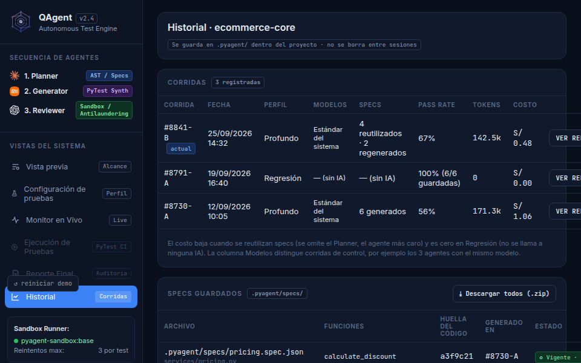

*Después: cada tabla puede desplazarse horizontalmente y «Ver reporte» queda accesible.*

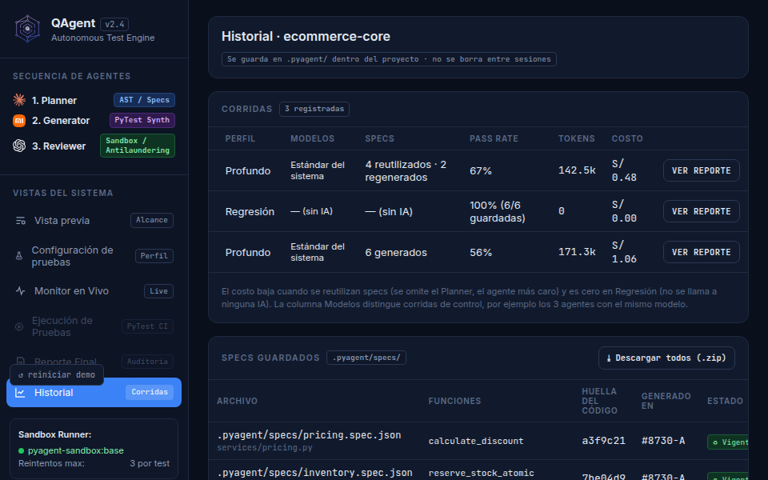

*También se llegó al último botón de descarga de specs.*

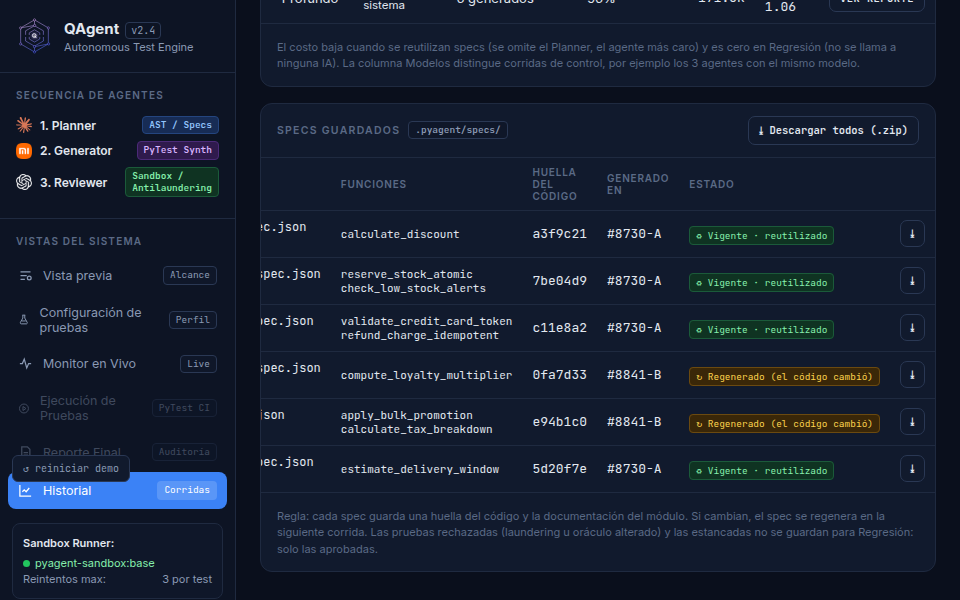

### UI-02 · Inicio / Proyectos

*Antes: las acciones empezaban fuera del borde superior y la lista no tenía un scroll utilizable.*

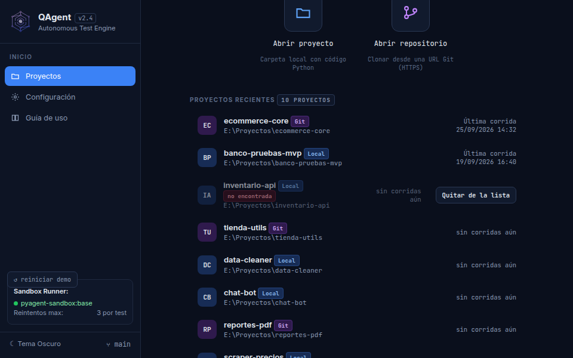

*Después: las acciones principales se muestran completas.*

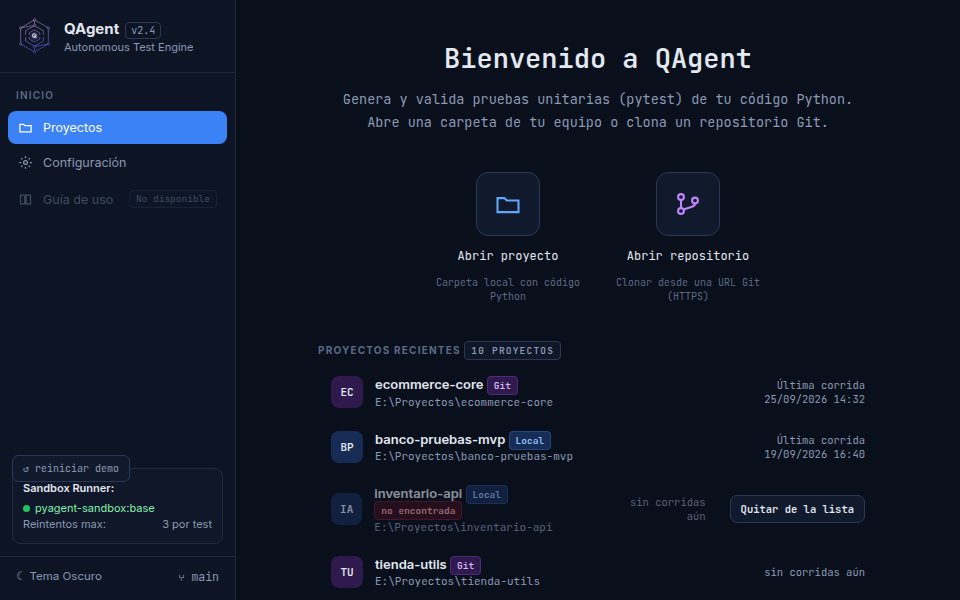

*El desplazamiento permite llegar al final de la lista de proyectos recientes.*

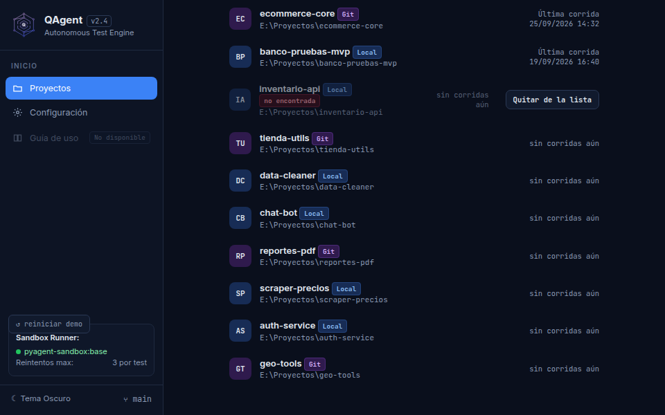

### UI-03 · Configuración

*Antes, en 960×600, la parte inferior quedaba fuera de alcance.*

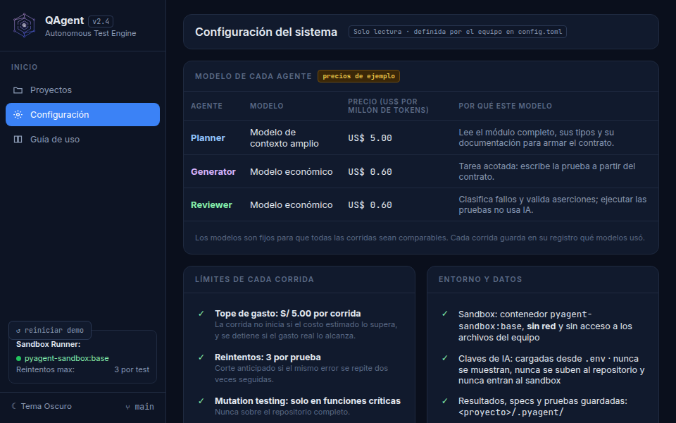

*Después se puede desplazar hasta el último bloque.*

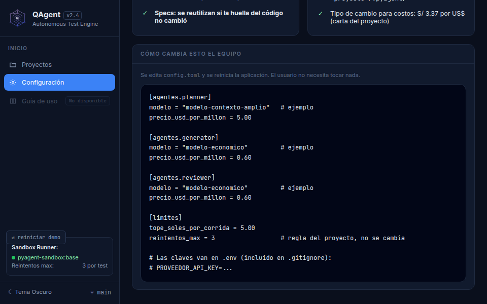

*El mismo problema se reproducía en el tamaño inicial de 1400×900.*

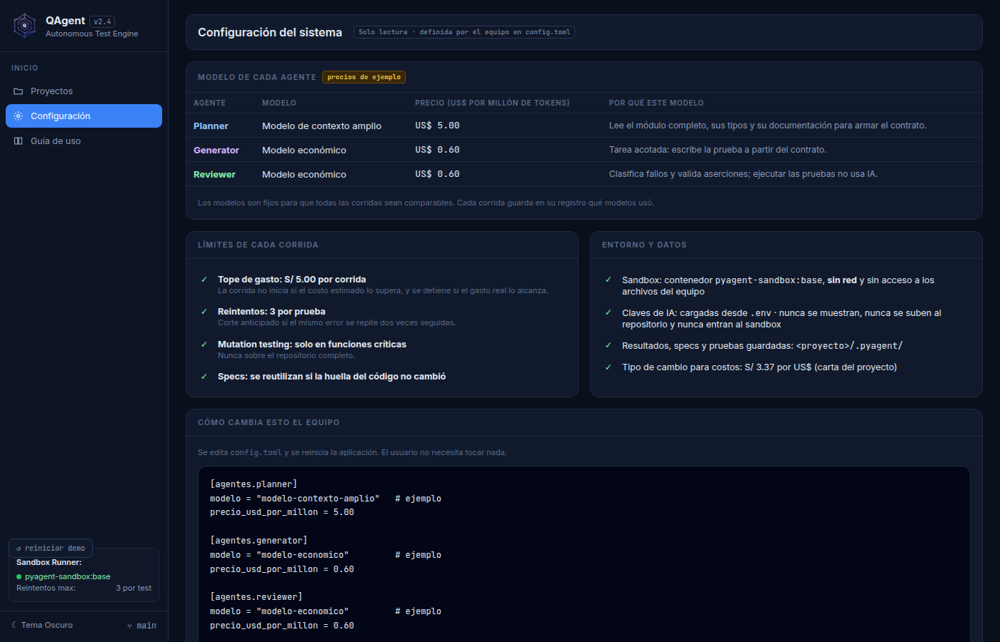

*Después, el bloque final también es accesible en 1400×900.*

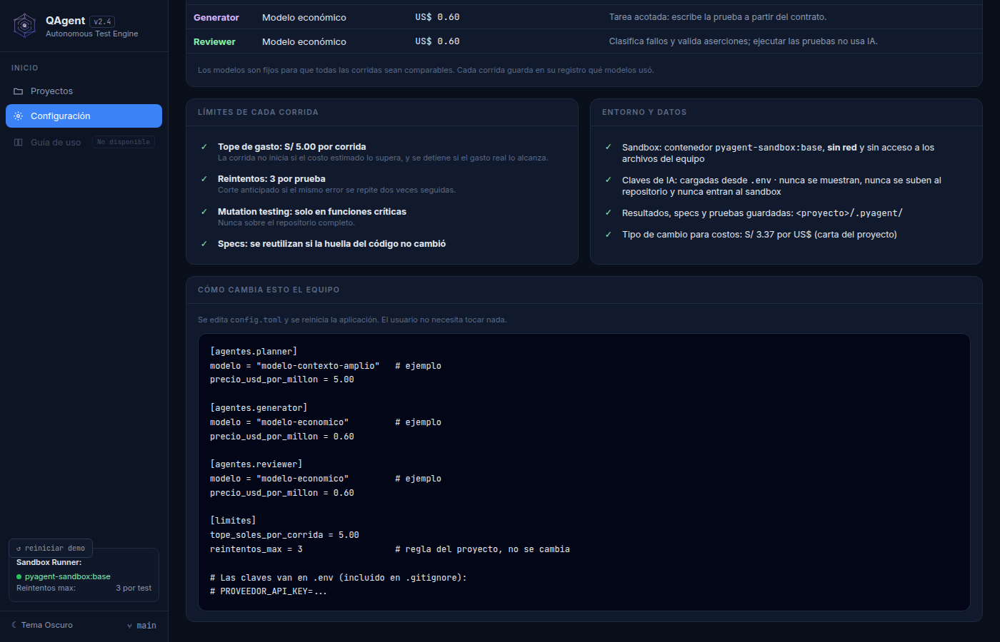

### UI-04 · Vista previa

*Antes: «Reintentar» quedaba parcialmente debajo del pie de navegación.*

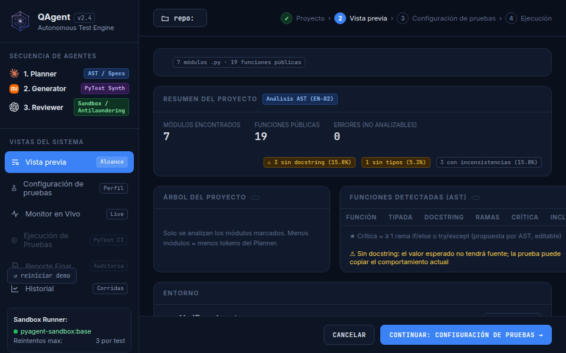

*Después: el botón se ve completo, separado del pie y recibe el clic en toda su zona central.*

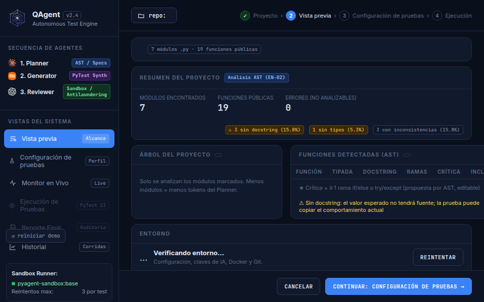

### UI-05 · Guía de uso

*Antes: la opción se veía como una navegación normal aunque no tenía acción.*

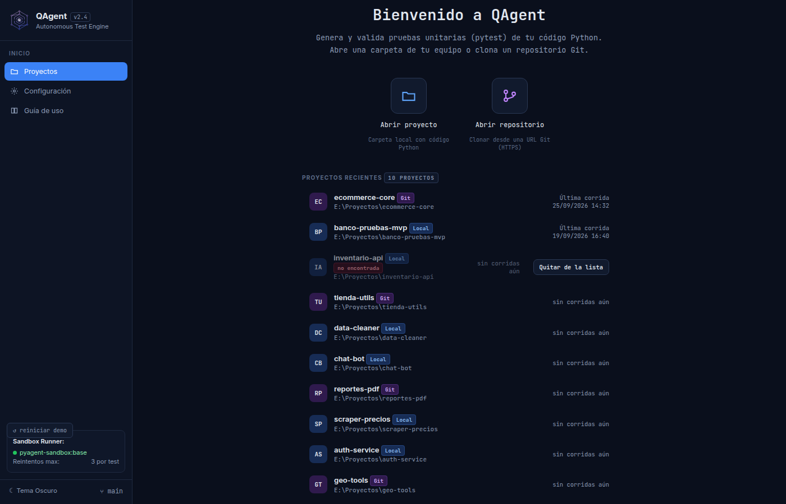

*Después: aparece atenuada y con la etiqueta «No disponible».*


### UI-06 · Monitor en Vivo

*Antes: el resumen final ampliaba el contenido, creaba un scroll horizontal y cortaba el segundo botón.*

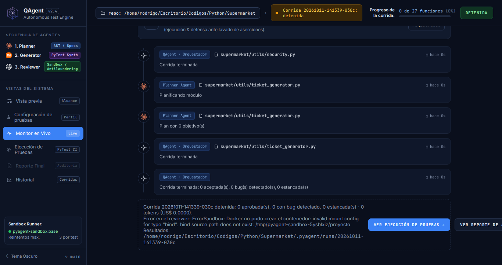

*Después: el mensaje se adapta al ancho y los dos botones quedan completos en 1366×723.*

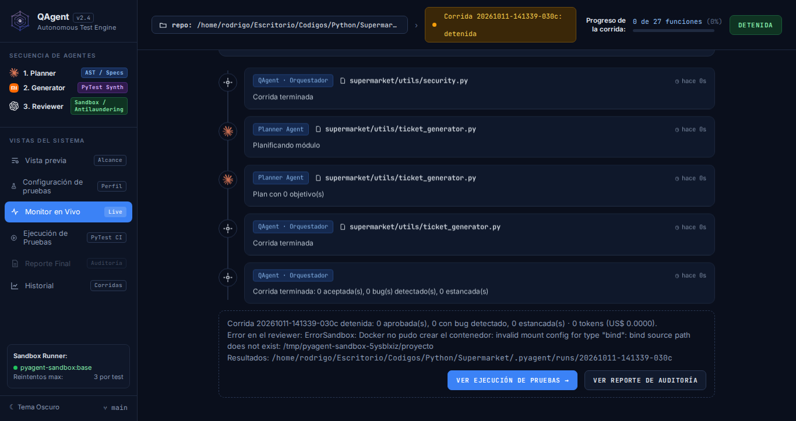

*La misma estructura permanece accesible en la ventana mínima de 960×600.*

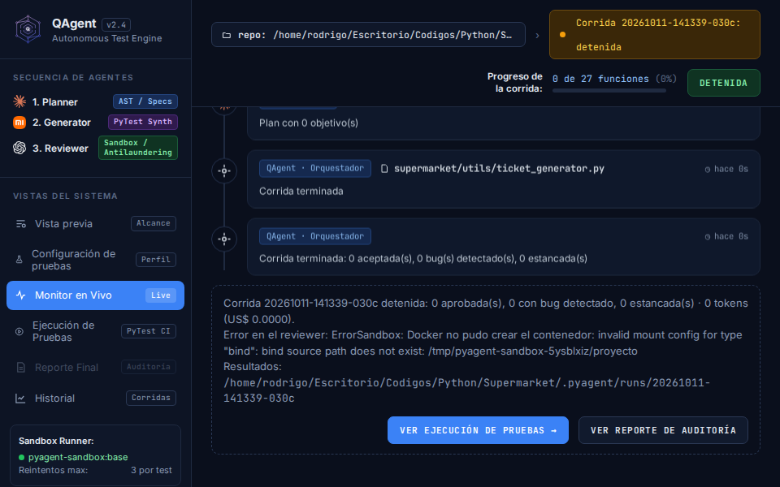

### Comprobación en 1920×1080

Historial conserva su distribución normal cuando hay espacio suficiente; el cambio no obliga a mostrar barras innecesarias en una ventana grande.

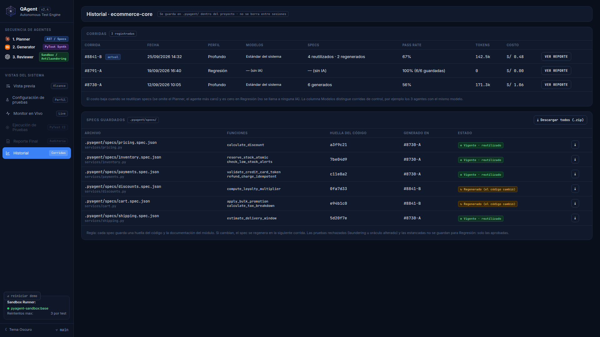

## Comprobación de integración

- [x] La navegación entre las pantallas existentes se conserva.
- [x] Inicio mantiene «Abrir proyecto» y «Abrir repositorio».
- [x] Historial sigue consultando corridas y specs reales mediante el backend de HU-24.
- [x] La descarga individual y general de specs conserva sus funciones originales.
- [x] «Ver reporte» sigue abriendo el reporte correspondiente.
- [x] Vista previa conserva el análisis, la selección y el paso hacia Configuración de pruebas.
- [x] Monitor mantiene visibles el resumen final y sus dos acciones sin scroll horizontal general.
- [x] Los tres modales existentes conservan su estructura.
- [x] Configuración de pruebas, Monitor, Ejecución y Reporte se renderizaron en las tres resoluciones.
- [x] El recorrido final también fue comprobado manualmente en la ventana nativa de pywebview.
- [x] Las pruebas usan la IA simulada y no consumieron tokens de pago.
- [x] No se agregaron claves, credenciales ni datos sensibles.
- [x] No se implementó ni modificó la pausa real de «LIVE AGENTS».
- [x] No se hicieron commit, push, merge ni pull request.

## Problemas encontrados

- El botón «↺ reiniciar demo» que aparece sobre la barra lateral pertenece únicamente al modo navegador. En pywebview permanece oculto y no forma parte del FIX.
- `python test.py` termina con código de error por dos causas independientes del FIX: dos archivos ajenos no cumplen actualmente el formato de Ruff y las 12 pruebas Docker fallan porque el contexto `desktop-linux` no puede montar las rutas temporales de `/tmp`. El lint y las 668 pruebas restantes sí pasan.
- No se hicieron llamadas reales a modelos de IA.

## Estado final

El FIX está **implementado y verificado en Chromium y en la ventana nativa de QAgent**. UI-01, UI-02, UI-03, UI-04, UI-05 y el defecto adicional UI-06 quedaron corregidos y cuentan con pruebas y evidencias.

La revisión manual final fue completada por el responsable. No hay commits, push ni pull request realizados.
