# Arquitectura de QAgent

> **Ítems:** EN-01 — Arquitectura GAIA y contratos JSON (Sprint 1) · EN-20 — Arquitectura del Sprint 2 · **Responsable:** Oncoy Patricio, Angel · **Estado:** borrador para aprobación del equipo

QAgent genera y valida pruebas para el código del usuario. Hoy cubre Python 3.10+ con pytest: **pruebas unitarias de funciones** y **pruebas de endpoints FastAPI**. Tres agentes basados en LLM (Planner, Generator y Reviewer) trabajan bajo un orquestador determinista, y todas las pruebas se ejecutan en un sandbox Docker aislado.

En el **Sprint 2** la arquitectura se amplía sin rehacerse (ADR-010): una capa de **adaptadores por lenguaje** para JavaScript/TypeScript y Java (ADR-007, ADR-009), un **Agente Explicador** que traduce los hallazgos a lenguaje simple (ADR-008) y nuevos tipos de prueba por prioridad (sección 10.6). El orquestador sigue siendo determinista.

**Convención de los diagramas:** lo que todavía no está en `develop` lleva la etiqueta **«propuesto»** y se dibuja con línea punteada. Lo demás está implementado.

| Qué cambia en el Sprint 2 | Dónde se describe | Decisión |
|---|---|---|
| Capa de adaptadores por lenguaje y contratos versionados | Secciones 4, 9 | ADR-007 (EN-17) |
| tree-sitter para JS/TS y Java; Python sigue con `ast` | Secciones 4, 11 | ADR-009 (SPK-04) |
| Agente Explicador como etapa posterior al veredicto | Secciones 4, 6.5, 8 | ADR-008 (SPK-03) |
| Imágenes del sandbox por lenguaje | Sección 7 | ADR-010 |
| Nuevos tipos de prueba (componentes, E2E de humo, arquitectura) | Sección 10.6 | ADR-010 |
| Lo que no cambia y las decisiones abiertas | Sección 13 | ADR-010 |

El documento sigue el **modelo C4** (Contexto → Contenedores → Componentes → Código) y lo completa con vistas dinámicas, despliegue, el modelo GAIA de los agentes y las decisiones de diseño.

**Contenido**

1. [Estilo de arquitectura](#1-estilo-de-arquitectura)
2. [Nivel 1 · Contexto](#2-nivel-1--contexto)
3. [Nivel 2 · Contenedores](#3-nivel-2--contenedores)
4. [Nivel 3 · Componentes del backend](#4-nivel-3--componentes-del-backend)
5. [Nivel 4 · Código](#5-nivel-4--código)
6. [Vistas dinámicas](#6-vistas-dinámicas)
7. [Vista de despliegue](#7-vista-de-despliegue)
8. [Modelo GAIA](#8-modelo-gaia)
9. [Contratos JSON](#9-contratos-json)
10. [Enfoque de pruebas](#10-enfoque-de-pruebas)
11. [Stack tecnológico](#11-stack-tecnológico)
12. [Decisiones de arquitectura](#12-decisiones-de-arquitectura)
13. [Sprint 2: lo que no cambia y pendientes](#13-sprint-2-lo-que-no-cambia-y-pendientes)
14. [Aprobación](#14-aprobación)

---

## 1. Estilo de arquitectura

**QAgent es un monolito modular en capas, de escritorio, con un pipeline multiagente orquestado.**

| Característica | Qué significa en QAgent |
|---|---|
| **Monolito** | Toda la aplicación (interfaz, orquestador, agentes y servicios) se instala y se ejecuta como **un solo programa** en la PC del usuario, en **un solo proceso Python**. No hay servicios separados que se desplieguen por su cuenta. |
| **Modular** | Por dentro, el código está dividido en módulos con una responsabilidad cada uno (`agents`, `analysis`, `sandbox`, `llm`, `orchestrator`, `app` y, desde el Sprint 2, `lenguajes`) que se comunican por contratos JSON y reglas de dependencia (sección 4). |
| **En capas** | Presentación → aplicación → datos. Cada capa solo usa la de abajo. |
| **Pipeline orquestado** | Cada función pasa por etapas fijas (analizar → planificar → generar → ejecutar y revisar → reportar), dirigidas por una máquina de estados. En el Sprint 2 se suma una etapa final opcional, explicar (ADR-008), fuera de la máquina de estados. |
| **Multiagente (GAIA)** | Las etapas que requieren criterio las cumplen agentes con roles, permisos y protocolos definidos (sección 8). |

### Por qué monolito y no otra opción

| Alternativa | Por qué no aplica a QAgent |
|---|---|
| **Microservicios** | Tiene sentido cuando varias partes escalan o se despliegan por separado y hay muchos usuarios concurrentes. QAgent tiene un usuario por instalación, 5 desarrolladores y un semestre: separar en servicios agregaría red, despliegue y fallos entre servicios sin ningún beneficio. |
| **Cliente-servidor** | Requiere un servidor propio que atienda a varios clientes. En QAgent la interfaz y el backend corren en el mismo proceso: pywebview expone funciones Python a JavaScript directamente (`js_api`), sin HTTP. |
| **Aplicación web** | Obligaría a subir el código del usuario a un servidor. QAgent analiza el código localmente y solo envía a las APIs de IA el resumen que necesita cada agente. |

La relación cliente-servidor solo aparece **hacia afuera**: el backend es cliente de las APIs de los LLM (HTTPS) y del motor de Docker (socket local). El sandbox es un **proceso aparte** a propósito, por seguridad, pero no es un servicio de QAgent: es un contenedor efímero que se crea y destruye en cada prueba.

---

## 2. Nivel 1 · Contexto

Quién usa QAgent y con qué sistemas externos se relaciona.

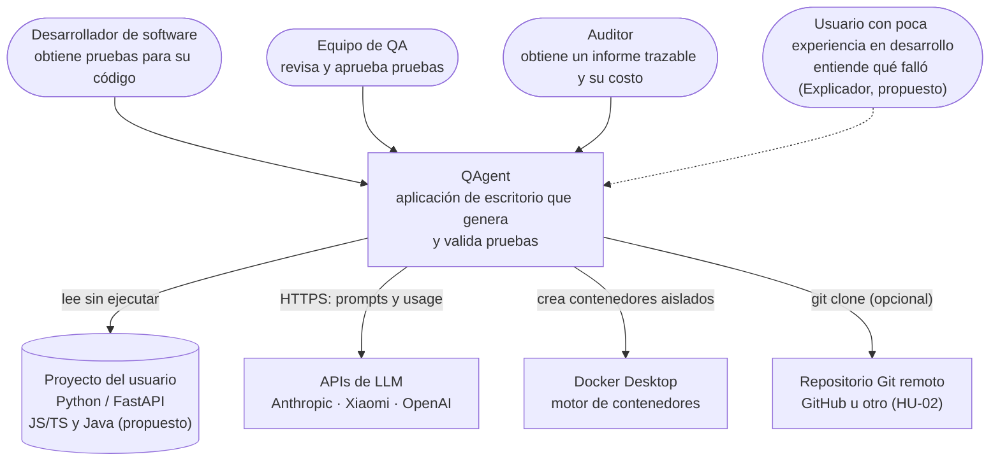

| Actor o sistema | Relación con QAgent |
|---|---|
| Desarrollador de software | Abre su proyecto, lanza la corrida y obtiene pruebas listas para su repositorio. |
| Equipo de QA | Revisa las pruebas, las alertas de laundering y los mutantes sobrevivientes. |
| Auditor | Consulta el costo estimado y real, el historial y el informe exportable. |
| Usuario con poca experiencia en desarrollo (propuesto) | Lee la explicación en lenguaje simple de cada hallazgo. Es el público principal del Explicador (ADR-008); a un usuario técnico le basta la traza actual. |
| Proyecto del usuario | Fuente del análisis estático. Nunca se ejecuta fuera del sandbox. Hoy Python; JS/TS y Java en el Sprint 2. |
| APIs de LLM | Un modelo por agente (ADR-001). Única salida a internet con información del proyecto. |
| Docker Desktop | Ejecuta las pruebas en contenedores sin red. |
| Repositorio Git remoto | Opcional: clonar un proyecto público por URL. |

---

## 3. Nivel 2 · Contenedores

En C4, un "contenedor" es cualquier pieza que se ejecuta o guarda datos por separado (no necesariamente Docker).

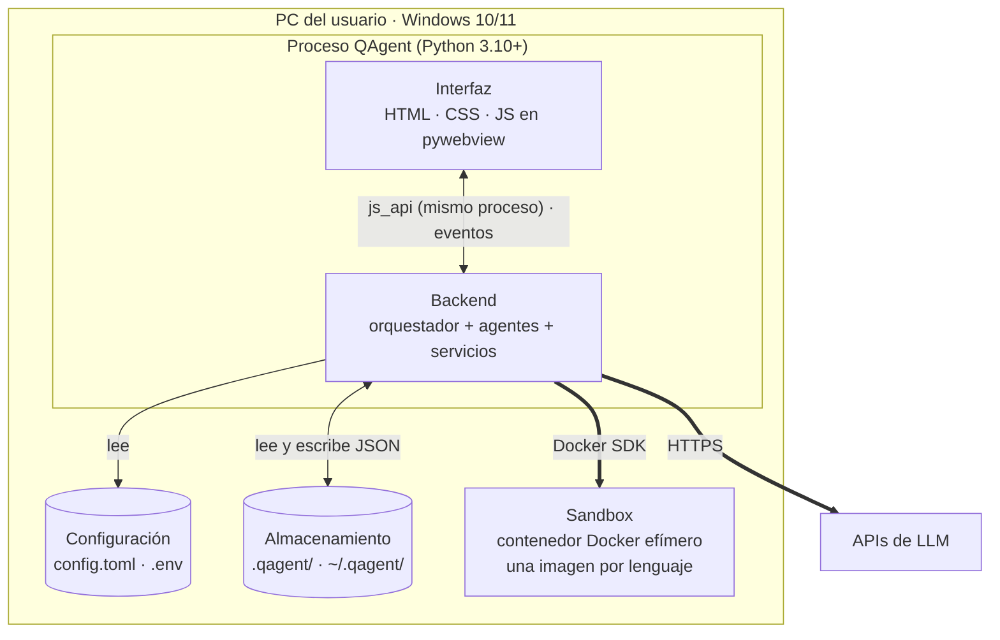

| Contenedor | Tecnología | Responsabilidad | Ítems |
|---|---|---|---|
| **Interfaz** | HTML, CSS, JS dentro de pywebview (carpeta `src/qagent/frontend/`, sin compilación; un componente por pantalla, ver ADR-003) | Pantallas: Bienvenida, Vista previa, Monitor en vivo, Ejecución, Reporte, Historial, Configuración | EN-08, HU-* |
| **Backend** | Python 3.10+ | Análisis, orquestación, agentes, cálculo de métricas y costo. En el Sprint 2, también los adaptadores por lenguaje y el Explicador | EN-02 a EN-07, EN-14, EN-15, EN-17, EP-10 |
| **Configuración** | TOML + variables de entorno | Modelos, precios, topes y reintentos (`config.toml`, se versiona); claves de API (`.env`, no se versiona) | EN-06 |
| **Almacenamiento** | Archivos JSON | `.qagent/` dentro del proyecto analizado: corridas, specs, pruebas aprobadas. `~/.qagent/recientes.json`: proyectos recientes | EN-07, HU-01, HU-03 |
| **Sandbox** | Docker. Hoy: Python 3.11, pytest, coverage, mutmut, fastapi, httpx. Propuesto: una imagen por lenguaje (sección 7) | Ejecutar cada prueba aislada: `--network none`, `--rm`, 4 CPU (recortados a los de Docker), 3 GB, 120 s; configurables en `[sandbox]` | EN-03, EN-09, EN-15 |

---

## 4. Nivel 3 · Componentes del backend

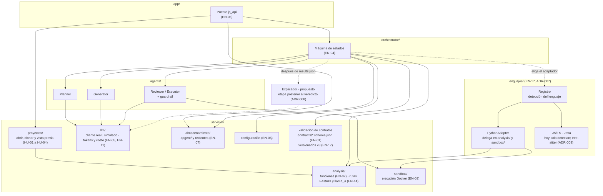

El Sprint 2 agrega dos piezas, ambas fuera de la máquina de estados:

- **`lenguajes/`** (EN-17) reúne todo lo que depende del lenguaje (análisis, comando de pruebas, imagen del sandbox, lectura de resultados y guardrail de aserciones) detrás de la interfaz `LanguageAdapter`. Planner, Generator, Reviewer y el orquestador son compartidos y no conocen lenguajes. `PythonAdapter` solo delega en el código actual, así que el flujo de Python no cambia. Todavía no está conectado a la corrida: la flecha punteada desde el orquestador es lo que falta.
- **El Explicador** lo invoca el código de la corrida (`corrida.py`) cuando los veredictos ya están guardados. Es de solo lectura y, si falla o está desactivado, los informes siguen como hoy.

| Componente | Carpeta | Responsabilidad | Ítems |
|---|---|---|---|
| Puente js_api | `src/qagent/app/` | Recibe las acciones de la interfaz (`desktop.py`) y le envía eventos. No contiene lógica de negocio. | EN-08 |
| Proyectos | `src/qagent/proyectos/` | Lógica de los proyectos del usuario: abrir una carpeta, clonar un repositorio y vista previa. Sin dependencia de pywebview. | HU-01 a HU-04 |
| Orquestador | `src/qagent/orchestrator/` | Máquina de estados de la corrida: ordena funciones por dependencias (`llama_a`), reparte trabajo, controla reintentos, topes de gasto y fallos. Sin LLM. | EN-04 |
| Planner | `src/qagent/agents/` | Diseña casos de prueba y valores esperados por función o endpoint. | HU-11, HU-27 |
| Generator | `src/qagent/agents/` | Escribe el test pytest de una función o endpoint. | HU-11, EN-15 |
| Reviewer / Executor | `src/qagent/agents/` | Ejecuta en el sandbox, detecta laundering y decide. | HU-14, HU-16 |
| Analizador | `src/qagent/analysis/` | Análisis estático con `ast`: firmas, tipos, docstrings, ramas, rutas FastAPI, `llama_a`, SHA-256. | EN-02, EN-14 |
| Cliente LLM | `src/qagent/llm/` | Llama a la API del modelo de cada agente (o a la IA simulada) y registra el `usage`. | EN-05, EN-11 |
| Sandbox | `src/qagent/sandbox/` | Prepara la imagen, copia el proyecto y ejecuta pytest, coverage y mutmut. | EN-03, EN-09 |
| Almacenamiento | `src/qagent/almacenamiento/` | `AlmacenProyecto`: crea `.qagent/` y lee y escribe `runs/<run_id>/run.json`, `specs/`, `tests/` (pruebas aprobadas) y `mutacion/` (último Mutation Score por función, #70); `recientes.py`: `~/.qagent/recientes.json`. Escritura atómica en UTF-8. | EN-07, HU-01, HU-03 |
| Registro de corridas | `src/qagent/storage/` | `log.json` y `results.json` de cada corrida, validados contra `run_log.schema.json`. | EN-05 |
| Configuración | `src/qagent/config/` | Carga `config.toml` y `.env`, audita las claves y verifica Docker y Git. | EN-06 |
| Contratos | `src/qagent/contracts/` | JSON Schema de cada mensaje; se validan en cada paso. En el Sprint 2, versiones con lenguaje y framework (sección 9). | EN-01, EN-17 |
| Adaptadores por lenguaje | `src/qagent/lenguajes/` | Interfaz `LanguageAdapter` y registro: detección del lenguaje, análisis estático, comando de pruebas, entorno del sandbox, lectura de resultados y guardrail de aserciones. Python completo (delega en el código actual); JS/TS y Java solo detectan por ahora. | EN-17, EP-11a, EP-12a · ADR-007, ADR-009 |
| Explicador (propuesto) | por definir en EP-10 | Explica en lenguaje simple los objetivos que no terminaron en `accept`, con plantillas deterministas y un LLM opcional. | EP-10 · ADR-008 |

### Reglas de dependencia

1. `app/` solo llama al orquestador y a los servicios (por ejemplo `proyectos/`); no contiene lógica de negocio.
2. El orquestador puede usar agentes y servicios.
3. **Los agentes no se importan entre sí** ni importan al orquestador. Solo reciben y devuelven contratos.
4. Los agentes usan el Cliente LLM; solo el Reviewer usa el Sandbox.
5. Ningún componente ejecuta el código del usuario fuera del Sandbox.
6. **Los servicios no dependen de la interfaz:** `proyectos/`, `almacenamiento/`, `analysis/`, `sandbox/`, `llm/`, `storage/` y `lenguajes/` nunca importan `qagent.app` ni pywebview. Así se prueban sin ventana.
7. **Lo específico de un lenguaje vive solo en su adaptador** (`lenguajes/`), nunca en los agentes ni en el orquestador (ADR-007).
8. **El Explicador no decide el flujo:** no cambia decisiones, intentos, cobertura ni `laundering_detectado`, no propone relajar aserciones, no ejecuta código y no llama a otros agentes (ADR-008).
9. **Un único punto híbrido:** el único lugar donde un LLM interviene en una decisión es `ReviewerAgent._clasificar_con_llm`, que responde un enum cerrado (`error_test` o `bug_codigo`) solo cuando las reglas no alcanzan, con `stalled` como respaldo (ADR-008).

---

## 5. Nivel 4 · Código

C4 recomienda dibujar este nivel solo para los componentes clave. Aquí se documenta el **orquestador y sus agentes**, que es donde se cumplen las reglas de GAIA, y se mapea cada componente del Nivel 3 al código que lo implementa. Refleja el código de `develop` al 2026-10-10.

### 5.1 Orquestador y agentes

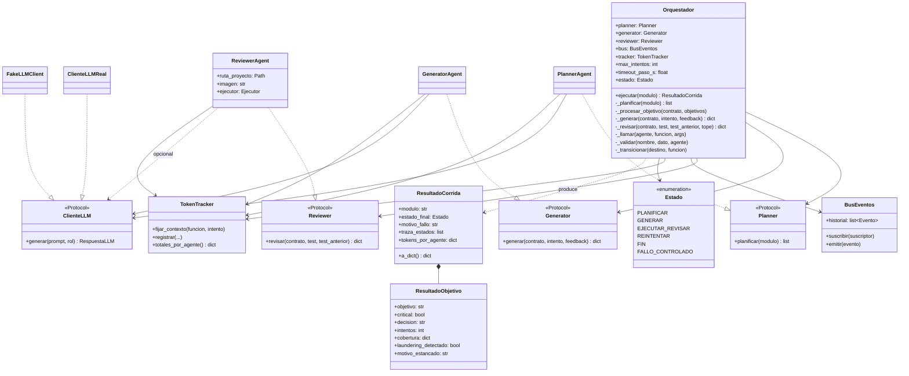

Fuera del diagrama, `ReviewerAgent` usa dos funciones: `sandbox.ejecutar_pruebas` (ejecución aislada) y `analysis.comparar_aserciones` (guardrail de laundering, HU-16). La regla de corte es la función pura `decidir_corte()` de `orquestador.py`.

### 5.2 Del componente al código

| Componente (Nivel 3) | Archivo | Punto de entrada |
|---|---|---|
| Puente js_api | `app/desktop.py` | `DesktopAPI` (`start_run`, `emit_event`, …) |
| Orquestador | `orchestrator/orquestador.py` | `Orquestador.ejecutar(modulo) -> ResultadoCorrida` |
| Estados | `orchestrator/estados.py` | `Estado`, `TRANSICIONES`, `validar_transicion()` |
| Interfaces de los agentes | `orchestrator/puertos.py` | `Planner`, `Generator`, `Reviewer` (`Protocol`) |
| Eventos del Monitor | `orchestrator/eventos.py` | `BusEventos`, `Evento` |
| Planner | `agents/planner.py` | `PlannerAgent.planificar()` |
| Generator | `agents/generator.py` | `GeneratorAgent.generar()` |
| Reviewer / Executor | `agents/reviewer.py` | `ReviewerAgent.revisar()` |
| Analizador | `analysis/analyzer.py` | `analizar_proyecto(raiz)` |
| Guardrail de laundering | `analysis/laundering.py` | `comparar_aserciones()` |
| Cliente LLM | `llm/fabrica.py`, `llm/cliente.py`, `llm/fake.py` | `crear_cliente(precio, claves, simulado=...)` |
| Tokens y costo | `llm/tracker.py`, `llm/precios.py` | `TokenTracker`, `cargar_precios()` |
| Sandbox | `sandbox/imagen.py`, `sandbox/ejecucion.py` | `preparar_imagen()`, `ejecutar_pruebas()` |
| Hash del error | `sandbox/normalizacion.py` | `hash_error()` |
| Contratos | `contracts/__init__.py` + `contracts/*.schema.json` | `validar(nombre, dato)` |
| Registro de corridas | `storage/registro.py` | `escribir_corrida()` (`log.json`, `results.json`) |
| Almacenamiento | `almacenamiento/proyecto.py`, `almacenamiento/recientes.py` | `AlmacenProyecto`, `recientes.registrar()` |
| Configuración | `config/carga.py`, `config/entorno.py` | `cargar_configuracion()`, `verificar_entorno()` |
| Proyectos | `proyectos/proyecto_local.py`, `clonador.py`, `vista_previa.py` | `inspeccionar_carpeta()`, `clonar()`, `generar_vista_previa()` |

Todas las rutas son relativas a `src/qagent/`.

### 5.3 Patrones de diseño del orquestador

| Patrón | Dónde | Para qué |
|---|---|---|
| Máquina de estados con tabla explícita | `estados.py` | Cada transición se valida con `validar_transicion()`; una transición no prevista lanza `TransicionInvalida`. |
| Puertos y adaptadores | `puertos.py` | El orquestador depende de interfaces, no de `agents/`. Los agentes reales y los simulados de los tests se intercambian sin tocarlo. |
| Inyección de dependencias | constructor de `Orquestador` | Los agentes, el bus y el tracker se pasan desde afuera. |
| Mediador | `Orquestador` | Todo mensaje entre agentes pasa por él (modelo de conocidos, sección 8.5). |
| Validación en cada frontera | `_validar()`, `_coherente()` | Cada respuesta se valida contra su JSON Schema y se comprueba que sea del objetivo e intento pedidos. |
| Observador | `BusEventos` | El Monitor se suscribe a los eventos; un suscriptor que falla no detiene la corrida. |
| Tiempo máximo por paso | `_llamar()` | Cada llamada a un agente corre en un hilo daemon con `join(120 s)`; si no responde, `TimeoutPaso` (fallo controlado). |
| Copia defensiva | `copy.deepcopy(contrato)` | Lo que un agente cambie en su copia del contrato no llega al intento siguiente. |

### 5.4 Dependencias reales entre paquetes

Grafo obtenido de los `import` de `src/qagent/`.

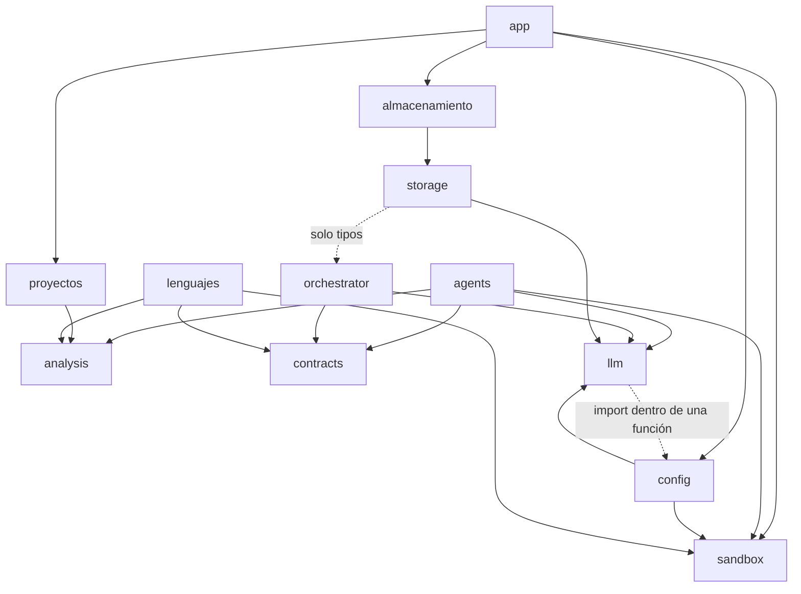

| Regla (sección 4) | ¿Se cumple? |
|---|---|
| 3 · Los agentes no se importan entre sí ni al orquestador | Sí. Y el orquestador tampoco importa `agents/`: los recibe por el constructor. |
| 4 · Solo el Reviewer usa el Sandbox | Sí. Solo `agents/reviewer.py` importa `sandbox`. |
| 6 · Los servicios no dependen de la interfaz | Sí. Nadie importa `qagent.app` salvo `__main__`. |

Deuda conocida: `config` y `llm` se importan mutuamente (`llm/fabrica.py` lo resuelve con un import dentro de la función), y hay dos paquetes de persistencia, `storage/` (EN-05) y `almacenamiento/` (EN-07), donde el segundo usa `nuevo_run_id` del primero.

### 5.5 Pendiente

| Qué falta | Dónde está hoy | Referencia |
|---|---|---|
| Recorrer los módulos en orden topológico por `llama_a`. Hoy `ejecutar_corrida()` recorre todos los módulos seleccionados, en el orden del análisis. | `orchestrator/corrida.py` | Sección 6.4, regla 3 |
| Tope de gasto antes de cada llamada al LLM. Hoy `ejecutar_corrida()` corta antes del siguiente módulo si se alcanzó el tope de `config.toml`, y el orquestador aplica el límite de tokens antes de cada objetivo y reintento. | `orchestrator/corrida.py`, `orchestrator/orquestador.py` | Sección 6.3 |
| Corte por causa común entre objetivos distintos. Hoy el hash repetido se detecta solo dentro de un mismo objetivo. | `decidir_corte()` | Sección 6.4, regla 4 |
| Conectar el registro de adaptadores a la corrida: hoy `ejecutar_corrida()` llama directamente a `analizar_proyecto()`. | `orchestrator/corrida.py` | EN-17, ADR-007 |

Ya resueltos desde la primera versión de este documento: la corrida está conectada (`DesktopAPI.start_run` → `ejecutar_corrida()`) y la caché de specs por huella del módulo existe en `.qagent/specs/` (HU-24).

---

## 6. Vistas dinámicas

### 6.1 Pipeline de una corrida

Cada función o endpoint seleccionado pasa por estas etapas, en **orden de dependencias** (sección 6.4). Entre paréntesis, dónde se gastan tokens.

```mermaid
flowchart LR
    A["1 · Abrir proyecto<br/>HU-01 · HU-02<br/>(0 tokens)"] -.-> L["Detectar lenguaje y<br/>elegir adaptador<br/>propuesto · ADR-007<br/>(0 tokens)"]
    L -.-> B["2 · Análisis estático<br/>ast (Python) · tree-sitter (JS/TS, Java)<br/>EN-02 · EN-14 · ADR-009<br/>(0 tokens)"]
    A --> B
    B --> T{"¿Tipo?"}
    T -->|función| C
    T -->|endpoint FastAPI| C
    C{"¿Spec en caché?<br/>mismo SHA-256<br/>HU-24"}
    C -->|sí| D
    C -->|no| P["3 · Planner<br/>planner_contract.v2<br/>(tokens altos)"]
    P --> D["4 · Generator<br/>pytest o TestClient<br/>(tokens bajos)"]
    D --> E["5 · Sandbox<br/>pytest + coverage<br/>(0 tokens)"]
    E --> F{"6 · Reviewer<br/>¿aserciones legítimas?<br/>(tokens bajos)"}
    F -->|"retry · error del test<br/>intento < 3"| D
    F -->|"bug detectado<br/>(no se reintenta)"| R
    F -->|accept| G{"¿critical: true?"}
    F -->|"stalled · 3 intentos<br/>o hash de error repetido"| R
    G -->|sí| M["Mutation testing<br/>mutmut · EN-09<br/>(0 tokens)"]
    G -->|no| R["7 · Reporte<br/>log.json + results.json"]
    M --> R
    R -.->|"no cancelada, con presupuesto<br/>y Explicador activo"| X["8 · Explicador · propuesto<br/>explicaciones.json<br/>(0 tokens con plantilla,<br/>tokens bajos con LLM)"]
```

Hoy el paso 1 va directo al análisis con `ast`. Con los adaptadores, el registro detecta el lenguaje del proyecto y el análisis, el comando de pruebas y la imagen del sandbox salen del adaptador elegido. El resto del pipeline es el mismo para todos los lenguajes.

| Etapa | Qué produce | Métrica que alimenta |
|---|---|---|
| Sandbox | exit code, stdout/stderr, `coverage.json` | Pass Rate, cobertura de líneas y ramas |
| Reviewer | `review_result` con n.º de intento | Iteraciones de autorreparación |
| Cliente LLM | `usage` de cada llamada | Tokens por agente (`prompt_tokens` + `completion_tokens`) |
| Mutation testing | mutantes muertos / totales | Mutation Score (solo funciones críticas) |
| Explicador (propuesto) | `explicaciones.json` | Ninguna: no cambia resultados. Se registran sus tokens como agente `explicador` |

### 6.2 Flujo de información

Mensajes, en orden, para una función o endpoint.

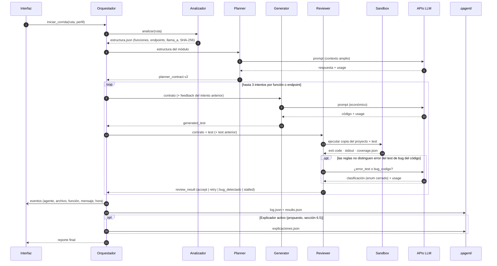

### 6.3 Máquina de estados del orquestador

Implementada en `orchestrator/estados.py` (EN-04). Una llamada a `Orquestador.ejecutar()` procesa **un módulo**.

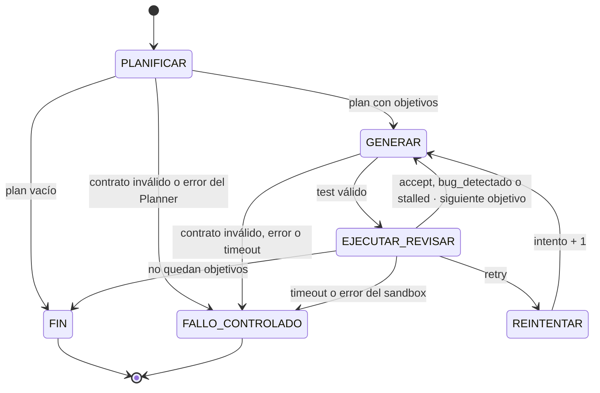

- **Fallo controlado:** la corrida no se cuelga. `ejecutar()` nunca lanza la excepción: devuelve un `ResultadoCorrida` con el motivo y los objetivos que se alcanzaron a procesar, que `storage.escribir_corrida()` convierte en `log.json` y `results.json`.
- **Corte de reintentos (`decidir_corte`):** `stalled` si el hash del error se repite respecto del intento anterior (`error_repetido`) o si se llega al tope de 3 intentos (`limite_intentos`).
- **Un reintento nunca vuelve al Planner.** `REINTENTAR` solo puede ir a `GENERAR`; el plan se hace una vez por módulo.
- **Pendiente** (sección 5.5): recorrer los módulos en orden topológico, el tope de gasto (`tope_por_corrida_usd`) antes de cada llamada al LLM y la caché del plan (HU-24).

### 6.4 Manejo de fallos y dependencias

**Problema:** de 5 pruebas A, B, C, D, E, pasan A y B; C falla, y D y E fallan "por culpa" de C (D usa C, E usa D). ¿Hay que rehacer el plan? **No.** Se resuelve con cuatro reglas, ninguna llama al Planner.

**Regla 1 · Pruebas independientes.** Una prueba unitaria no depende de otra: cada test corre en su propio contenedor efímero, sin estado compartido. Si una función llama a otra del proyecto (`llama_a`), el test **simula** esa dependencia con mocks, así un bug en C no hace fallar el test de D.

**Regla 2 · Clasificar el fallo antes de reintentar.** El Reviewer distingue:

| Resultado en el sandbox | Clasificación | Decisión |
|---|---|---|
| Error de sintaxis, import, fixture o mock mal armado | `error_test`: el test está mal escrito | `retry` (hasta 3 intentos, solo Generator + Reviewer) |
| La aserción falla con el valor esperado del contrato (docstring o declaración de la ruta) | `bug_codigo`: el código no cumple lo que declara | `bug_detectado`: **no se reintenta**; se reporta como hallazgo |
| El test pasa | — | `accept` |
| 3 intentos, o el hash del error normalizado se repite | — | `stalled` |

Reintentar un `bug_codigo` para que el test pase sería Assertion Laundering. Por eso esta regla ahorra tokens y protege el oráculo a la vez.

**Regla 3 · Orden topológico.** El orquestador procesa las funciones de las hojas hacia arriba según `llama_a`, con la biblioteca estándar:

```python
from graphlib import TopologicalSorter

llama_a = {"c": [], "d": ["c"], "e": ["d"]}
orden = list(TopologicalSorter(llama_a).static_order())  # ['c', 'd', 'e']
```

Si C termina en `bug_detectado` o `stalled`, D y E se prueban igual (con C simulado) y el reporte los marca con *"depende de C, que tiene un fallo"*, para indicar por dónde empezar a corregir.

**Regla 4 · Corte por causa común.** Si varios tests fallan con el mismo error normalizado (mismo hash), el orquestador lo trata como una sola causa y no reintenta los demás.

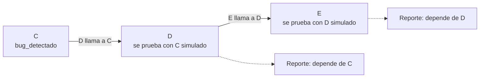

**Costo de cada opción** (precios del ADR-001):

| Acción ante el fallo de C, D y E | Costo aproximado |
|---|---|
| Rehacer el plan del módulo con Claude Opus 5.5 | ~US$ 0.26 |
| Reintentar C, D y E con Generator + Reviewer, 2 veces cada uno | ~US$ 0.04 |
| Aplicando las reglas 2 y 4 (bug detectado o error repetido) | ~US$ 0 |

### 6.5 Etapa del Explicador (propuesto)

Decidida en ADR-008 (SPK-03). Corre en `corrida.py` cuando los veredictos ya están escritos, así que un fallo del Explicador nunca pierde resultados.

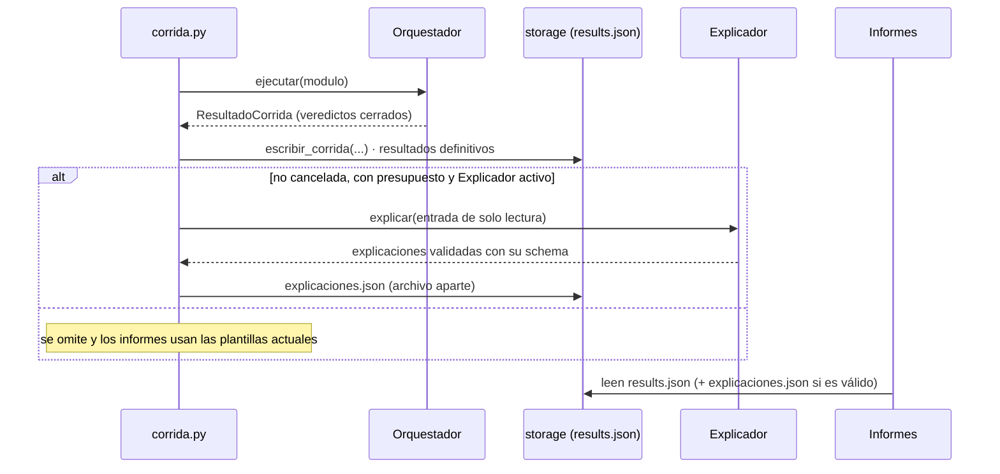

| Aspecto | Regla |
|---|---|
| Qué explica | Solo los objetivos que no terminaron en `accept` (bug detectado, estancado, sin veredicto). |
| Dos niveles | Plantillas deterministas con el esperado, el obtenido y el motivo (0 tokens, siempre disponibles) y, encima, un LLM opcional que lee **toda la traza de intentos**. |
| Entradas | Contrato del Planner, `review_result` de cada intento y `ResultadoObjetivo`, pasados por `sanitizar_secretos`. Nunca claves, rutas absolutas ni el proyecto completo. |
| Salida | `.qagent/runs/<run_id>/explicaciones.json`, nunca dentro de `results.json`. La `decision` es un eco: si no coincide, la explicación se descarta. |
| Cuándo se omite | Corrida cancelada, límite de tokens o tope en USD alcanzado, perfil Humo o Explicador desactivado. |
| Público | Pensado sobre todo para usuarios con poca experiencia en desarrollo; se puede desactivar. |

---

## 7. Vista de despliegue

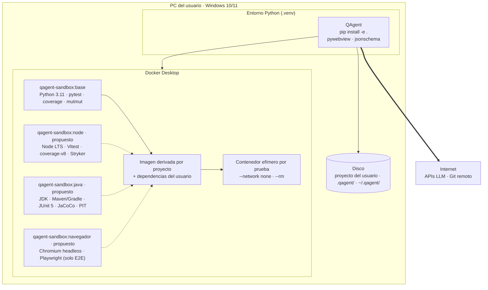

| Flujo de red | Origen → destino | Cuándo |
|---|---|---|
| HTTPS a APIs LLM | Backend → Anthropic, Xiaomi, OpenAI | Cada llamada del Planner, Generator o Reviewer (salvo con IA simulada) |
| `git clone` | Backend → repositorio remoto | Solo si el usuario clona por URL (HU-02) |
| Instalación de dependencias | Docker → PyPI (propuesto: npm, Maven Central) | Una vez por proyecto, al construir la imagen derivada (`npm ci`, `mvn dependency:go-offline`) |
| **Ejecución de pruebas** | **Sin red** | Siempre (`--network none`) |

**Requisitos de la máquina:** Windows 10/11, Python 3.10+, Docker Desktop y Git. EN-06 los verifica al abrir un proyecto. Analizar JS/TS o Java **no** exige Node ni un JDK en la PC del usuario: tree-sitter corre dentro de QAgent (ADR-009) y los runtimes solo viven en las imágenes del sandbox.

**Imágenes por lenguaje (propuesto).** La imagen de cada lenguaje la declara su adaptador (`LanguageAdapter.entorno_sandbox()`, ADR-007). Las reglas del sandbox son las mismas para todas: contenedor efímero, sin red al ejecutar, sistema de archivos de solo lectura salvo las carpetas de trabajo y límites de CPU, memoria y tiempo. Los límites por lenguaje están pendientes de medir (sección 13): la JVM necesita más memoria y tiempo que Python, y la imagen con navegador es la más pesada, así que solo se usa para E2E.

---

## 8. Modelo GAIA

QAgent se modela con la metodología GAIA (Wooldridge, Jennings y Kinny): primero el **análisis** (modelo de roles y modelo de interacción) y luego el **diseño** (modelo de agentes, de servicios y de conocidos).

Hay **cuatro roles** implementados: tres con LLM (Planner, Generator y Reviewer) y un **Coordinador** determinista, que implementa el orquestador. El Sprint 2 propone un quinto rol, **Explicador** (ADR-008), que actúa después de que el Coordinador cierra los veredictos.

**Notación de las expresiones de vida (liveness):** `x . y` = x seguido de y · `x | y` = x o y · `x*` = cero o más veces · `x+` = una o más veces · `[x]` = opcional. Las actividades internas van en *cursiva* y los protocolos en texto normal.

### 8.1 Modelo de roles

#### Rol: Planner

| Campo | Contenido |
|---|---|
| **Descripción** | Analiza la estructura de un módulo y diseña los casos de prueba de cada función pública o endpoint, con su valor esperado. |
| **Protocolos y actividades** | SolicitarPlan, *LeerEstructura*, *DerivarCasos*, *AsignarOráculo*, *ValidarContrato*, EntregarContrato |
| **Permisos** | Lee: `estructura.json` del módulo (firmas, tipos, docstrings, ramas, rutas, `llama_a`). Genera: `planner_contract.v2`. No puede ejecutar ni importar el código del usuario. |
| **Liveness** | `PLANNER = (SolicitarPlan . LeerEstructura . DerivarCasos . AsignarOráculo . ValidarContrato . EntregarContrato)*` |
| **Safety** | • El contrato valida contra `planner_contract.v2.schema.json`. • Cada valor esperado declara su origen: firma, tipo o docstring de una función, o la declaración de la ruta (`response_model`, `status_code`) de un endpoint. • Nunca ejecuta el código del usuario. |

#### Rol: Generator

| Campo | Contenido |
|---|---|
| **Descripción** | Escribe el archivo pytest de una función (llamada directa) o de un endpoint (`TestClient`) a partir de su contrato. En un reintento, corrige el test con el feedback del Reviewer. |
| **Protocolos y actividades** | SolicitarTest, *RedactarTest*, *IncorporarFeedback*, *ValidarSintaxis*, EntregarTest |
| **Permisos** | Lee: el contrato de **una** función o endpoint y el feedback del intento anterior. Genera: `generated_test`. No ve el resto del repositorio ni importa el módulo objetivo para calcular valores. |
| **Liveness** | `GENERATOR = (SolicitarTest . [IncorporarFeedback] . RedactarTest . ValidarSintaxis . EntregarTest)*` |
| **Safety** | • Las aserciones usan los valores esperados del contrato. • El código pasa `ast.parse` antes de entregarse. • Las funciones del proyecto que aparecen en `llama_a` se simulan con mocks; las dependencias de un endpoint (`Depends`), con `dependency_overrides`. • intento ≤ 3. |

#### Rol: Reviewer / Executor

| Campo | Contenido |
|---|---|
| **Descripción** | Ejecuta el test en el sandbox, verifica que las aserciones sean legítimas (sin Assertion Laundering) y decide si se acepta, se reintenta o se detiene. |
| **Protocolos y actividades** | SolicitarRevisión, *EjecutarEnSandbox*, *CompararAserciones*, *ClasificarFallo*, *ClasificarConLLM*, *CalcularHashError*, *Decidir*, EntregarVeredicto |
| **Permisos** | Lee: contrato, test actual, test anterior y `coverage.json`. Ejecuta: el test **solo dentro del sandbox** (único rol con permiso de ejecución). Genera: `review_result`. |
| **Liveness** | `REVIEWER = (SolicitarRevisión . CompararAserciones . EjecutarEnSandbox . [ClasificarFallo . [ClasificarConLLM] . CalcularHashError] . Decidir . EntregarVeredicto)*` |
| **Safety** | • Nunca acepta un test cuyas aserciones se debilitaron respecto al contrato o al intento anterior (por ejemplo `== 200` → `in (200, 500)`). • Si la aserción falla con el valor esperado del contrato, devuelve `bug_detectado` y **no pide reintento**. • Devuelve `stalled` si intento = 3 o si el hash del error normalizado se repite dos veces seguidas. • Toda ejecución es con `--network none`. |

`CompararAserciones` es el guardrail determinista: compara el AST de las aserciones (`analysis/laundering.py`, sin IA) **antes** de ejecutar. `ClasificarFallo` separa `error_test` de `bug_codigo` con reglas (sección 6.4); solo si las reglas no alcanzan, `ClasificarConLLM` (`_clasificar_con_llm`) pide al LLM una respuesta de ese enum cerrado, con `stalled` como respaldo. Es el único punto donde un LLM interviene en una decisión (ADR-008).

#### Rol: Coordinador (orquestador, sin LLM)

| Campo | Contenido |
|---|---|
| **Descripción** | Dirige la corrida: analiza el proyecto, reparte el trabajo a los roles, aplica los límites y registra todo. |
| **Protocolos y actividades** | SolicitarPlan, SolicitarTest, SolicitarRevisión, NotificarEvento, *AnalizarProyecto*, *OrdenarPorDependencias*, *ControlarGasto*, *RegistrarCorrida* |
| **Permisos** | Lee: `config.toml`, estructura del proyecto y todos los contratos. Genera: `log.json`, `results.json` y eventos para la interfaz. |
| **Liveness** | `COORDINADOR = AnalizarProyecto . OrdenarPorDependencias . (SolicitarPlan . (SolicitarTest . SolicitarRevisión)+)+ . RegistrarCorrida` |
| **Safety** | • Gasto acumulado ≤ tope por corrida. • Todo mensaje entre roles pasa por él (sin broadcast). • Un error o timeout del sandbox termina en fallo controlado. • Un reintento nunca vuelve a solicitar el plan. • Solo solicita una explicación después de escribir `results.json`. |

#### Rol: Explicador (propuesto, ADR-008)

| Campo | Contenido |
|---|---|
| **Descripción** | Explica en lenguaje simple por qué un objetivo no terminó en `accept`: qué prometía la especificación, qué pasó y qué revisar. |
| **Protocolos y actividades** | SolicitarExplicación, *LeerHallazgo*, *AplicarPlantilla*, *[RedactarConLLM]*, *ValidarContrato*, EntregarExplicación |
| **Permisos** | Lee, solo lectura: contrato del Planner, `review_result` de cada intento y `ResultadoObjetivo`, sin secretos. Genera: `explicaciones.json`. No ejecuta nada, no edita pruebas ni contratos y no llama a otros agentes. |
| **Liveness** | `EXPLICADOR = (SolicitarExplicación . LeerHallazgo . AplicarPlantilla . [RedactarConLLM] . ValidarContrato . EntregarExplicación)*` |
| **Safety** | • Nunca cambia ni reinterpreta una decisión, un intento, la cobertura ni `laundering_detectado`. • Si sugiere relajar una aserción o cambiar el valor esperado, la explicación se descarta. • Su `decision` debe coincidir con `results.json`. • Si falla, queda la plantilla. • No corre si la corrida se canceló o se alcanzó el presupuesto. |

### 8.2 Modelo de interacción

| Protocolo | Iniciador | Respondedor | Entrada | Salida | Propósito |
|---|---|---|---|---|---|
| SolicitarPlan | Coordinador | Planner | estructura del módulo | `planner_contract.v2` | Obtener los casos de prueba de un módulo |
| SolicitarTest | Coordinador | Generator | contrato de 1 función o endpoint (+ feedback) | `generated_test` | Obtener o corregir un test |
| SolicitarRevisión | Coordinador | Reviewer | contrato + test (+ test anterior) | `review_result` | Ejecutar y validar el test; decidir el siguiente paso |
| NotificarEvento | Coordinador | Interfaz | — | evento (agente, archivo, función, mensaje, hora) | Mostrar el avance en el Monitor en vivo (HU-09) |
| SolicitarExplicación (propuesto) | Coordinador (`corrida.py`) | Explicador | hallazgos de solo lectura | `explicaciones.json` | Explicar los objetivos que no se aceptaron (ADR-008) |

Los tres primeros protocolos son de **petición-respuesta**: el Coordinador espera la salida antes de continuar. NotificarEvento es asíncrono y no espera respuesta. SolicitarExplicación también es de petición-respuesta, pero tiene su propio tiempo máximo y su fallo no afecta la corrida.

### 8.3 Modelo de agentes

| Tipo de agente | Rol que cumple | Instancias por corrida | Modelo |
|---|---|---|---|
| PlannerAgent | Planner | 1 | Claude Opus 5.5 (fase de arranque: MiMo-V2.6-Pro, ver ADR-001) |
| GeneratorAgent | Generator | 1 | MiMo-V2.6-Pro |
| ReviewerAgent | Reviewer / Executor | 1 | GPT-6 Luna + guardrail determinista |
| Orquestador | Coordinador | 1 | Sin LLM |
| ExplicadorAgent (propuesto) | Explicador | 0 o 1 | Plantillas sin LLM; LLM opcional, modelo económico definido en `[agentes.explicador]` (ADR-001) |

Cada rol lo cumple un solo tipo de agente. Las funciones y endpoints se procesan uno tras otro, así que una instancia de cada agente es suficiente en la Fase 1.

### 8.4 Modelo de servicios

| Servicio | Agente | Entradas | Salidas | Precondición | Postcondición |
|---|---|---|---|---|---|
| Planificar módulo | PlannerAgent | estructura del módulo | `planner_contract.v2` | el módulo se analizó sin error de sintaxis | contrato válido contra su schema; cada caso tiene origen del valor esperado |
| Generar test | GeneratorAgent | contrato de 1 función o endpoint, feedback opcional | `generated_test` | contrato válido; intento ≤ 3 | el código pasa `ast.parse` |
| Revisar test | ReviewerAgent | contrato, test, test anterior opcional | `review_result` | el sandbox está disponible | decisión en {accept, retry, bug_detectado, stalled}; métricas del intento registradas |
| Coordinar corrida | Orquestador | ruta del proyecto, perfil | `log.json`, `results.json` | configuración válida y entorno listo (EN-06) | ambos archivos validan contra `run_log.schema.json` |
| Explicar hallazgos (propuesto) | ExplicadorAgent | hallazgos de solo lectura | `explicaciones.json` | `results.json` escrito; corrida no cancelada; presupuesto disponible | cada explicación valida contra su schema y su `decision` coincide con `results.json` |

### 8.5 Modelo de conocidos

Quién puede comunicarse con quién. El único nodo conectado con todos es el Orquestador.

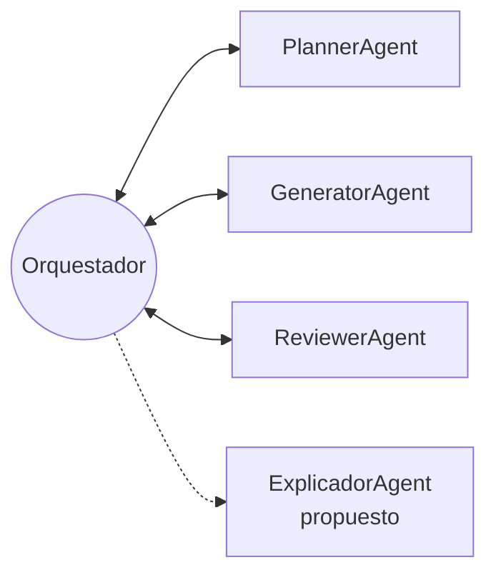

No existe ninguna comunicación directa entre PlannerAgent, GeneratorAgent, ReviewerAgent y ExplicadorAgent.

---

## 9. Contratos JSON

Los schemas completos van en `src/qagent/contracts/` y los valida `tests/test_contracts.py`.

| Contrato | De → a | Campos principales | Schema |
|---|---|---|---|
| `estructura.json` | Analizador (o adaptador del lenguaje) → Orquestador / Planner | módulos; funciones (firma, tipos, docstring, n.º de ramas, `llama_a`); endpoints FastAPI (método, ruta, `response_model`, `status_code`, modelo del body); SHA-256 por módulo. Propuesto: campo `lenguaje`, con la misma forma para todos los lenguajes (ADR-009) | salida de EN-02 / EN-14 |
| `planner_contract.v2` | Planner → Generator (vía orquestador) | módulo, `tipo` (`funcion` \| `endpoint`), función o ruta, firma, `critical`, casos: [id, entrada, valor esperado, origen del valor esperado]. En funciones Python, `tipo_valor_esperado: "tuple"` conserva la semántica de una tupla serializada como array; si falta, sigue siendo lista (#145) | `planner_contract.v2.schema.json` |
| `planner_contract.v3` (EN-17) | mismo recorrido que v2 | v2 + `lenguaje`, `framework_pruebas` y `framework_app`, con las combinaciones válidas por lenguaje. Un v2 se convierte en memoria sin perder la metadata de tupla; las specs guardadas y el flujo de Python siguen en v2 | `planner_contract.v3.schema.json` |
| `oracle.v1` (EN-18) | documentación JS/TS → validación determinista → futuro Planner JS/TS | lenguaje, objetivo, entrada, comprobación, estado de evidencia y procedencia verificable. El schema valida la forma y una capa determinista contrasta la evidencia con un registro confiable | `oracle.v1.schema.json` |
| `generated_test` | Generator → Reviewer (vía orquestador) | función o ruta, intento, código pytest, ids de casos cubiertos | `generated_test.schema.json` |
| `generated_test.v2` (EN-17) | mismo recorrido que v1 | v1 + `lenguaje`, `framework_pruebas` y `archivo` del test | `generated_test.v2.schema.json` |
| `review_result` | Reviewer → Orquestador | función o ruta, intento, estado del sandbox, cobertura, laundering detectado, `tipo_fallo` (`error_test` \| `bug_codigo`), hash del error, decisión (`accept` \| `retry` \| `bug_detectado` \| `stalled`), feedback, `ejecucion` opcional (EN-17: casos, salida y entorno del sandbox) | `review_result.schema.json` |
| `detalle.json` | Orquestador → `.qagent/` | por función: contrato, último test y traza; por intento (EN-17): feedback, hash del error, cobertura y `ejecucion` (casos de pytest con archivo, línea, código, esperado y obtenido, salida recortada y entorno) | `detalle.schema.json` |
| `log.json` / `results.json` | Orquestador → `.qagent/` | modelos usados, perfil, llamadas con tokens por agente, costo, 5 métricas por función o endpoint | `run_log.schema.json` |
| `explanation.v1` (EN-18; Agente Explicador aún propuesto) | futuro Explicador → validación determinista → futura persistencia separada → Informes | ids de explicación y hallazgo, referencia al resultado, ubicación, evidencia, explicación, impacto, recomendación y estado de verificación. No contiene campos para modificar veredictos o pruebas | `explanation.v1.schema.json` |

**Origen del valor esperado (oráculo):** firma, tipos o docstring de una función (en JS/TS, JSDoc y tipos de TypeScript; en Java, Javadoc y tipos); o la declaración de la ruta (`response_model`, `status_code`, modelos Pydantic) de un endpoint. Nunca el resultado de ejecutar el código.

**Contratos que no cambian:** `planner_contract.v2`, `generated_test` v1, `review_result`, `detalle` y `run_log` se mantienen. Las versiones nuevas se agregan al lado (ADR-007) y la persistencia histórica de `.qagent/` sigue leyéndose igual.

---

## 10. Enfoque de pruebas

Qué tipos de prueba hace QAgent, cómo se clasifican y qué elige el usuario en la pantalla **Configuración de pruebas** (#69).

### 10.1 Nivel, técnica y estrategia

Los nombres de prueba mezclan tres ideas distintas. QAgent las separa así:

| Concepto | Responde a | En QAgent |
|---|---|---|
| **Nivel** | Qué se prueba | **Unitarias** (una función aislada; sus llamadas `llama_a` se simulan) y **de API** (un endpoint FastAPI vía HTTP con `TestClient`, simulando `Depends`) |
| **Técnica** | Cómo se diseñan los casos | Casos normales, **valores límite y casos borde** y casos de error, desde la especificación; **mutación** (mutmut) para medir la calidad de las pruebas |
| **Estrategia** | Cuándo y cuánto se prueba | **Humo** (comprobación mínima), **Estándar** (completa) y **Regresión** (repetir lo ya aprobado) |

El tipo de caja (negra, gris o blanca) es una propiedad de la **técnica de diseño**, no del nivel ni de la estrategia: depende de qué información se usa para elegir los casos.

### 10.2 Tipo de caja de cada parte

| Parte | Qué recibe quien diseña los casos | Tipo de caja |
|---|---|---|
| **Funciones** | Solo nombre, firma y docstring; el Planner no recibe el código (`Planner._crear_prompt`) | **Caja negra** |
| **Endpoints** | La declaración de la ruta (método, `status_code`, `response_model`, modelos, `Depends`, `HTTPException`) **y el código del manejador** (`Planner.planificar_endpoints`, parámetro `fuente`) | **Caja gris**: el código guía qué casos probar, pero el resultado esperado sale de la declaración |
| **Profundizar** | El código de las funciones prioritarias, para mutarlo y ver si las pruebas detectan el cambio | **Caja blanca**, como capa **sobre** la prueba Estándar |

Lo que no cambia en ninguna parte es el **oráculo**: el valor esperado sale siempre de la especificación (sección 9), nunca de ejecutar el código. Eso evita que una prueba confirme un bug como si fuera el comportamiento correcto; el Reviewer lo vigila como *Assertion Laundering*.

El análisis con `ast` (EN-02) no convierte las pruebas de funciones en caja gris: solo **extrae** la especificación (firma, tipos, docstring) y cuenta las decisiones para proponer qué funciones profundizar (sección 10.4).

### 10.3 Lo que elige el usuario

La pantalla Preparar hace dos preguntas. «¿Qué quieres hacer?» elige la estrategia y se traduce al perfil que recibe `start_run` (`perfilDeEleccion` en `config-pruebas.js`). «Tipos de prueba» elige el nivel (Unitarias, Endpoints API o ambos) y se combina con cualquier estrategia:

| ¿Qué quieres hacer? | Condición | Perfil |
|---|---|---|
| Generar pruebas nuevas (opción por defecto) | — | `std` |
| Revisión rápida (humo) | — | `humo` |
| Volver a correr las guardadas | Requiere una corrida previa del proyecto | `reg` |
| Análisis a fondo de críticas | Con funciones o endpoints críticos marcados | `deep` |
| Análisis a fondo de críticas | Sin críticas marcadas | `std` |

Humo solo se usa si el usuario lo elige: QAgent no lo activa por su cuenta, por ejemplo en la primera corrida de un proyecto (#133). Con Humo, las funciones críticas y la fortaleza de las pruebas se muestran desactivadas, con su explicación.

El análisis a fondo no se ofrece con Humo porque añade la capa de caja blanca encima de las pruebas normales: la mutación mide qué tan buenas son las pruebas que ya existen, así que necesita una base completa. Con Humo (un solo caso por objetivo) casi todos los mutantes sobrevivirían y el resultado no aportaría información. «Volver a correr las guardadas» tampoco es un nivel de profundidad: es otra acción, que vuelve a ejecutar sin IA las pruebas aprobadas cuyo código no cambió (HU-25).

El backend también acepta `reg_deep` (repetir y mutar las críticas, #70), pero desde el rediseño de Preparar (18/10/2026) la pantalla no ofrece esa combinación.

Al repetir con `reg_deep`, Profundizar (#70) mide sin gastar tokens qué tan fuertes son las pruebas que ya están guardadas, por ejemplo las que se aprobaron con Estándar. Solo cuentan las funciones marcadas que tienen hoy una prueba guardada vigente (`objetivos_repetibles`): las que requieren corrida nueva o fallaron no se mutan, porque su prueba no sirve hoy para juzgar a los mutantes. La casilla viene desmarcada, para que repetir no se vuelva lento sin pedirlo.

### 10.4 Por qué Profundizar solo en funciones prioritarias

- **Regla del alcance:** mutmut solo se ejecuta sobre funciones `critical: true`, nunca sobre el repositorio completo (RN-04).
- **Costo:** por cada función, mutmut crea decenas de versiones alteradas del código y ejecuta las pruebas contra cada una; aplicarlo a todo puede llevar horas. El tiempo máximo por función se fija en `[mutacion]` de `config.toml`.
- **Cálculo:** Mutation Score = mutantes detectados ÷ (detectados + sobrevivientes) × 100. Un mutante que agota el tiempo cuenta como detectado; uno sin pruebas que lo cubran, como sobreviviente. La meta es 60 % (ADR-001).
- **Cómo se ejecuta (`sandbox/mutacion.py`):** las pruebas aprobadas se copian dentro de la copia del proyecto antes de llamar a mutmut. mutmut identifica las pruebas con rutas relativas; si quedan fuera del proyecto no las encuentra y cuenta cada mutante como «killed», lo que daría un 100 % falso. Si el proyecto ya tiene `[tool.mutmut]` en `pyproject.toml`, QAgent no la sobrescribe y no ejecuta la mutación.
- **Reutilización (#70):** cada resultado con puntuación se guarda en `.qagent/mutacion/<spec>.json` con la huella AST de la función y la huella de las pruebas usadas (todas las aprobadas del módulo, porque cualquiera puede detectar un mutante). Si ninguna de las dos cambió, la siguiente corrida con Profundizar reutiliza el resultado sin ejecutar mutmut y el informe dice de qué corrida salió. Un tiempo agotado o un error no se guardan: se vuelven a intentar.
- **Pruebas basadas en riesgo:** el esfuerzo se concentra donde un fallo es más probable o más grave. Ninguna función se deja sin probar: todas reciben su prueba Estándar.

QAgent propone como prioritaria toda función con al menos una decisión (`if`/`elif`, ternario, `for`, `while`, `except`, `case` o `if` de comprensión; `contar_ramas` en `analysis/analyzer.py`). Una función sin decisiones tiene un solo camino, así que profundizar aporta poco, pero el usuario puede marcarla igual si es importante (por ejemplo, un cálculo de dinero), porque la mutación también cambia operadores y constantes (HU-06).

### 10.5 Estado actual

| Pieza | Estado | Ítem |
|---|---|---|
| Pruebas unitarias y de API, regresión sin IA | Implementado | HU-27 · HU-25 |
| Pantalla de configuración como opciones | Implementado | #69 |
| Humo con un solo caso por objetivo | Implementado: un caso normal por objetivo, sin exigir ramas; se elige en Preparar como «Revisión rápida (humo)» | #75 · #133 |
| Marcas de función prioritaria hasta la corrida | Implementado: la selección envía las marcas y el spec reutilizado toma la marca actual | HU-06 |
| Mutación (Profundizar) | Implementado en el perfil Profundo: mutmut en el sandbox solo sobre las funciones críticas aprobadas; Mutation Score y sobrevivientes en `results.json` y en el informe | EN-09 |
| Mutación al repetir pruebas guardadas | Implementado (`reg_deep`): sin IA, solo sobre las críticas con prueba guardada vigente, con reutilización del resultado si nada cambió | #70 |
| Mutación en endpoints | Pendiente | Issue de endpoints con caja blanca |
| Categoría de cada caso (normal / límite / error) | Pendiente | Issue «Feat: categoría de cada caso de prueba» |

### 10.6 Nuevos tipos de prueba del Sprint 2 (propuesto)

Las categorías actuales se aplican a cada lenguaje. **Caja negra:** el valor esperado sale del contrato (docstring, JSDoc, Javadoc, tipos). **Caja blanca:** se leen las ramas del código para elegir entradas, nunca para decidir el resultado. Prioridades tentativas del plan del Sprint 2, a confirmar en el Sprint Planning:

| Tipo de prueba | Cómo se prueba | Oráculo | Prioridad | Ítem |
|---|---|---|---|---|
| Unitarias TS/JS puro (utilidades, servicios, lógica) | Vitest en `qagent-sandbox:node` | JSDoc y tipos | Must | EP-11a |
| Unitarias Java y controladores Spring | JUnit 5 + Mockito; controladores con MockMvc (análogo a `TestClient`), sin `@SpringBootTest` completo | Javadoc y tipos | Must | EP-12a |
| Componentes React | Vitest + Testing Library + jsdom | Tipos de las props; JSDoc si existe | Should | EP-11b |
| Servicios Angular / componentes Angular | Servicios como TS puro / TestBed (requiere compilar el proyecto) | Tipos y contratos de servicios | Should / Could | EP-11d |
| Mutación en críticas TS y Java | Stryker / PIT, solo sobre funciones `critical: true` | El de las pruebas aprobadas | Should | EP-11c, EP-12b |
| Pruebas de arquitectura | import-linter (Python), dependency-cruiser (JS/TS), ArchUnit (Java) | Reglas universales (sin ciclos) y reglas **declaradas por el usuario**; el LLM puede proponer reglas, pero solo se ejecutan las confirmadas | Should | EP-13a |
| E2E de humo | Playwright con Chromium headless en `qagent-sandbox:navegador`, la app arranca dentro del sandbox | Rutas detectadas por el análisis y ausencia de errores HTTP o de consola; los flujos completos solo si el usuario los declara | Should | EP-13b |
| Astro, E2E de flujos completos, carga y estrés | — | — | Fuera de este sprint | — |

**Regla para frameworks no soportados:** el framework se detecta por `package.json` (`react`, `@angular/core`, `astro`). Si no tiene soporte, QAgent prueba solo los archivos de lógica `.ts`/`.js` y el informe marca «componentes no soportados». Así el producto funciona en cualquier proyecto aunque el soporte del framework llegue después.

---

## 11. Stack tecnológico

| Capa | Tecnología | Uso | Ítem |
|---|---|---|---|
| Presentación |    | Pantallas del demo | EN-08 |
| Presentación | pywebview | Ventana de escritorio y puente JS ↔ Python | EN-08 |
| Backend |  | Orquestador, agentes y servicios | EN-04 |
| Análisis | `ast` (biblioteca estándar) | Funciones, rutas FastAPI y `llama_a`, sin ejecutar código | EN-02 · EN-14 |
| Análisis (propuesto) | tree-sitter con gramáticas de JavaScript, TypeScript y Java | Lo mismo para los lenguajes nuevos, con consultas `.scm` por lenguaje | ADR-009 · EP-11a · EP-12a |
| Configuración |  `tomllib` | `config.toml` | EN-06 |
| IA |  | Planner | SPK-01 |
| IA |  | Generator (y Planner en la fase de arranque) | SPK-01 |
| IA |  | Reviewer | SPK-01 |
| Sandbox |  | Contenedor aislado | EN-03 |
| Métricas |  coverage.py · mutmut | Ejecución, cobertura y Mutation Score | EN-03 · EN-09 |
| Pruebas de endpoints |  httpx | Probar endpoints sin levantar servidor | EN-15 |
| Pruebas JS/TS (propuesto) | Vitest · @vitest/coverage-v8 · Stryker · Testing Library + jsdom | Ejecución, cobertura, mutación y componentes React | EP-11a a EP-11d |
| Pruebas Java (propuesto) | JUnit 5 · Mockito · MockMvc · JaCoCo · PIT · Maven/Gradle sin red | Ejecución, cobertura, mutación y controladores Spring | EP-12a · EP-12b |
| E2E y arquitectura (propuesto) | Playwright · import-linter · dependency-cruiser · ArchUnit | E2E de humo y reglas de estructura | EP-13a · EP-13b |
| Contratos |  `jsonschema` | Validación de contratos y logs | EN-01 |
| Equipo |    | Versiones, PRs y lint | — |

---

## 12. Decisiones de arquitectura

| Decisión | Motivo | Registro |
|---|---|---|
| Monolito modular de escritorio | Un usuario por instalación, sin servidor ni despliegue; el código del usuario no sale de su PC | Sección 1 |
| pywebview con `js_api` | Reusar el HTML del demo sin levantar un servidor HTTP | Sección 1 |
| Sandbox Docker sin red | Las pruebas generadas son código desconocido; se aíslan de archivos, dependencias y red | Sección 7 |
| Orquestador determinista, sin LLM; el único punto híbrido es `_clasificar_con_llm` del Reviewer | Reglas fijas (reintentos, topes); métricas reproducibles; 0 tokens; un LLM coordinador no tendría nada que decidir que las reglas no decidan | Sección 8 · ADR-008 |
| Un modelo por agente | Inteligencia solo donde hay ambigüedad; el Planner concentra el gasto | ADR-001 |
| Análisis con `ast` para Python y tree-sitter para JS/TS y Java; sin Graphify | 0 tokens, determinista, ~3 ms por archivo y sin Node ni JDK en la PC del usuario | ADR-002 · ADR-009 |
| Frontend separado, un componente por pantalla, sin bundler ni módulos ES | Cambios por pantalla en lugar de un archivo de 2000 líneas; funciona con `file://` y pywebview sin servidor propio; sin Node ni compilación | ADR-003 |
| Pruebas de endpoints FastAPI con `TestClient` | Reutiliza el sandbox, pytest y las 5 métricas; integración contra servicios reales y carga siguen fuera; E2E solo de humo, en el Sprint 2 | Backlog EP-09 · ADR-010 |
| Reintentos solo Generator → Reviewer; bug detectado no se reintenta; orden topológico por `llama_a` | Evita rehacer el plan (el agente más caro) y la cascada de fallos entre funciones | Sección 6.4 |
| Datos en archivos JSON | Viajan con el proyecto; no requiere base de datos | EN-07 |
| Profundizar (mutación) como capa sobre Estándar, solo en funciones prioritarias | La mutación mide pruebas que ya existen y es costosa; se concentra donde hay más riesgo | Sección 10 |
| Adaptadores por lenguaje y contratos versionados, sin tocar los existentes | Incorporar JS/TS y Java sin duplicar agentes ni romper las specs guardadas | ADR-007 |
| Explicador como etapa posterior al veredicto, de solo lectura y con plantillas de respaldo | Aporta explicaciones para usuarios no técnicos sin comprometer resultados ni reglas | ADR-008 |
| Arquitectura y ampliación de alcance del Sprint 2 | Un solo modelo de referencia para cinco integrantes que trabajan en paralelo | ADR-010 |

---

## 13. Sprint 2: lo que no cambia y pendientes

### 13.1 Lo que no cambia

| Regla | Dónde se cumple |
|---|---|
| El orquestador no usa LLM y decide con reglas | `orchestrator/orquestador.py`, `estados.py` (ADR-008) |
| Máximo 3 intentos por objetivo; un reintento nunca vuelve al Planner | `MAX_INTENTOS_CONTRATO`, `decidir_corte()`, sección 6.3 |
| Corte por hash de error repetido | `decidir_corte()`, `sandbox/normalizacion.py` |
| Tope de gasto por corrida y límite de tokens | `corrida.py`, `TokenTracker` |
| Toda ejecución en Docker, sin red al ejecutar | `sandbox/ejecucion.py`, sección 7 |
| El valor esperado nunca sale de ejecutar el código | Planner y contratos, sección 9 |
| Assertion Laundering detectado sin IA, antes de ejecutar | `analysis/laundering.py` (Python); un guardrail equivalente por adaptador en JS/TS y Java |
| Mutación solo en funciones `critical: true` | Sección 10.4 |
| Los agentes no se llaman entre sí | Sección 8.5 |
| Las 5 métricas por prueba, ahora con la columna lenguaje | `run_log.schema.json` |
| Cada cambio de alcance, de modelo o de dependencia se registra en un ADR | `docs/decisiones/` |

### 13.2 Decisiones abiertas

Responsables sugeridos en el plan del Sprint 2, a confirmar en el Sprint Planning.

| Decisión o tarea abierta | Responsable sugerido | Referencia |
|---|---|---|
| Integrar `explanation.v1` con el futuro Agente Explicador y su persistencia separada; el nombre y la forma base quedaron definidos en EN-18 | Rodríguez Malca, Rodrigo | ADR-008 · EN-18 · EP-10 |
| Si el Explicador propone parches y el orquestador los verifica en el sandbox (necesita su propia decisión) | Rodríguez Malca, Rodrigo, con el equipo | ADR-008 |
| Medir el Explicador con un LLM real (tokens, costo, latencia y calidad) antes de activarlo por defecto | Rodríguez Malca, Rodrigo y Sanchez Vargas, Adrián | ADR-008, paso 5 |
| Conectar el registro de adaptadores a la corrida y usar `planner_contract.v3` en el flujo | Oncoy Patricio, Angel | ADR-007 |
| Agregar tree-sitter y las gramáticas de JS/TS; analizador y guardrail de `expect` | Castillo Pezo, Mateo | ADR-009 · EP-11a |
| Adaptador de Java completo y banco equivalente en los 3 lenguajes (brecha B5) | Nuevo integrante | ADR-009 · EP-12a |
| Imágenes `node`, `java` y `navegador` del sandbox y límites de memoria y tiempo por lenguaje | Sanchez Vargas, Adrián | Sección 7 |
| Migrar el analizador de Python a tree-sitter, solo si da la misma estructura que `analizar_proyecto()` | Por asignar | ADR-009 |
| Versionar en `bench/` los bancos y scripts de medición de SPK-03 y SPK-04 | Sanchez Vargas, Adrián y Castillo Pezo, Mateo | ADR-008 · ADR-009 |

## 14. Aprobación

Criterio 5 de EN-01 y criterio de aprobación de EN-20: aprobado por los integrantes del equipo (se marca al aprobar el PR).

- [ ] Castillo Pezo, Mateo
- [ ] Oncoy Patricio, Angel
- [ ] Rodríguez Malca, Rodrigo
- [ ] Sanchez Vargas, Adrián
- [ ] Nuevo integrante (Java)
