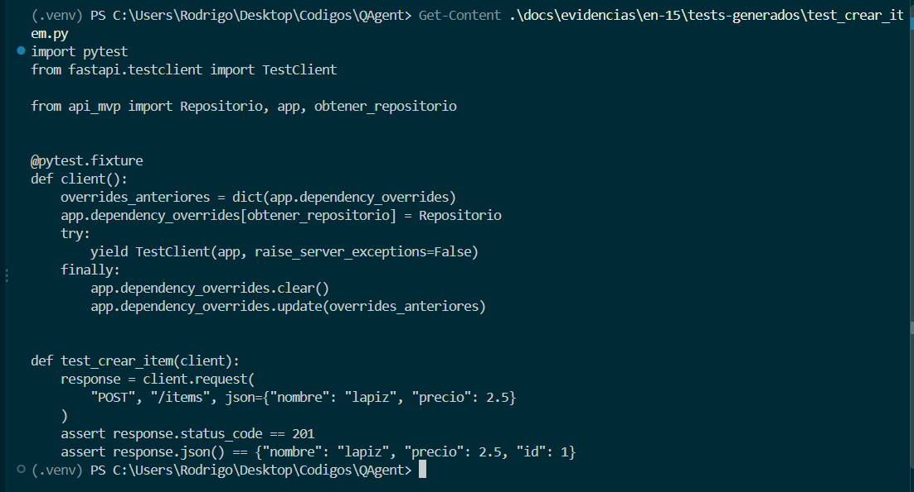
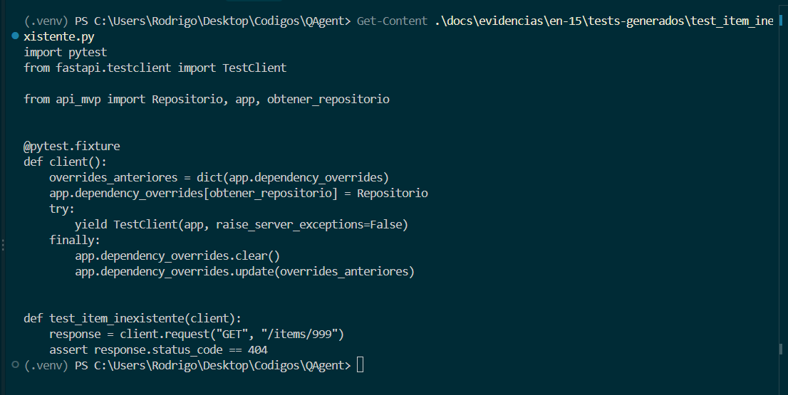
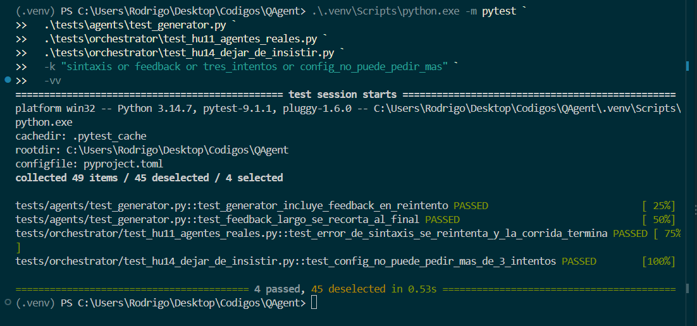
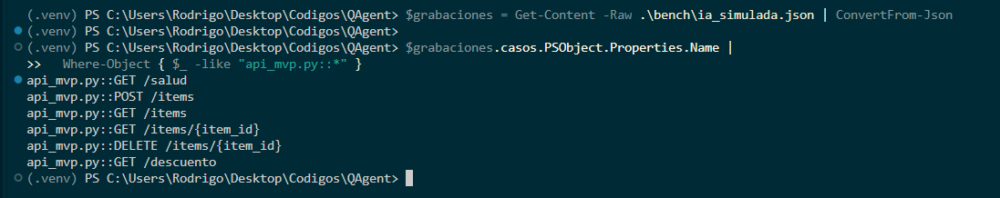
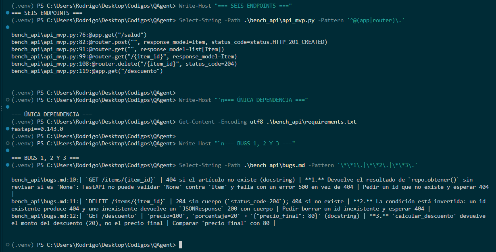
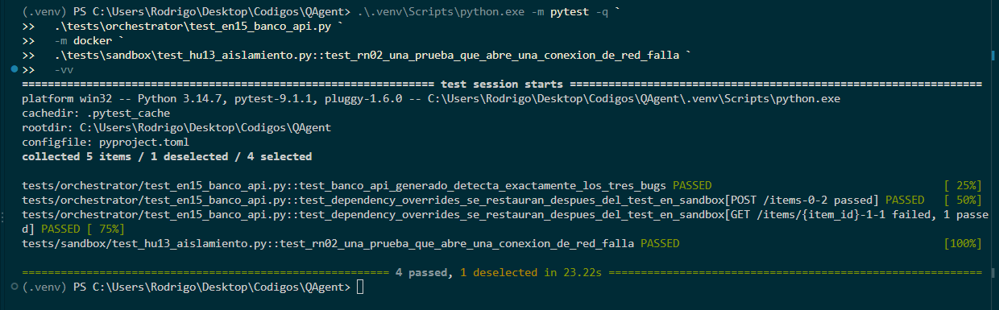
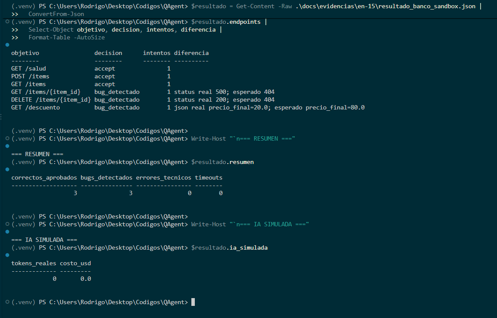

# EN-15 — Generator de tests con TestClient y banco de la API

> Informe acumulativo. Validación final local: 13 de octubre de 2026.
> Rama: `feat/en-15-generator-testclient`. Base integrada: `origin/develop@3127132`.

## 1. Resumen ejecutivo

EN-15 quedó integrada con HU-27 y EN-16. El flujo real `PlannerAgent → GeneratorAgent → ReviewerAgent → sandbox Docker` produjo tests pytest con `TestClient` para los seis endpoints del banco FastAPI, restauró `dependency_overrides`, ejecutó sin red y distinguió tres endpoints correctos de los tres defectos documentados.

La prueba que antes utilizaba `GeneratorAMano` fue reemplazada por `GeneratorAgent`. La suite rápida terminó con **780 pruebas aprobadas y 17 excluidas**, y la validación Docker con **4 aprobadas y 1 excluida**. Se usó IA simulada: **0 tokens reales y US$0.00 de costo LLM real**.

## 2. Objetivo y alcance

El objetivo fue extender el Generator para producir tests de endpoints FastAPI a partir del contrato del Planner:

- uso de `TestClient(app)`;
- aserciones sobre `status_code` y `json()` según el contrato;
- sustitución controlada de dependencias con `app.dependency_overrides`;
- preparación de estado declarada por el Planner cuando un caso necesita datos previos;
- validación sintáctica con `ast.parse`;
- ejecución exclusiva dentro del sandbox Docker, con `network_mode="none"`.

No se añadió una API externa, no se usó un LLM real y no se ejecutó código del banco fuera del sandbox.

## 3. Criterios de aceptación

| CA | Estado final | Evidencia principal |
|---|---|---|
| CA-01 | Cumplido | Seis módulos TestClient generados desde contratos reales del Planner; 13 funciones de prueba. |
| CA-02 | Cumplido | Overrides instalados con dobles controlados y restaurados mediante `try/finally`, incluso tras fallos esperados. |
| CA-03 | Cumplido | `ast.parse`, feedback del Reviewer y máximo de tres intentos cubiertos por pruebas. |
| CA-04 | Cumplido | Seis grabaciones deterministas de IA simulada; 0 tokens y US$0.00. |
| CA-05 | Cumplido | Banco de seis endpoints: tres correctos y tres defectuosos documentados en `bugs.md`. |
| CA-06 | Cumplido | Tests del Generator ejecutados por el sandbox real sin red: 3 `accept` y 3 `bug_detectado`. |

## 4. Rebase e integración con HU-27 y EN-16

Antes del rebase se creó el commit local de respaldo `2fb38b5`, sin push. La rama se rebasó sobre `origin/develop@3127132`; el commit reescrito quedó como `d2b9539`.

Los conflictos se resolvieron conservando:

- las grabaciones y el contrato de planificación enriquecido de HU-27;
- el flujo de endpoints y las decisiones del Reviewer de EN-16;
- el soporte TestClient, validación AST y limpieza de EN-15.

La primera validación tras el rebase reveló una incompatibilidad real: EN-15 requería `aplicacion` y `dependencias`, pero el Planner actualizado todavía no las emitía. Se corrigió el contrato y su producción estática. También se añadió `entrada.preparacion` para declarar, sin ejecutar la implementación, el estado previo requerido por los casos de consulta y borrado.

## 5. Flujo técnico final

1. El analizador AST descubre los endpoints FastAPI y sus dependencias.
2. `PlannerAgent` produce contratos de endpoint con aplicación, dependencias, casos y preparación.
3. El esquema JSON valida el contrato.
4. `GeneratorAgent` solicita o produce el módulo pytest y valida su sintaxis.
5. La implementación simulada importa la aplicación, crea el doble de repositorio, prepara el estado contractual e instala el override mediante una `lambda` que conserva la instancia.
6. `ReviewerAgent` valida el test y lo envía al ejecutor Docker.
7. El sandbox ejecuta pytest y cobertura con `network_mode="none"`.
8. El orquestador registra `accept`, `bug_detectado`, feedback y métricas.

## 6. Cambios realizados

| Área | Cambio |
|---|---|
| `src/pyagent/agents/planner.py` | Produce `aplicacion`, reemplazos de dependencias y casos del contrato actualizado. |
| `contracts/planner_contract.v2.schema.json` | Valida aplicación, dependencias y preparación opcional de endpoints. |
| `src/pyagent/agents/generator.py` | Instrucciones TestClient, preparación de dobles y validación AST. |
| `src/pyagent/llm/fake.py` | Generación determinista de fixtures, overrides y preparación contractual. |
| `src/pyagent/agents/reviewer.py` | Oráculo HTTP/JSON y aceptación de `try/finally` sin permitir ocultamiento mediante `except`. |
| `src/pyagent/orchestrator/orquestador.py` | Conserva el ciclo de feedback ante candidatos sintácticamente inválidos. |
| `bench/ia_simulada.json` | Grabaciones enriquecidas de HU-27, incluida la preparación de datos. |
| `bench_api/` | Se conservó la versión de EN-16 presente en `origin/develop`. |
| `tests/agents/test_reviewer_endpoints.py` | Eliminó `GeneratorAMano`; la corrida usa `GeneratorAgent` real. |
| `tests/orchestrator/test_en15_banco_api.py` | Obtiene los contratos mediante `PlannerAgent` y ejecuta el banco en Docker. |

No se modificaron Planner, contratos u orquestador por una función ajena: los cambios son la adaptación mínima necesaria para conectar EN-15 con las interfaces reales incorporadas por HU-27 y EN-16.

## 7. Banco API y resultados reales

| Endpoint | Resultado | Diferencia observada |
|---|---|---|
| `GET /salud` | `accept` | Test aprobado. |
| `POST /items` | `accept` | Test aprobado. |
| `GET /items` | `accept` | Test aprobado. |
| `GET /items/{item_id}` | `bug_detectado` | Estado 500; se esperaba 404. |
| `DELETE /items/{item_id}` | `bug_detectado` | Estado 200; se esperaba 204. |
| `GET /descuento` | `bug_detectado` | `precio_final=20.0`; se esperaba 80.0. |

Los resultados coinciden con [`bench_api/bugs.md`](../../../bench_api/bugs.md). No hubo errores técnicos, timeouts ni contenedores residuales.

## 8. Pruebas ejecutadas

### Validación focalizada sin Docker

```text
130 passed, 3 deselected in 1.17s
```

Incluye `test_corrida_de_la_api_de_prueba_con_generator_real`, con el Generator real y sin `GeneratorAMano`.

### Suite rápida

```text
ruff check .: All checks passed!
python test.py --rapido: 780 passed, 17 deselected in 14.11s
runner: OK (14.6s)
```

### Sandbox Docker y aislamiento

```text
4 passed, 1 deselected in 21.24s
Docker Engine 29.7.2
Python del sandbox 3.11.17
network_mode="none"
contenedores pyagent restantes: 0
```

El comando exacto y las incidencias están en [`pruebas_ejecutadas.md`](pruebas_ejecutadas.md). El resultado estructurado está en [`resultado_banco_sandbox.json`](resultado_banco_sandbox.json).

## 9. Tests generados y hashes

Se conservaron seis módulos generados y saneados en [`tests-generados/`](tests-generados/), con **13 funciones de prueba** en total. Todos pasan `ast.parse`. Sus hashes SHA-256 están registrados en [`validacion_tests_generados.json`](validacion_tests_generados.json).

La diferencia entre seis módulos y trece funciones es intencional: existe un módulo por endpoint y cada contrato enriquecido puede contener más de un caso.

## 10. Limpieza y seguridad

- El código del banco y los tests generados solo se ejecutaron dentro del sandbox.
- Docker usó `network_mode="none"`; la prueba explícita de conexión aprobó porque el socket no pudo conectarse.
- Los overrides anteriores se copiaron y se restauraron en `finally`.
- La preparación de datos usa el reemplazo controlado, no el repositorio global de la aplicación.
- No se almacenaron claves ni credenciales.
- No se llamó a servicios LLM reales.
- Tras la ejecución quedaron cero contenedores de QAgent.

## 11. Incidencias y soluciones

1. **Conflictos de rebase:** se conservaron explícitamente HU-27 y EN-16 y se reaplicaron las partes de EN-15.
2. **Contrato incompatible tras el rebase:** se añadieron aplicación, dependencias y preparación al contrato real producido por el Planner.
3. **`try/finally` marcado como evasión:** el Reviewer ahora rechaza `try` con manejadores `except`, pero permite `finally` para limpieza.
4. **Validación AST temprana:** el candidato inválido puede generar feedback sin entrar al sandbox y sin romper el máximo de tres intentos.
5. **Aserciones Docker desactualizadas:** se actualizaron a los casos enriquecidos de HU-27 y al defecto de borrado definido por EN-16.
6. **Docker Desktop detenido en la comprobación final:** la primera invocación quedó omitida; se inició Docker Engine 29.7.2 y el mismo comando terminó con 4 pruebas aprobadas.

Los intentos fallidos se conservaron como diagnóstico y no se contabilizaron como pruebas aprobadas.

## 12. Capturas reales

Las imágenes se encuentran en [`img/`](img/). Fueron obtenidas de comandos ejecutados en la terminal local; no son terminales recreadas ni salidas simuladas.

> Nota de trazabilidad: CAP-01 a CAP-06 corresponden a la primera validación de EN-15, anterior al rebase. Se conservan como evidencia histórica. Los conteos y resultados vigentes posteriores al rebase son los registrados en las secciones 7 a 9 y en los archivos JSON/Markdown enlazados.

### CAP-01 — TestClient y aserciones



### CAP-02 — dependency_overrides y limpieza



### CAP-03 — AST, feedback y reintentos



### CAP-04 — Grabaciones de IA simulada



### CAP-05 — Banco FastAPI



### CAP-06A — Ejecución Docker histórica



### CAP-06B — Tres correctos y tres bugs



## 13. Evidencias verificables

- [`pruebas_ejecutadas.md`](pruebas_ejecutadas.md)
- [`resultado_banco_sandbox.json`](resultado_banco_sandbox.json)
- [`validacion_tests_generados.json`](validacion_tests_generados.json)
- [`tests-generados/`](tests-generados/)
- [`img/`](img/)

Los enlaces anteriores existen físicamente y no contienen tokens ni credenciales.

## 14. Riesgos y limitaciones

- La inferencia del nombre de la aplicación prioriza el símbolo `app`; proyectos con una estructura no convencional necesitan más casos de compatibilidad.
- La inferencia del reemplazo de una dependencia se apoya en su anotación de retorno estática; fábricas complejas requieren ampliar el contrato.
- La evidencia usa IA simulada y no mide calidad, latencia o costo de un LLM real.
- `network_mode="none"` controla la red, pero no sustituye límites de CPU, memoria, procesos, capacidades y sistema de archivos.
- Las capturas históricas no sustituyen los resultados automatizados actuales posteriores al rebase.

## 15. Conclusión

EN-15 puede considerarse terminada dentro de su alcance y compatible con el Planner de HU-27 y el flujo de endpoints de EN-16. La corrida integrada ya no depende de pruebas escritas a mano: usa `GeneratorAgent`, genera TestClient desde contratos reales y ejecuta los resultados en el sandbox Docker sin red.

Los tres endpoints correctos aprobaron y los tres defectuosos fallaron por las causas documentadas. La restauración de dependencias, el límite de intentos, la validación AST, la ausencia de red y la limpieza final quedaron cubiertos por pruebas.

## 16. Resumen para Notion

| Descripción / objetivo | Resultado |
|---|---|
| Integrar el Generator TestClient con el Planner y Reviewer actuales. | Integrado sobre `origin/develop@3127132`, conservando HU-27 y EN-16. |
| Sustituir el generador manual de la prueba de corrida. | `GeneratorAMano` eliminado; `test_corrida_de_la_api_de_prueba_con_generator_real` aprobado. |
| Validar el banco FastAPI en sandbox sin red. | 3 endpoints correctos aceptados y 3 bugs detectados; Docker: 4 passed, 1 deselected. |
| Verificar regresiones. | Ruff aprobado; suite rápida: 780 passed, 17 deselected. |
| Conservar evidencia. | Informe, JSON, hashes, seis módulos generados y siete capturas reales. |

**Avance para compartir:** EN-15 quedó integrada con HU-27 y EN-16. El flujo Planner → Generator → Reviewer ejecutó el banco en Docker sin red, produjo tres aceptaciones y detectó los tres bugs previstos. La suite rápida aprobó 780 pruebas y no quedaron contenedores residuales ni se consumieron tokens reales.
