# QAgent — Correcciones de Vista previa y selección del directorio de clonación

| Dato | Valor |
|---|---|
| Proyecto | QAgent |
| Título | Correcciones de Vista previa y selección del directorio de clonación |
| Responsable | Rodrigo Abel Rodríguez Malca |
| Fecha de elaboración | 16 de octubre de 2026 |
| Rama de trabajo | `fix/seleccion-objetivos-directorio-clon` |
| Rama de destino | `develop` |
| Commit base | `7dc800d73da6af5cc0a4de336bbc455809b8898d` |
| Estado | Implementación, pruebas y validación visual terminadas; commit, push y Pull Request pendientes de autorización |
| FIX A | Los archivos sin funciones ni endpoints analizables quedan desmarcados, deshabilitados y atenuados |
| FIX B | El modal de clonación permite elegir gráficamente la carpeta padre y construye el destino final |

Este trabajo no tiene un número de issue propio asignado. La issue #61 se menciona
únicamente como dependencia futura de integración; no se la cierra ni se modifica su
rama desde este trabajo.

## 1. Introducción

QAgent es una aplicación de escritorio local, construida con Python, pywebview y
JavaScript vanilla, que analiza estáticamente proyectos Python y coordina la generación
y validación de pruebas pytest. Su alcance incluye funciones públicas y endpoints
FastAPI, que se identifican sin ejecutar el código del usuario.

La selección de objetivos en **Vista previa** define qué elementos llegarán al Planner,
Generator y Reviewer. Por ello, un archivo que no aporta funciones ni endpoints no debe
parecer ejecutable ni afectar conteos. Del mismo modo, la clonación es una entrada al
flujo de trabajo: elegir con claridad una carpeta padre, conocer el destino final y
conservar las validaciones Git reduce errores de ruta sin automatizar una acción que el
usuario todavía no confirmó.

Este informe documenta dos correcciones complementarias, su implementación real, las
pruebas automatizadas y una validación auténtica de escritorio en Windows.

## 2. Objetivos

### Objetivo general

Corregir la selección de objetivos analizables y mejorar la elección del destino de
clonación, manteniendo la separación entre interfaz, lógica de proyecto y orquestador,
así como la compatibilidad con los flujos existentes de Vista previa, Configuración de
pruebas, ejecución y Regresión.

### Objetivos específicos

- Desmarcar, deshabilitar y atenuar los módulos con cero funciones y cero endpoints.
- Mantener habilitados los archivos con funciones y los archivos que solo contienen
  endpoints.
- Excluir módulos vacíos de **Seleccionar todos**, los conteos y la carga enviada a
  Python.
- Revalidar en el backend cada módulo y objetivo contra un análisis AST fresco.
- Filtrar la corrida normal y Regresión conforme a la selección validada.
- Añadir un botón **Examinar…** al campo **Destino final** del modal de clonación.
- Abrir el diálogo nativo de carpetas mediante pywebview y tratar lo elegido como
  carpeta padre.
- Construir el destino final con el nombre sugerido del repositorio, sin clonar al
  seleccionar la carpeta.
- Conservar edición manual, cancelación, validación del backend, rama, clonado
  superficial y protección de destinos ocupados.
- Demostrar ambos cambios con pruebas repetibles y diez capturas auténticas.

## 3. Descripción de los problemas

| Problema | Comportamiento anterior | Resultado esperado | Impacto |
|---|---|---|---|
| A — archivos sin objetivos | Vista previa podía presentar como seleccionados archivos con `0 fn · 0 ep`. | Deben aparecer desmarcados, deshabilitados, atenuados y con una explicación breve. | El usuario podía interpretar que un archivo vacío formaría parte de la corrida; además, selección y conteos resultaban ambiguos. |
| B — destino de clonación | El usuario debía aceptar la propuesta automática o escribir manualmente toda la ruta. | Debe poder abrir el selector del sistema, escoger una carpeta padre y revisar el destino final antes de clonar. | Aumentaba la fricción y el riesgo de escribir una ruta equivocada; no existía una elección gráfica equivalente a la de abrir un proyecto local. |

El FIX A requería una defensa en dos niveles. La interfaz debía impedir la selección
inválida, pero el backend no podía confiar exclusivamente en datos provenientes de
JavaScript. El FIX B debía diferenciar explícitamente la carpeta padre elegida en el
diálogo del destino final entregado a `git clone`; si ambos conceptos se confundían, el
nombre del repositorio podía perderse o duplicarse.

## 4. Análisis técnico

### 4.1 Análisis AST y detección de objetivos

`src/qagent/analysis/analyzer.py` recorre archivos `.py`, lee su fuente y usa
`ast.parse`; no importa ni ejecuta el proyecto. `_funciones_publicas()` conserva los
`FunctionDef` y `AsyncFunctionDef` públicos de primer nivel. Después,
`_agregar_rutas()` incorpora la información obtenida por `analizar_rutas()` y retira de
la lista de funciones los manejadores ya representados como endpoints, evitando
duplicarlos.

```python
def _funciones_publicas(arbol: ast.Module) -> list[dict[str, Any]]:
    return [
        _extraer_funcion(nodo)
        for nodo in arbol.body
        if isinstance(nodo, (ast.FunctionDef, ast.AsyncFunctionDef))
        and not nodo.name.startswith("_")
    ]

modulo["funciones"] = [
    {**funcion, "llama_a": info["llama_a"].get(funcion["nombre"], [])}
    for funcion in modulo["funciones"]
    if funcion["nombre"] not in manejadores
]
modulo["endpoints"] = info["endpoints"]
```

El analizador ya entregaba correctamente `funciones` y `endpoints`; por eso estas
correcciones no alteraron el AST.

### 4.2 Construcción de Vista previa y selección

`cargarDatosVistaPrevia()` transforma cada módulo analizado al estado `MODULES`. La
condición relevante es la presencia de al menos una función o un endpoint. El árbol se
genera en `renderTree()`, las tablas y conteos en `renderFns()`, y la carga destinada al
backend en `obtenerSeleccionObjetivos()`.

Antes del cambio, el estado visual del archivo y la selección efectiva no aplicaban una
regla común que excluyera de forma inequívoca los módulos vacíos. Ahora
`moduloTieneObjetivos()` es el predicado compartido por inicialización, interacción,
conteo y serialización.

### 4.3 Transmisión, validación y ejecución

`startMonitor()` llama al puente pywebview con la selección explícita:

```javascript
const r = await window.pywebview.api.start_run(
  projectPath, profile, obtenerSeleccionObjetivos()
);
```

`DesktopAPI.start_run()` vuelve a analizar el proyecto antes de iniciar y llama a
`filtrar_modulos()`. Una discrepancia retorna `status: "seleccion_invalida"`; la
interfaz muestra el mensaje y no inicia la corrida. La misma selección se pasa al hilo,
a `ejecutar_corrida()` y, cuando el perfil es `reg`, a `ejecutar_regresion()`.

La corrida normal filtra el resultado AST antes de calcular totales y procesar módulos.
Regresión cruza pares `(módulo, objetivo)` contra las pruebas aprobadas vigentes. Así,
un objetivo no seleccionado no se ejecuta por el hecho de tener una prueba persistida.

### 4.4 Modal de clonación y diálogo nativo

El modal vive en `modal-clonar.js`. JavaScript conserva URL, rama, destino final y el
indicador de clonado superficial. `examinarDestinoClonado()` llama a
`window.pywebview.api.select_folder()`. El método Python usa la ventana activa y
`create_file_dialog(webview.FOLDER_DIALOG)`; devuelve la primera ruta o `None` si el
usuario cancela.

La carpeta devuelta es **padre**, no el destino final. JavaScript elimina separadores
terminales y agrega `nombreRepo(url)`. La clonación solo comienza posteriormente al
pulsar **Clonar**, mediante `clonar_repositorio(url, rama, destino, superficial)`.

### 4.5 Causas comprobadas

- **Problema A:** no existía una regla integral aplicada a todos los puntos de la
  selección que declarara inhabilitable un módulo sin funciones ni endpoints; tampoco
  había validación backend de la carga explícita contra un AST recién calculado.
- **Problema B:** el modal no exponía una acción gráfica ni una operación del puente
  específicamente conectada al destino de clonación, aunque `DesktopAPI.select_folder()`
  ya ofrecía el diálogo nativo usado por otros flujos.

## 5. Diseño de las soluciones

### Flujo A — selección de objetivos

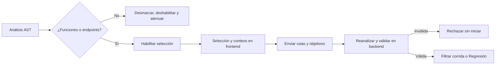

La interfaz previene errores y el backend establece la frontera de confianza. `None`
mantiene compatibilidad con llamadas históricas e incluye todos los módulos analizables;
una lista explícita debe contener al menos un objetivo real.

### Flujo B — directorio de clonación

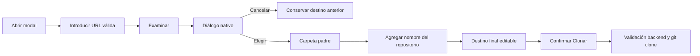

Elegir una carpeta nunca invoca `doClone()`. El destino final continúa visible y
editable. La protección frente a rutas ocupadas permanece en `qagent.proyectos.clonador`,
junto con las validaciones de URL, rama y destino.

## 6. Implementación del FIX A

### 6.1 Estado inicial y representación visual

En `vista-previa.js`, cada módulo recibe `sel: tieneObjetivos`. `renderTree()` fuerza
`sel = false` si la condición deja de cumplirse, deshabilita el checkbox y añade el
texto solicitado:

```javascript
function moduloTieneObjetivos(m){
  return !m.error && ((m.fns || []).length > 0 || (m.endpoints || []).length > 0);
}

const tieneObjetivos = moduloTieneObjetivos(m);
if (!tieneObjetivos) m.sel = false;
// La fila usa la clase no-targets, el atributo disabled y la nota visible.
```

`vista-previa.css` define el estado sin colores literales nuevos:

```css
.tree .row.no-targets{opacity:.5}
.tree .row.no-targets:hover{background:transparent}
.tree .no-targets-note{font-family:var(--sans);font-size:10px;color:var(--mut)}
```

### 6.2 Seleccionar todos, conteos y persistencia del estado

`seleccionarTodosModulos()` evalúa el mismo predicado para cada módulo. El control
maestro solo considera habilitados y refleja selección completa o parcial:

```javascript
function seleccionarTodosModulos(seleccionado){
  MODULES.forEach(m => { m.sel = moduloTieneObjetivos(m) && seleccionado; });
  renderTree();
}

const habilitados = MODULES.filter(moduloTieneObjetivos);
const seleccionados = habilitados.filter(m => m.sel).length;
```

`renderFns()` calcula módulos y objetivos sobre módulos seleccionados analizables. Las
funciones respetan su indicador individual `inc`; los endpoints del módulo seleccionado
se incluyen por su identidad canónica. `config-pruebas.js` reutiliza la misma selección
para el resumen del perfil. Por ello, un archivo vacío no incrementa el número de
módulos ni objetivos y los cambios de pantalla conservan el estado alojado en `MODULES`.

Un proyecto con solo endpoints conserva `total > 0`, habilita **Continuar** y muestra
un alcance válido aunque tenga cero funciones.

### 6.3 Carga enviada al backend

```javascript
function obtenerSeleccionObjetivos(){
  return MODULES.filter(m => m.sel && moduloTieneObjetivos(m)).map(m => ({
    ruta: m.path,
    funciones: (m.fns || []).filter(f => f.inc).map(f => f.n),
    endpoints: (m.endpoints || []).map(e => e.objetivo)
  })).filter(m => m.funciones.length || m.endpoints.length);
}
```

La estructura conserva por módulo la ruta, nombres de funciones e identidades de
endpoints. `monitor.js` entrega esta lista como tercer argumento de `start_run()` y
trata `seleccion_invalida` como un error visible, sin continuar.

### 6.4 Validación con AST fresco

El nuevo `src/qagent/proyectos/seleccion.py` concentra validación y filtrado. Descarta
archivos sin objetivos en el modo compatible, rechaza listas vacías, tipos ambiguos,
rutas repetidas, módulos inexistentes, objetivos inexistentes y módulos sin objetivos
seleccionados. Luego reconstruye cada módulo usando exclusivamente objetos provenientes
del AST:

```python
analizables = [m for m in modulos if m.get("funciones") or m.get("endpoints")]
funciones_reales = {f.get("nombre"): f for f in modulo.get("funciones", [])}
endpoints_reales = {e.get("objetivo"): e for e in modulo.get("endpoints", [])}

if inexistentes_fn or inexistentes_ep:
    raise SeleccionInvalida(f"Objetivos inexistentes en {ruta}: {inexistentes}")

filtrado["funciones"] = [funciones_reales[nombre] for nombre in funciones]
filtrado["endpoints"] = [endpoints_reales[objetivo] for objetivo in endpoints]
```

`DesktopAPI.start_run()` hace una validación temprana con
`analizar_proyecto(folder_path)`. `ejecutar_corrida()` vuelve a filtrar el análisis que
realmente consumirá el orquestador, de manera que el pipeline no opera sobre nombres
aportados directamente por la interfaz.

### 6.5 Regresión

`ejecutar_regresion()` crea el conjunto de pares elegidos y limita `_specs_aprobadas()`:

```python
elegidos = {
    (entrada["ruta"], objetivo)
    for entrada in seleccion
    for objetivo in entrada["funciones"] + entrada["endpoints"]
}
specs = [
    spec for spec in specs
    if (spec["contrato"]["modulo"], spec["contrato"]["objetivo"]) in elegidos
]
```

La prueba aislada confirmó una selección de un objetivo, un total de uno y una sola
invocación al ejecutor.

## 7. Implementación del FIX B

### 7.1 Botón Examinar y claridad de ruta

`modal-clonar.js` agrupa el `input` existente y el nuevo botón con la clase reutilizable
`.field-action`. La etiqueta se cambió a **Destino final**, y la ayuda aclara que
**Examinar selecciona la carpeta padre; QAgent agrega el nombre del repositorio**. El
campo conserva `oninput="dirEditado=true;vUrl()"`, por lo que sigue siendo editable.

```html
<input class="inp" id="dir" ... oninput="dirEditado=true;vUrl()">
<button type="button" class="btn" id="browseClone"
        onclick="examinarDestinoClonado()">Examinar…</button>
```

### 7.2 Integración con pywebview

`DesktopAPI.select_folder()` reutiliza el diálogo nativo disponible:

```python
result = self._window.create_file_dialog(webview.FOLDER_DIALOG)
if result and len(result) > 0:
    folder_path = result[0]
    return folder_path
return None
```

La implementación fue validada en Windows con el backend WinForms/Chromium. La API de
pywebview abstrae el selector por plataforma, aunque Linux y macOS no se probaron en
esta fase.

### 7.3 Carpeta padre, destino final y cancelación

```javascript
const destinoEnCarpeta = (carpeta, nombre) =>
  carpeta.replace(/[\\/]+$/,'') + (carpeta.includes('\\') ? '\\' : '/') + nombre;

const anterior = $('dir').value;
const carpetaPadre = await api.select_folder();
if(!carpetaPadre) return;
$('dir').value = destinoEnCarpeta(String(carpetaPadre), nombreRepo(url));
dirEditado = true;
```

Una cancelación devuelve `None`/valor vacío y ejecuta el retorno temprano: el valor
anterior permanece intacto. Si ocurre una excepción, se restaura explícitamente
`anterior`. El nombre se deriva de la URL válida, retirando el sufijo `.git`, y se añade
una sola vez a la carpeta padre.

### 7.4 Confirmación y clonación

`examinarDestinoClonado()` no cambia `clonando` ni llama al backend de Git. Solo
`doClone()` lee el estado definitivo y ejecuta:

```javascript
window.pywebview.api.clonar_repositorio(url, br, dir, shallow)
```

Se mantienen la rama introducida, el checkbox `--depth 1`, el hilo de clonación y los
eventos de progreso. El backend `clonador.clonar()` sigue siendo responsable de no
sobrescribir un destino ocupado. La comprobación controlada confirmó
`tipo_error=destino_ocupado`, sin invocar Git ni alterar el archivo centinela.

La validación real clonó `https://github.com/octocat/Hello-World.git`, rama `master`,
con profundidad uno en el área aislada. Se verificaron `README`, rama, origen remoto y
un único commit accesible. La elección de carpeta no inició esa clonación: la operación
solo empezó después de pulsar **Clonar**.

## 8. Archivos modificados

| Archivo | Función o componente | Cambio realizado | Justificación |
|---|---|---|---|
| `src/qagent/app/desktop.py` | `DesktopAPI.start_run`, `_lanzar_corrida`, `_correr` | Recibe, valida y propaga la selección explícita. | Evitar que una carga manipulada o desactualizada ejecute objetivos inexistentes. |
| `src/qagent/proyectos/seleccion.py` | `filtrar_modulos`, `SeleccionInvalida` | Nuevo filtro central de módulos, funciones y endpoints contra el AST. | Compartir una regla backend estricta y conservar compatibilidad cuando la selección es `None`. |
| `src/qagent/orchestrator/corrida.py` | `ejecutar_corrida` | Filtra módulos antes de contar y planificar; transmite la selección a Regresión. | Ejecutar únicamente el alcance confirmado. |
| `src/qagent/orchestrator/regresion.py` | `ejecutar_regresion` | Limita specs aprobadas a pares módulo/objetivo seleccionados. | Impedir que Regresión reejecute pruebas fuera del alcance actual. |
| `src/qagent/frontend/componentes/vista-previa/vista-previa.js` | Árbol, conteos y selección | Introduce `moduloTieneObjetivos`, deshabilita vacíos, corrige Seleccionar todos y serializa objetivos. | Hacer coherentes UI, conteos y carga backend para funciones y endpoints. |
| `src/qagent/frontend/componentes/vista-previa/vista-previa.css` | Estado `.no-targets` | Atenúa filas, elimina hover activo y estiliza la nota. | Diferenciar visualmente archivos sin objetivos usando tokens existentes. |
| `src/qagent/frontend/componentes/config-pruebas/config-pruebas.js` | Estimación y alcance | Calcula perfiles sobre módulos analizables y suma funciones más endpoints. | Mantener Configuración de pruebas coherente con Vista previa. |
| `src/qagent/frontend/componentes/inicio/modal-clonar.js` | Modal y `examinarDestinoClonado` | Añade Examinar, compone carpeta padre + repositorio, conserva cancelación y edición. | Permitir selección gráfica sin perder control del destino final. |
| `src/qagent/frontend/componentes/monitor/monitor.js` | `startMonitor` | Envía `obtenerSeleccionObjetivos()` y maneja `seleccion_invalida`. | Conectar el alcance visual con la frontera backend. |
| `src/qagent/frontend/css/componentes.css` | `.field-action` | Alinea input y botón con estilos existentes. | Integrar el nuevo control sin una dependencia ni sistema visual adicional. |
| `tests/proyectos/test_seleccion.py` | Pruebas de filtrado | Cubre vacíos, funciones, varios endpoints y selecciones inválidas. | Verificar la política central del backend. |
| `tests/app/test_desktop_selector_clonado.py` | Pruebas del diálogo | Comprueba apertura, ruta devuelta y cancelación. | Validar el puente pywebview sin abrir un diálogo real en la suite. |
| `tests/frontend/test_fase2_seleccion_clonado.py` | Contratos estáticos frontend | Verifica estado vacío, Seleccionar todos, persistencia, envío, Examinar y clonación. | Proteger la integración JavaScript sin añadir bundler. |
| `tests/app/test_desktop_corrida.py` | Pruebas de `start_run` | Comprueba propagación de una selección válida y rechazo temprano de una inexistente. | Confirmar que el backend no inicia el pipeline con objetivos inválidos. |

No se modificó el analizador AST porque ya distinguía correctamente funciones,
manejadores y endpoints.

## 9. Pruebas automatizadas

Todas las pruebas se realizaron con `QAGENT_FAKE_LLM=1` cuando correspondía. No se
contactó a proveedores LLM reales y no se ejecutó Docker para esta validación.

| Alcance y comando real | Resultado |
|---|---|
| `python test.py --rapido` | `1038 passed, 19 deselected` |
| `python -m pytest tests/frontend -q` | `81 passed` |
| `python -m pytest tests/proyectos/test_clonador.py -m "not red" -q` | `74 passed, 2 deselected` |
| `python -m pytest tests/proyectos/test_seleccion.py tests/app/test_desktop_selector_clonado.py tests/frontend/test_fase2_seleccion_clonado.py tests/app/test_desktop_corrida.py -q` | `19 passed` |
| Prueba aislada externa de selección en Regresión | `1 passed` |
| `python -m ruff check src tests scripts test.py` | `All checks passed!` |
| `python -m ruff format --check src tests scripts test.py` | `168 files already formatted` |
| `node --check` sobre los cuatro JavaScript modificados | Sintaxis correcta en los cuatro archivos |
| `git diff --check` | Aprobado, sin errores de espacios |

Las suites se informan por separado y **no se suman**, porque la suite rápida incluye
casos presentes en ejecuciones focalizadas. El test de Regresión se ejecutó de forma
aislada fuera del árbol del repositorio para comprobar el comportamiento sin agregar un
quinto archivo de pruebas a esta rama.

Cobertura funcional agregada:

- archivo con cero funciones y cero endpoints;
- archivo con una o más funciones;
- archivo con cero funciones y varios endpoints;
- Seleccionar todos y conteo de objetivos;
- persistencia y envío de selección;
- validación backend de objetivos existentes e inexistentes;
- apertura y cancelación del selector;
- destino seleccionado y edición manual;
- rama y clonado superficial;
- destino ocupado y clonación funcional.

## 10. Validación funcional en escritorio

QAgent se ejecutó mediante su entrada real `qagent.app.desktop.main()`, con pywebview
WinForms/Chromium en Windows 11. Para no afectar datos personales, `Path.home()` se
aisló dentro del proceso de validación y se usó
`C:\Users\Rodrigo\Desktop\QAgent-validacion-fase3` como área controlada.

### 10.1 Validación A

| Comprobación | Tipo | Resultado real |
|---|---|---|
| `__init__.py` y `vacio.py`, ambos `0 fn · 0 ep` | Visual y funcional | Desmarcados, deshabilitados, atenuados y con dos notas DOM. |
| `funciones.py`, dos funciones | Visual y funcional | Habilitado y seleccionable. |
| `api.py`, cero funciones y dos endpoints | Visual y funcional | Habilitado y seleccionable. |
| Seleccionar todos | Funcional | Cero archivos vacíos seleccionados. |
| Contador | Visual y funcional | `2 módulos · 4 objetivos`. |
| Proyecto solo-endpoints | Funcional | `0 funciones`, `2 endpoints`, botón Continuar habilitado y Configuración visible. |
| Carga backend | Funcional y automatizada | `funciones.py`: `sumar`, `absoluto`; `api.py`: `GET /salud`, `POST /items`. |
| Objetivo inexistente | Funcional y automatizada | `status=seleccion_invalida` y mensaje `Objetivos inexistentes…`. |
| Regresión | Automatizada aislada | Un objetivo elegido, un total y una ejecución. |

No se observaron pantalla en blanco, overlay inesperado, controles ocultos ni
solapamientos críticos.

### 10.2 Validación B

| Comprobación | Tipo | Resultado real |
|---|---|---|
| Botón Examinar | Visual | Visible junto al campo Destino final. |
| Selector de carpetas | Visual y funcional | Diálogo nativo de Windows abierto desde pywebview. |
| Carpeta padre | Funcional | Elegida `...\QAgent-validacion-fase3\clones`. |
| Destino final | Visual y funcional | Construido `...\clones\Hello-World`. |
| Cancelación | Funcional | Conservó `C:\destino-anterior`; `clonando=false`. |
| Edición manual | Funcional | Aceptó `C:\editado-manualmente`; `dirEditado=true`. |
| Destino ocupado | Automatizada y funcional | `tipo_error=destino_ocupado`; Git no se ejecutó y el archivo existente no cambió. |
| Rama y profundidad | Visual, funcional y automatizada | Rama `master`; opción `--depth 1` activa. |
| Clonación real | Funcional | Resultado exitoso, `README` presente, rama `master`, remoto esperado y `rev-list --count HEAD = 1`. |

El repositorio `octocat/Hello-World` no contiene módulos Python. En consecuencia, la
Vista previa posterior mostró cero módulos analizables; este resultado esperado no
afecta la comprobación del clonado.

## 11. Capturas reales

Las imágenes siguientes son los PNG originales de la validación y están protegidas por
el manifiesto `evidencias_sha256.json`.

### CAP-01 — Archivos sin objetivos deshabilitados

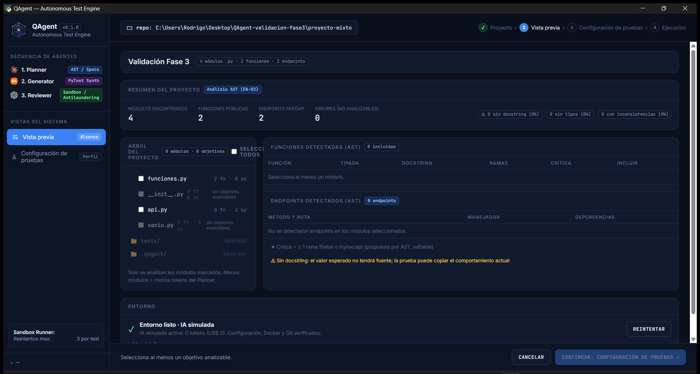

**Descripción:** Vista previa muestra archivos con `0 fn · 0 ep`, checkbox inactivo,
atenuación y la leyenda “sin objetivos analizables”.<br>
**Demuestra:** estado inicial correcto de módulos vacíos.<br>
**Requisito relacionado:** FIX A — desmarcar, deshabilitar, atenuar e informar.

### CAP-02 — Archivo con funciones detectadas

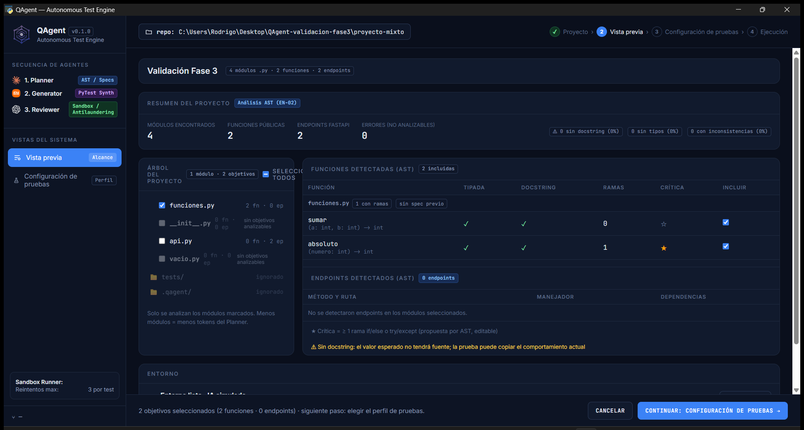

**Descripción:** el archivo con dos funciones públicas permanece marcado y habilitado.<br>
**Demuestra:** la corrección no bloquea funciones válidas.<br>
**Requisito relacionado:** FIX A — archivos con funciones seleccionables.

### CAP-03 — Archivo con endpoints detectados

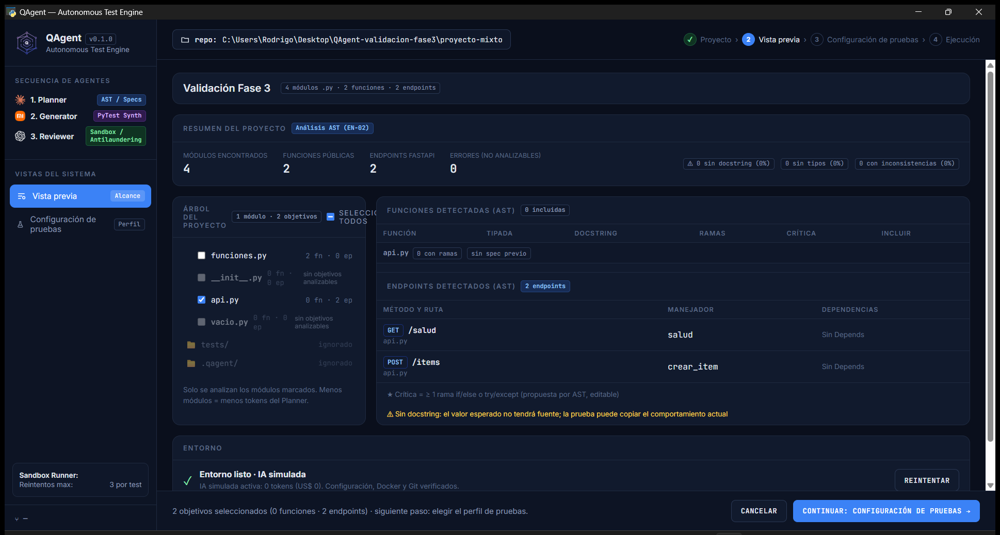

**Descripción:** el archivo con cero funciones y dos endpoints FastAPI está habilitado.<br>
**Demuestra:** los endpoints son objetivos suficientes por sí solos.<br>
**Requisito relacionado:** FIX A — compatibilidad con proyectos solo-endpoints.

### CAP-04 — Seleccionar todos y contador

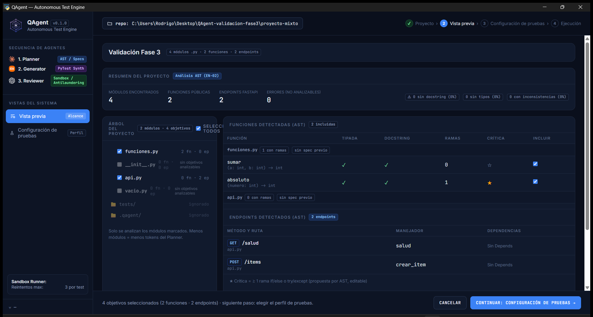

**Descripción:** el control maestro selecciona solo los dos módulos analizables y el
resumen indica cuatro objetivos.<br>
**Demuestra:** archivos vacíos excluidos de selección y conteo.<br>
**Requisito relacionado:** FIX A — Seleccionar todos y contadores correctos.

### CAP-05 — Botón Examinar

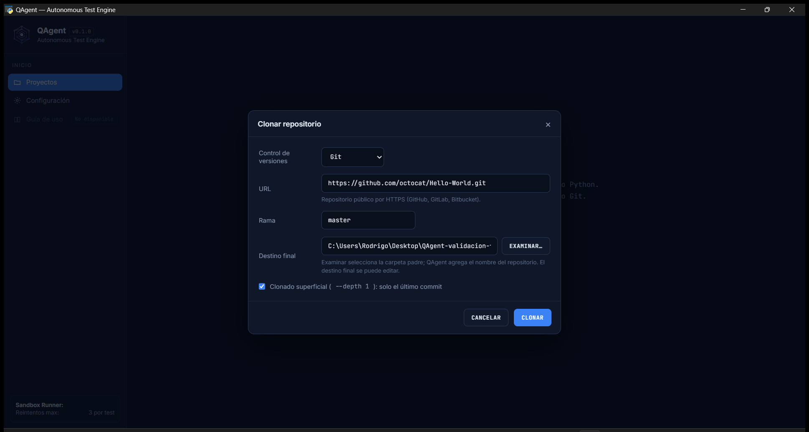

**Descripción:** el modal muestra **Examinar…** junto a **Destino final** y explica la
diferencia entre carpeta padre y destino.<br>
**Demuestra:** incorporación del control con los estilos existentes.<br>
**Requisito relacionado:** FIX B — selector gráfico y ruta manual editable.

### CAP-06 — Selector nativo de Windows

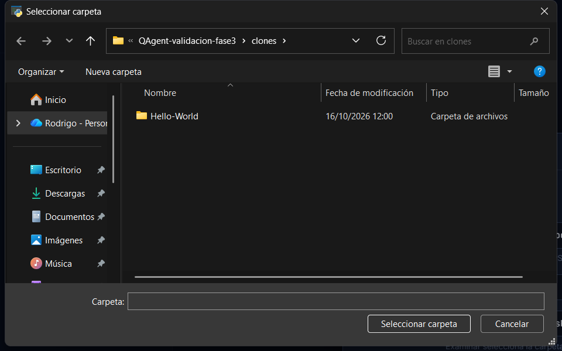

**Descripción:** diálogo real del sistema operativo abierto en el área aislada de
validación.<br>
**Demuestra:** comunicación JavaScript → DesktopAPI → pywebview.<br>
**Requisito relacionado:** FIX B — apertura del selector nativo.

### CAP-07 — Destino final seleccionado

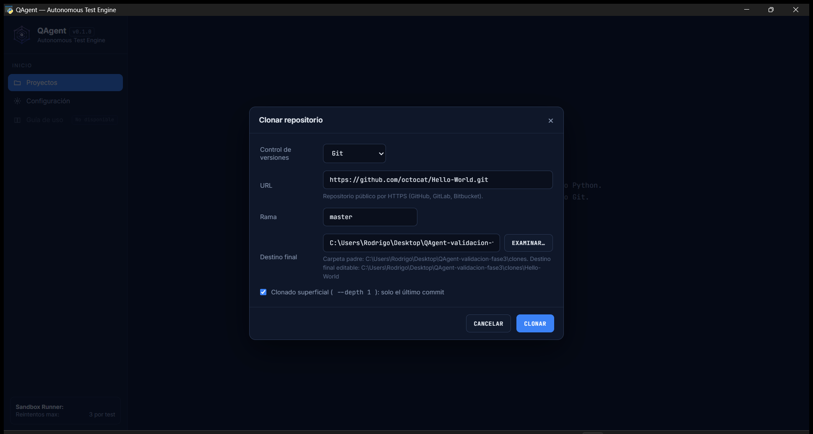

**Descripción:** después de elegir `clones` como carpeta padre, el campo contiene el
destino final terminado en `Hello-World`.<br>
**Demuestra:** construcción automática con el nombre sugerido sin iniciar el clon.<br>
**Requisito relacionado:** FIX B — diferenciar padre y destino final.

### CAP-08 — Clonación correcta

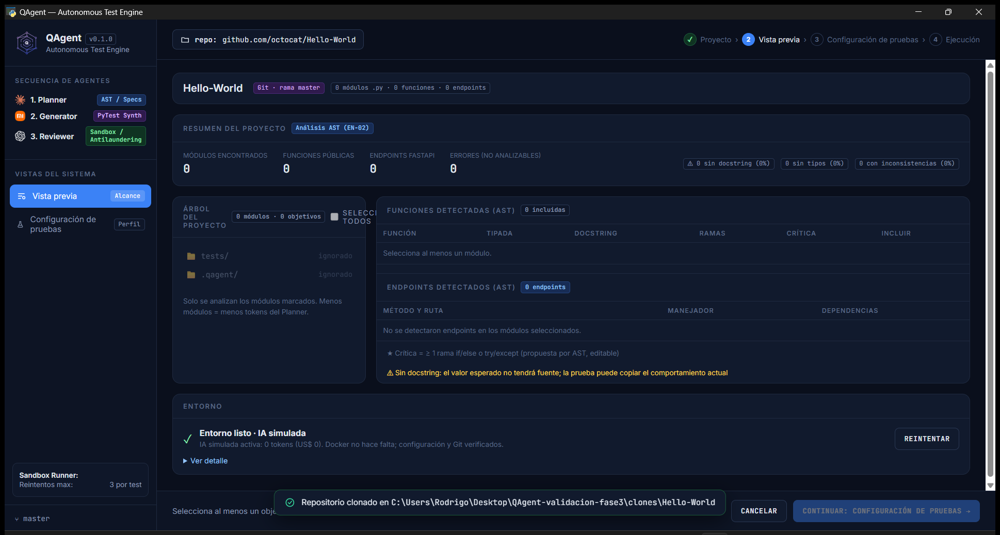

**Descripción:** QAgent muestra la notificación verde tras clonar el repositorio
controlado en el destino elegido.<br>
**Demuestra:** el flujo de clonación continúa operativo después de Examinar.<br>
**Requisito relacionado:** FIX B — clonación funcional, rama y modo superficial.

### CAP-09 — Pruebas automatizadas

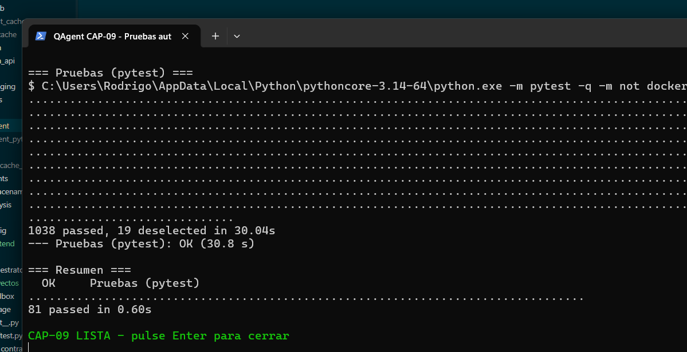

**Descripción:** consola real con la suite rápida y la suite frontend aprobadas.<br>
**Demuestra:** `1038 passed, 19 deselected` y `81 passed`.<br>
**Requisito relacionado:** regresión automatizada de ambas correcciones.

### CAP-10 — Ruff y verificaciones finales

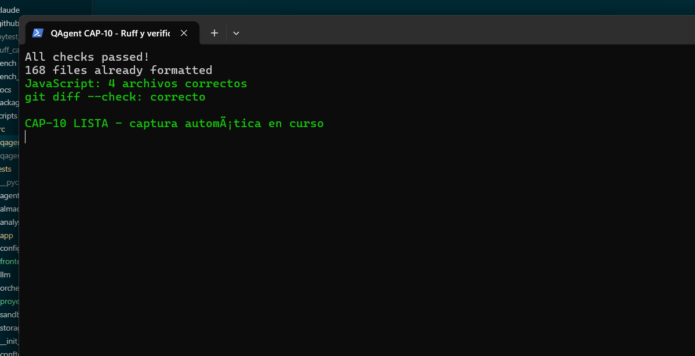

**Descripción:** consola real con Ruff, sintaxis JavaScript y comprobación de diff.<br>
**Demuestra:** lint aprobado, 168 archivos formateados, cuatro scripts válidos y diff
sin errores de espacios.<br>
**Requisito relacionado:** calidad y consistencia antes del futuro PR.

## 12. Problemas encontrados y soluciones

| Problema | Causa verificada | Solución o tratamiento | Resultado |
|---|---|---|---|
| Archivos sin objetivos seleccionables | La selección de módulos no aplicaba de extremo a extremo la condición funciones-o-endpoints. | `moduloTieneObjetivos()` gobierna inicialización, interacción, selección maestra y serialización. | Vacíos desmarcados y deshabilitados. |
| Conteos incorrectos o ambiguos | Los módulos seleccionados podían incluir elementos sin trabajo y el alcance no sumaba homogéneamente funciones y endpoints. | Conteos derivados solo de módulos analizables y de objetivos efectivamente incluidos. | `2 módulos · 4 objetivos` en el proyecto mixto. |
| Validación limitada al frontend | Una carga JavaScript puede estar manipulada o quedar obsoleta frente al disco. | `filtrar_modulos()` contrasta ruta e identidades con un AST fresco antes de iniciar y dentro del orquestador. | Objetivo inexistente rechazado sin ejecutar. |
| Regresión podía abarcar más specs | Las pruebas aprobadas se seleccionaban por vigencia, no por el alcance recién elegido. | Cruce por `(módulo, objetivo)` antes de reejecutar. | Una selección de un objetivo produce una ejecución. |
| Ausencia de selector gráfico | El modal solo ofrecía escritura/propuesta de ruta. | Botón Examinar y reutilización de `DesktopAPI.select_folder()`. | Selector nativo disponible en escritorio. |
| Posible confusión entre padre y destino | El diálogo devuelve una carpeta, mientras Git necesita el destino final. | Ayuda explícita y composición `carpeta padre + nombreRepo(url)`. | Ruta final visible y editable. |
| Destino existente ocupado | Clonar encima podía mezclar o sobrescribir contenido. | Se mantuvo la validación de `clonador`; prueba con archivo centinela. | `destino_ocupado`, sin invocar Git ni modificar contenido. |
| `WinError 50` en verificación de red | Python 3.14.7/Windows falló al duplicar un handle en el `subprocess.run` posterior del propio test de red. | Se aisló el diagnóstico; el Git directo y la variante con `stdin=DEVNULL` devolvieron `1`. Se propone robustecer ese test en otro cambio. | La clonación de QAgent ya había devuelto `ok=True`; el fallo no ocurrió durante el clonado del producto y no se declara corregido. |
| Browser/Playwright no disponibles | Esas capacidades no estaban instaladas en la sesión. | Se utilizó la aplicación real pywebview/Chromium, necesaria además para observar el diálogo del sistema. | Validación visual y funcional auténtica en Windows. |
| Advertencia de deprecación de `FOLDER_DIALOG` | pywebview 6.2.1 conserva la constante, pero recomienda `FileDialog.FOLDER`. | Se documenta como mantenimiento futuro; no se alteró tras la validación. | El diálogo funciona actualmente; la advertencia sigue presente y no se afirma corregida. |

## 13. Criterios de aceptación

| Criterio | Implementación | Prueba | Captura | Estado |
|---|---|---|---|---|
| Archivo sin objetivos no seleccionable | `moduloTieneObjetivos`, `disabled`, `no-targets` | Frontend y filtro backend | CAP-01 | Cumplido |
| Funciones válidas habilitadas | Estado inicial según `fns.length` | Archivo con funciones | CAP-02 | Cumplido |
| Endpoints válidos con cero funciones | Condición `fns || endpoints` | Módulo con varios endpoints y proyecto solo-endpoints | CAP-03 | Cumplido |
| Seleccionar todos ignora deshabilitados | Filtrado por `moduloTieneObjetivos` | Prueba frontend | CAP-04 | Cumplido |
| Conteos correctos | Módulos analizables + funciones incluidas + endpoints | Proyecto mixto: 2 módulos, 4 objetivos | CAP-04 | Cumplido |
| Validación backend | AST fresco + `filtrar_modulos` | Selección válida e inexistente | CAP-09 | Cumplido |
| Regresión respeta selección | Filtro de specs por módulo/objetivo | Prueba aislada: `1 passed` | — | Cumplido |
| Selector nativo | `create_file_dialog(webview.FOLDER_DIALOG)` | Prueba DesktopAPI y ejecución real | CAP-06 | Cumplido |
| Cancelación conserva valor | Retorno temprano y restauración ante excepción | Cancelación con ruta anterior | — | Cumplido |
| Edición manual | `input` conserva `oninput` y `dirEditado` | Ruta editada manualmente | CAP-05 | Cumplido |
| Destino final usa nombre sugerido | `destinoEnCarpeta(..., nombreRepo(url))` | Carpeta padre + `Hello-World` | CAP-07 | Cumplido |
| Clonación exitosa tras elegir destino | `doClone` conserva rama/destino/shallow | Clon real y pruebas del clonador | CAP-08 | Cumplido |
| Destino ocupado protegido | Validación existente del clonador | `tipo_error=destino_ocupado` y centinela intacto | — | Cumplido |

No hay criterios pendientes o no cumplidos dentro del alcance solicitado. La falta de
captura específica para cancelación, Regresión y destino ocupado no impide su estado:
son comprobaciones funcionales y automatizadas registradas en
`pruebas_ejecutadas.md`; las diez capturas requeridas sí están completas.

## 14. Observaciones y limitaciones

- La validación visual se realizó en Windows 11 con pywebview WinForms/Chromium.
- No se confirmó visualmente la interfaz nativa en Linux o macOS. La abstracción de
  pywebview busca compatibilidad, pero esa compatibilidad permanece sin evidencia en
  esta fase.
- `webview.FOLDER_DIALOG` funciona con pywebview 6.2.1, pero está deprecado. Una mejora
  futura debe evaluar `webview.FileDialog.FOLDER` y, si corresponde, compatibilidad con
  versiones anteriores. Esta advertencia no fue corregida aquí.
- `WinError 50` ocurrió en una comprobación Git posterior perteneciente al test de red,
  no en el `Popen` usado por QAgent para clonar. Docker y proveedores LLM reales no se
  usaron.
- `docs/evidencias/` está ignorado por la regla exacta `.gitignore:3:docs/evidencias/`;
  los documentos requerirán staging explícito con `git add -f` cuando el usuario lo
  autorice.

### Integración con la issue #61

El PR #62 de la issue #61 fue fusionado en `develop` mediante el commit
`d8c9bdf44a3cf989f85011caf387fcc9df7ab0b9`. Esta rama incorporó ese `develop` con el
merge `a582c64`. Las dos líneas de trabajo modificaban
`src/qagent/app/desktop.py` y
`src/qagent/frontend/componentes/inicio/modal-clonar.js`, pero Git las integró sin
conflictos textuales. La revisión semántica y las pruebas conjuntas confirmaron que no se
perdió comportamiento.

La integración conserva de la issue #61:

- registro automático del clon exitoso en Proyectos recientes;
- persistencia y deduplicación existentes;
- actualización con `await cargarRecientes()`;
- escape seguro de destino y advertencias;
- manejo de fallos de persistencia como advertencia cuando Git sí terminó.

También conserva de esta rama:

- botón **Examinar…** y selector nativo;
- composición de carpeta padre y destino final;
- edición manual y cancelación sin cambios;
- selección y validación de funciones/endpoints;
- alcance respetado en corrida normal y Regresión.

No se modificó la rama de #61 ni su Pull Request. Se realizó un merge normal de
`origin/develop` sobre esta rama, sin rebase ni force push. Los resultados posteriores
se detallan en el anexo de integración al final del documento.

## 15. Resultados y conclusiones

El FIX A alinea la interfaz con el alcance real del analizador: los archivos vacíos ya
no se presentan como trabajo ejecutable, mientras que funciones y endpoints válidos
siguen disponibles. La selección atraviesa Configuración y Monitor, se valida contra un
AST fresco y limita tanto la corrida normal como Regresión. Esto fue demostrado con un
proyecto mixto, otro exclusivo de endpoints, rechazo de una identidad inventada y una
prueba aislada de Regresión.

El FIX B añade una elección gráfica sin reducir el control del usuario. El selector
devuelve una carpeta padre, QAgent muestra el destino final con el nombre del
repositorio y el usuario todavía puede editarlo o cancelar. La clonación conserva rama,
`--depth 1`, progreso y protección de destinos ocupados. Una clonación real confirmó el
flujo completo.

Las suites automatizadas, Ruff, validación de sintaxis JavaScript, comprobación del diff,
diez capturas y sus hashes respaldan los resultados. Permanecen como limitaciones la
validación visual exclusiva en Windows, la deprecación pendiente de `FOLDER_DIALOG` y
los problemas ambientales de handles de entrada observados con subprocess bajo Python
3.14 en Windows. La compatibilidad con la corrección de la issue #61 quedó validada
después de incorporarla desde `develop`.

## 16. Referencias de Git

| Referencia | Valor |
|---|---|
| Repositorio local | `C:/Users/Rodrigo/Desktop/Codigos/QAgent` |
| Repositorio | QAgent (`AngelOncoy/QAgent`) |
| Rama de trabajo | `fix/seleccion-objetivos-directorio-clon` |
| Rama de destino | `develop` |
| Commit base completo | `7dc800d73da6af5cc0a4de336bbc455809b8898d` |
| Estado de `develop` tras integrar | `origin/develop` en `d8c9bdf44a3cf989f85011caf387fcc9df7ab0b9`, incorporado mediante `a582c64` |
| Dependencia técnica | issue #61 integrada por el PR #62; compatibilidad comprobada en `desktop.py` y `modal-clonar.js` |
| Pull Request de estas correcciones | Pendiente; no creado |
| Commit original y publicación | `cad996ce1c5e151d4733fec5d5a8faa7d1e5496d`, publicado en la rama de trabajo |

Los archivos relevantes son los catorce enumerados en la sección 8, además de este
informe, `pruebas_ejecutadas.md`, `evidencias_sha256.json` y las diez imágenes de
`img/`. La futura publicación no debe atribuirse el cierre de la issue #61, porque ese
cierre corresponde a su Pull Request original.

Debido a la regla de exclusión de `docs/evidencias/`, estos son los archivos exactos que
deberán incorporarse mediante staging forzado cuando exista autorización:

- `docs/evidencias/fix-seleccion-objetivos-directorio-clon/informe-fix-seleccion-objetivos-directorio-clon.md`;
- `docs/evidencias/fix-seleccion-objetivos-directorio-clon/pruebas_ejecutadas.md`;
- `docs/evidencias/fix-seleccion-objetivos-directorio-clon/evidencias_sha256.json`;
- `docs/evidencias/fix-seleccion-objetivos-directorio-clon/img/CAP-01-archivo-sin-objetivos-deshabilitado.png`;
- `docs/evidencias/fix-seleccion-objetivos-directorio-clon/img/CAP-02-archivo-funciones-seleccionable.png`;
- `docs/evidencias/fix-seleccion-objetivos-directorio-clon/img/CAP-03-archivo-endpoints-seleccionable.png`;
- `docs/evidencias/fix-seleccion-objetivos-directorio-clon/img/CAP-04-seleccionar-todos-contador.png`;
- `docs/evidencias/fix-seleccion-objetivos-directorio-clon/img/CAP-05-modal-clonar-boton-examinar.png`;
- `docs/evidencias/fix-seleccion-objetivos-directorio-clon/img/CAP-06-selector-nativo-carpetas.png`;
- `docs/evidencias/fix-seleccion-objetivos-directorio-clon/img/CAP-07-directorio-final-completado.png`;
- `docs/evidencias/fix-seleccion-objetivos-directorio-clon/img/CAP-08-clonacion-controlada-correcta.png`;
- `docs/evidencias/fix-seleccion-objetivos-directorio-clon/img/CAP-09-pruebas-automatizadas.png`;
- `docs/evidencias/fix-seleccion-objetivos-directorio-clon/img/CAP-10-ruff-verificaciones-finales.png`.

## Anexo — Integración posterior del PR #62

Fecha de integración y validación: 16 de octubre de 2026.

### Base incorporada y resolución

- Commit original de esta rama: `cad996ce1c5e151d4733fec5d5a8faa7d1e5496d`.
- Commit de `develop` incorporado: `d8c9bdf44a3cf989f85011caf387fcc9df7ab0b9`.
- Commit de la corrección #61 contenido en `develop`:
  `7b7ac4c945312e4f21d8a6bb49b109eebb9a1c42`.
- Merge creado en esta rama: `a582c64`.
- Estrategia: merge normal con `ort`; no se utilizó rebase ni force push.
- Conflictos: ninguno. `desktop.py` y `modal-clonar.js` se combinaron automáticamente y
  luego se revisaron de forma semántica.

El flujo combinado conserva el selector **Examinar…**, la composición de carpeta padre
y destino final, edición manual, cancelación, rama y `--depth 1`. Tras un clon exitoso,
el backend registra nombre, origen Git, ruta y URL antes de `clonado_fin`; el frontend
espera `cargarRecientes()`, actualiza lista y contador, escapa destino y advertencias, y
navega a Vista previa. Allí permanecen la deshabilitación de archivos sin objetivos, la
selección de funciones/endpoints, la validación AST y el filtrado de corrida y Regresión.

### Pruebas conjuntas posteriores al merge

Estas ejecuciones son posteriores y no sustituyen ni se suman a las cifras históricas
de la sección 9:

| Verificación | Resultado real |
|---|---|
| Pruebas conjuntas de #61, selección, selector, clonador offline, Recientes y Regresión | `142 passed, 2 deselected` |
| Suite rápida oficial: `python test.py --rapido` | `1047 passed, 19 deselected` |
| Frontend completo | `85 passed` |
| Ruff check | `All checks passed!` |
| Ruff format | `170 files already formatted` |
| `node --check` sobre los cuatro JavaScript modificados | Correcto |
| `git diff --check` y diff del futuro PR | Correcto |

El primer intento del conjunto dirigido terminó con `141 passed, 2 deselected` y un
fallo ambiental: `WinError 6` al duplicar el handle de entrada antes de ejecutar
`git init` en una prueba offline de #61. El mismo caso pasó aislado y el conjunto
completo pasó al repetirlo con entrada estándar desconectada. No se modificaron el test
ni el producto para ocultar el fallo.

Se usó `QAGENT_FAKE_LLM=1`, sin proveedores reales, Docker ni pruebas marcadas `red`.
No se realizó una nueva captura visual durante la integración porque Browser/Playwright
no estaban disponibles. Las diez capturas originales y su manifiesto SHA-256 se
conservaron sin cambios; la validación automática cubrió la conexión funcional entre
ambas correcciones. Continúan pendientes la comprobación visual en Linux/macOS y la
migración futura desde `FOLDER_DIALOG`, actualmente deprecado.
