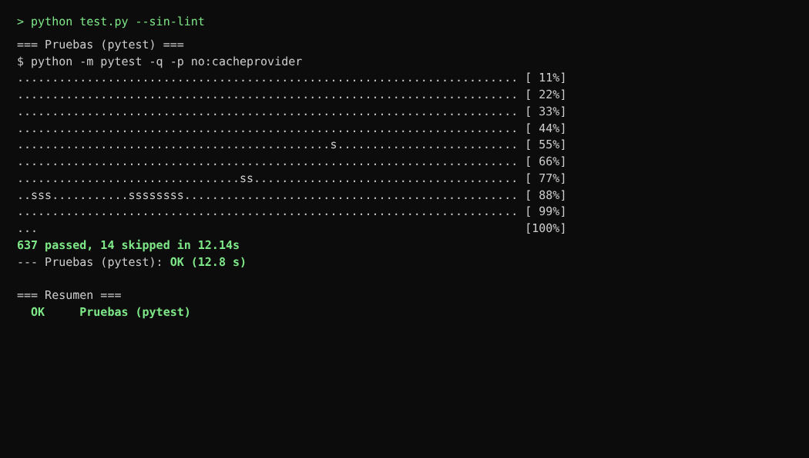
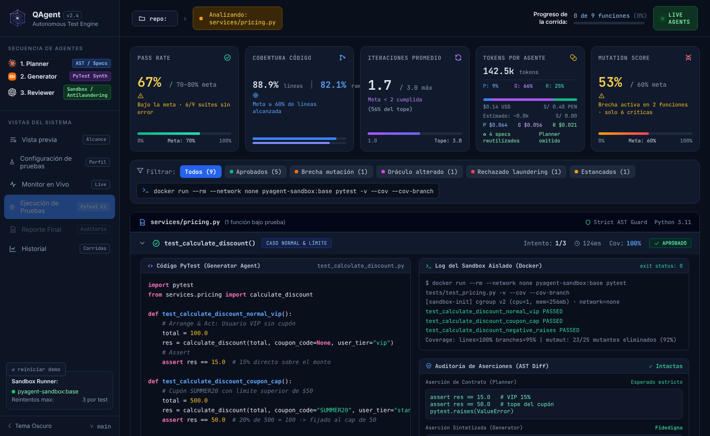
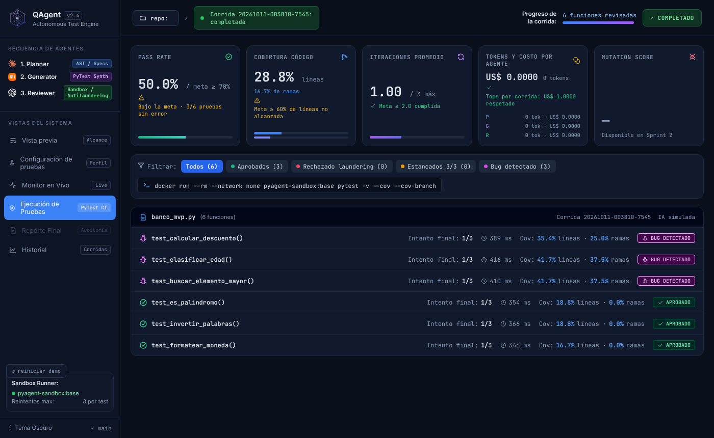
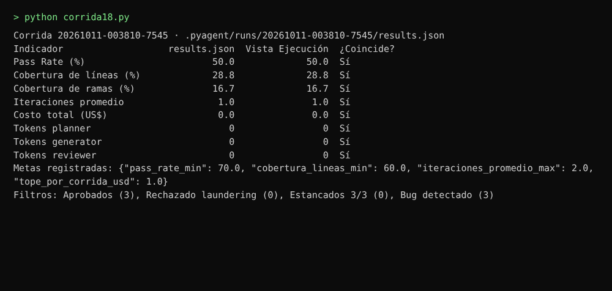
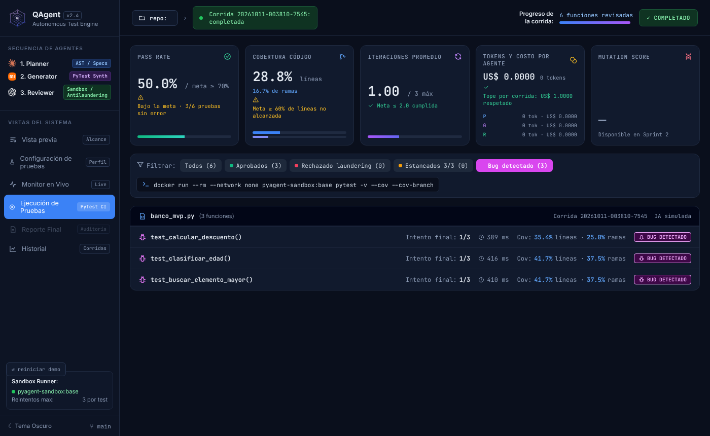

# HU-18 · La vista Ejecución muestra los resultados reales de la corrida

**Informe de lo realizado** · 10 de octubre de 2026 · Responsable: Oncoy Patricio, Angel

## En pocas palabras

La pantalla «Ejecución de pruebas» mostraba siempre los mismos datos de ejemplo, escritos a mano: 9 funciones inventadas y porcentajes fijos. Ahora, al terminar una corrida, muestra sus resultados reales. Todos los valores salen del archivo de resultados que guarda la corrida (`.pyagent/runs/<run_id>/results.json`), así que cualquiera puede abrirlo y comprobar que las cifras coinciden.

**Historia:** como desarrollador de software, quiero ver si las pruebas pasaron, qué parte de mi código cubren y cuánto costó, para saber dónde enfocar mi revisión.

## Qué se revisó y qué se hizo

**1. Los indicadores de la pantalla.**
*Se revisó:* los 5 indicadores se calculaban sobre la lista de ejemplo, con un reparto de tokens fijo (9 % / 66 % / 25 %) y precios de ejemplo.
*Se hizo:* muestran los 4 indicadores pedidos (Pass Rate, cobertura de líneas y de ramas, iteraciones promedio, y tokens y costo por agente), cada uno comparado con su meta. El Mutation Score dice «Disponible en Sprint 2».

**2. De dónde salen las cifras.**
*Se revisó:* el archivo de resultados no traía todo lo necesario: le faltaban la cobertura de ramas promedio, las iteraciones promedio, el costo por agente, las metas, el tiempo de cada prueba y si hubo pruebas debilitadas.
*Se hizo:* la corrida ahora guarda esos datos en el mismo archivo. Las metas se copian de `config.toml` en el momento de la corrida: Pass Rate ≥ 70 %, líneas ≥ 60 %, iteraciones ≤ 2 y tope de US$ 1,00. Se actualizó la descripción del formato (`contracts/run_log.schema.json`) y su ejemplo.

**3. Una pieza que prepara lo que se ve.**
*Se revisó:* la pantalla calculaba los promedios por su cuenta.
*Se hizo:* una pieza nueva (`storage/vista_ejecucion.py`) lee el archivo, comprueba que tenga el formato correcto y entrega a la pantalla los indicadores, los filtros y las pruebas ya ordenados. La pantalla solo los muestra.

**4. Filtros por estado.**
*Se revisó:* los filtros eran los de la demostración («Brecha mutación», «Oráculo alterado»…).
*Se hizo:* hay filtros para Aprobados, Rechazado laundering y Estancados 3/3, siempre visibles con su conteo, más «Bug detectado» cuando la corrida encuentra alguno.

**5. Pruebas agrupadas por archivo.**
*Se revisó:* la lista agrupaba las funciones inventadas.
*Se hizo:* cada prueba aparece bajo su archivo con el intento final (por ejemplo «1/3»), el tiempo que tardó, la cobertura de líneas y de ramas, y su estado. Si quedó estancada, dice el motivo.

**6. Cómo se llega a la pantalla.**
*Se revisó:* tras una corrida real, la pantalla quedaba desactivada para no mezclar datos inventados con reales.
*Se hizo:* al terminar la corrida aparece el botón «Ver ejecución de pruebas». La barra superior muestra la corrida que se está viendo. Sin una corrida real, por ejemplo al abrir la pantalla en el navegador, se sigue viendo la demostración.

**7. Corridas guardadas antes de este cambio.**
*Se revisó:* sus archivos no tienen los datos nuevos.
*Se hizo:* se completan con los datos por función del mismo archivo. Lo que no se puede saber, como las metas o el costo por agente, se muestra como «no registrado» en vez de inventarlo.

**8. Pruebas automáticas.**
*Se revisó:* había 624 pruebas automáticas aprobadas.
*Se hizo:* se agregaron 13 (ahora hay 637 aprobadas). Entre ellas está la comparación automática de los indicadores de la pantalla con el archivo de resultados que pide el criterio 5.

## Criterios de aceptación

| # | Criterio | Cómo se cumple | Prueba |
|---|---|---|---|
| 1 | 4 indicadores comparados con la meta; Mutation Score «Disponible en Sprint 2» | Tarjetas de Pass Rate, Cobertura, Iteraciones y Tokens y costo por agente, con la meta guardada en la corrida | 2 |
| 2 | Todo se calcula desde `results.json` | La pantalla recibe los valores ya leídos del archivo; una prueba automática revisa que no use los datos de ejemplo | 1, 3 |
| 3 | Filtros por estado con su conteo | Aprobados, Rechazado laundering y Estancados 3/3 siempre visibles (y Bug detectado cuando lo hay) | 2, 4 |
| 4 | Pruebas por módulo con intento final, tiempo, cobertura y estado | Una fila por prueba bajo su archivo | 2, 4 |
| 5 | Los indicadores coinciden con `results.json` | Prueba automática y comparación de una corrida real | 1, 3 |

## Para qué se hizo

- Saber de un vistazo si la corrida cumple las metas del proyecto y dónde falla.
- Poder demostrar que las cifras son reales: el archivo está en la carpeta del proyecto y coincide con la pantalla.
- Dejar listos los datos que usará el reporte de auditoría (HU-21).

## Pruebas realizadas

### Prueba 1 · Todas las pruebas automáticas siguen aprobadas

Se ejecutaron todas las pruebas automáticas del proyecto. **Resultado:** 637 aprobadas y 14 omitidas (necesitan Docker o internet), ninguna fallida.

### Prueba 2 · La pantalla antes y después

*Antes: los datos de ejemplo de siempre.*

*Después: la corrida real sobre el banco.*

Se abrió la misma pantalla en un navegador. Para el «antes» se mostró la demostración; para el «después» se le entregó lo que devuelve Python para la corrida de la prueba 3. **Resultado:** antes aparecían 9 funciones inventadas (`services/pricing.py`…); después aparecen las 6 funciones de `banco_mvp.py`, con sus tiempos y coberturas reales y las metas de `config.toml`.

### Prueba 3 · Los indicadores coinciden con el archivo de resultados

Se hizo una corrida completa sobre una copia del banco con la IA simulada y se comparó cada indicador de la pantalla con el valor del archivo. **Resultado:** coinciden los 8 valores comparados: Pass Rate, cobertura de líneas y de ramas, iteraciones, costo total y tokens de cada agente. En este equipo no había Docker, así que las pruebas generadas se ejecutaron con pytest en una carpeta temporal.

### Prueba 4 · El filtro deja solo las pruebas de ese estado

Sobre la misma corrida se eligió el filtro «Bug detectado». **Resultado:** quedan las 3 funciones con bug sembrado (`calcular_descuento`, `clasificar_edad` y `buscar_elemento_mayor`), igual al conteo del filtro.

## Pendiente (otra tarea)

- **Decidir qué cuenta el Pass Rate.** Hoy cuenta las pruebas que pasan en pytest. Una prueba que detecta un bug falla a propósito, así que en el banco el Pass Rate sale 50 % (bajo la meta) aunque el sistema funcionó bien. Conviene que el equipo decida si una prueba con bug detectado cuenta como «sin error».
- **Cobertura por función:** hoy se mide sobre el archivo completo, por eso los valores salen bajos (entre 17 % y 42 % en el banco).
- **Probarlo en la ventana real** tras una corrida con Docker. Las capturas son de la pantalla abierta en un navegador; por eso se ven el botón «reiniciar demo» y la etiqueta «repo:» vacía.
- **Ver el detalle de una prueba** (código, registro de ejecución, comparación de aserciones) corresponde a HU-19, del Sprint 2.
