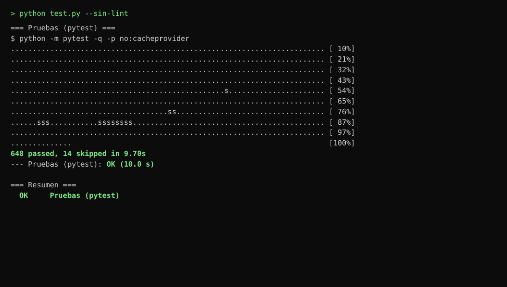
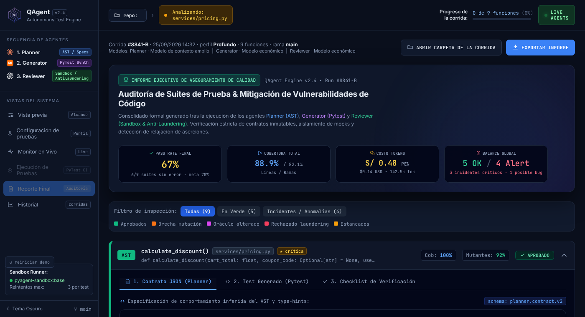
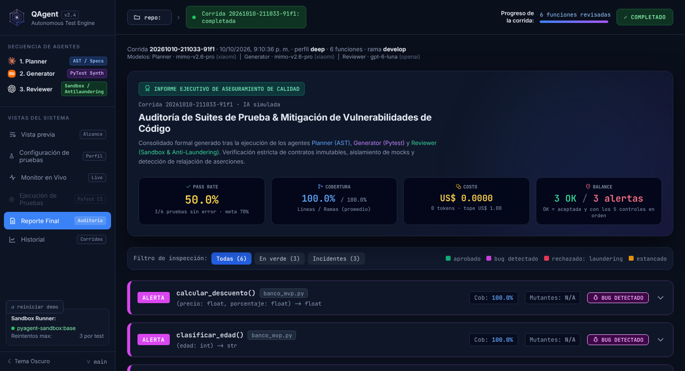
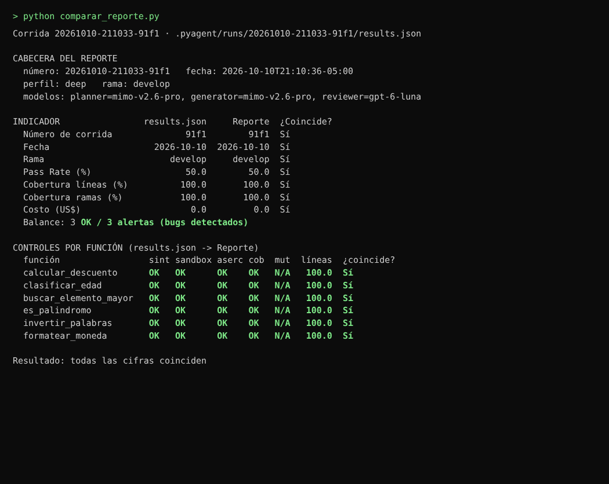
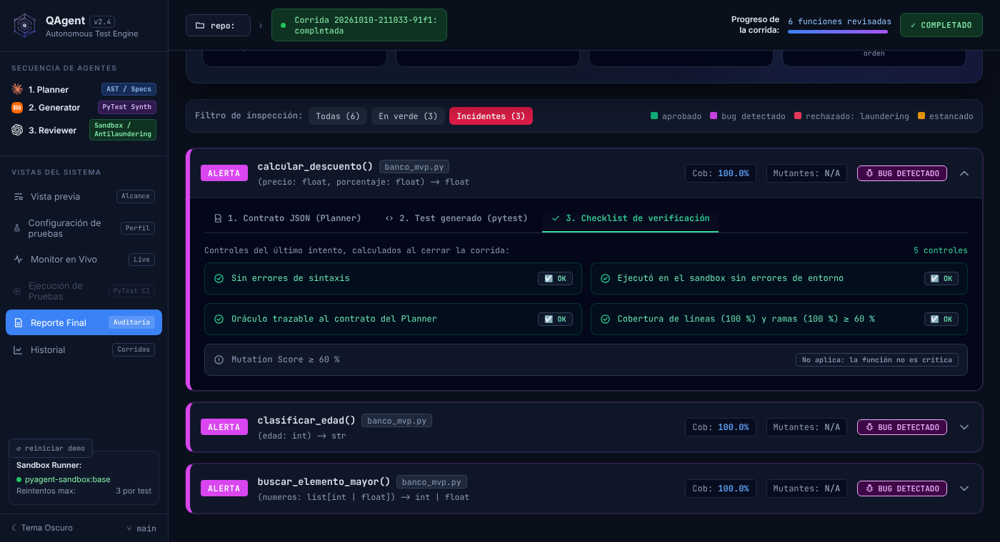
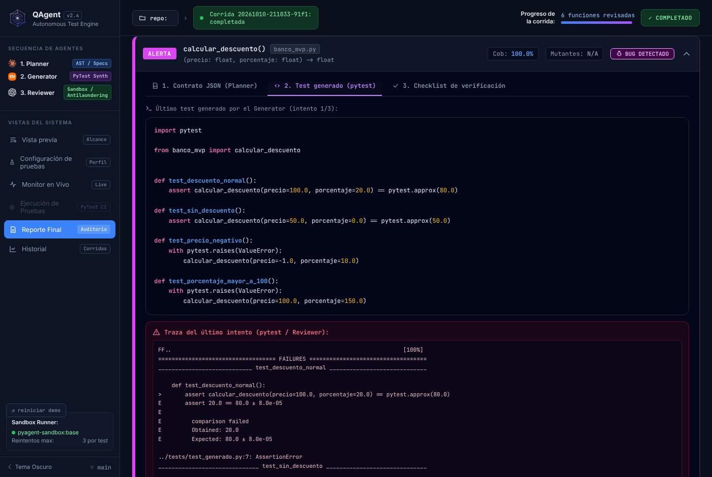
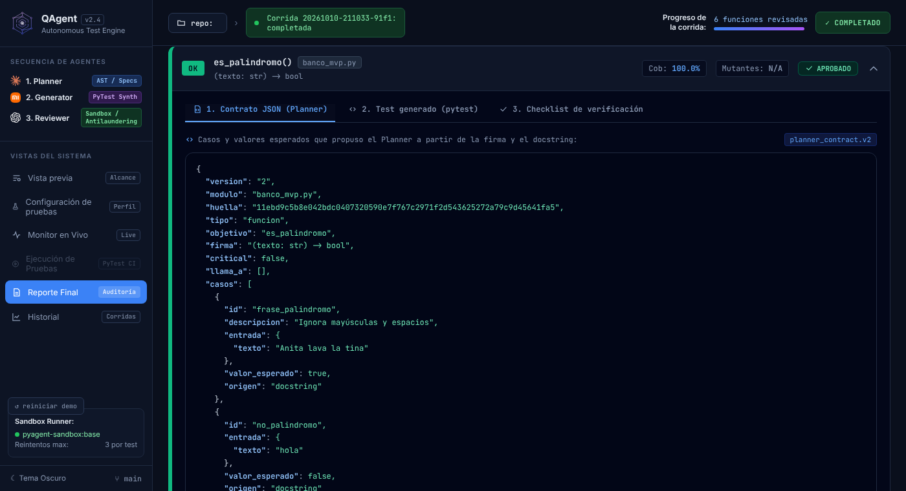

# HU-21 · Reporte de auditoría con el contrato, la prueba y los controles de cada función

**Informe de lo realizado** · 10 de octubre de 2026 · Responsable: Oncoy Patricio, Angel

## En pocas palabras

La pantalla «Reporte final» mostraba siempre la misma auditoría de ejemplo: 9 funciones inventadas y cifras escritas a mano. Ahora, al terminar una corrida, muestra su auditoría real: los datos de la corrida, 4 indicadores y una tarjeta por función con lo que propuso el Planner, la prueba que se generó y 5 controles de calidad. Las cifras salen del archivo de resultados de la corrida (`.pyagent/runs/<run_id>/results.json`), así que se pueden comprobar.

**Historia:** como auditor, quiero un reporte consolidado de la corrida con el contrato, la prueba y los controles de cada función, para evaluar la calidad sin revisar código a mano.

## Qué se revisó y qué se hizo

**1. La cabecera y los 4 indicadores.**
*Se revisó:* la pantalla mostraba la corrida «#8841-B» y valores fijos (Pass Rate 67 %, cobertura 88,9 %, costo S/ 0,48).
*Se hizo:* muestra el número de la corrida, la fecha, el perfil, la rama de Git y los modelos de cada agente. Los indicadores son Pass Rate (con su meta), cobertura de líneas y de ramas, costo con su tope y el balance: cuántas funciones están en orden frente a cuántas tienen alertas.

**2. Una tarjeta por función con 3 pestañas.**
*Se revisó:* la corrida no guardaba lo que el auditor necesita leer: el contrato del Planner y la prueba generada se perdían al terminar.
*Se hizo:* la corrida guarda ahora un archivo más, `detalle.json`, con el contrato, la última prueba y, si falló, su traza. Cada tarjeta tiene las pestañas «Contrato JSON (Planner)», «Test generado» (con la traza si falló) y «Checklist de verificación».

**3. Los 5 controles de cada función.**
*Se revisó:* nadie calculaba estos controles; solo existían en la demostración.
*Se hizo:* al cerrar la corrida se calculan y se guardan en `results.json`: sin errores de sintaxis; ejecutó en el entorno aislado sin errores de entorno; aserciones no relajadas (o, si encontró un bug, que lo esperado sale del contrato del Planner); cobertura de líneas y de ramas de al menos 60 %; y Mutation Score de al menos 60 %, que dice «No aplica» si la función no es crítica.

**4. Cobertura de la función, no del archivo entero.**
*Se revisó:* la cobertura se medía sobre todo el archivo, así que una prueba que cubría su función completa salía con 17 % a 42 % en el banco, y el control de cobertura habría fallado siempre.
*Se hizo:* el Reviewer cuenta solo las líneas y ramas de la función revisada. En el banco, las 6 funciones quedan con 100 %. El cambio también se ve en la pantalla «Ejecución de pruebas».

**5. Filtros.**
*Se revisó:* los filtros eran los de la demostración.
*Se hizo:* hay 3 filtros con su conteo: Todas, En verde (aceptada y con los 5 controles en orden) e Incidentes (todo lo demás, incluidos los bugs detectados, para que el auditor los mire).

**6. Cómo se llega al reporte.**
*Se revisó:* tras una corrida real, el reporte quedaba desactivado para no mezclar datos inventados con reales.
*Se hizo:* al terminar la corrida, el Monitor muestra el botón «Ver reporte de auditoría». En una corrida real se ocultan los botones de la demostración («Abrir carpeta» simulado y «Exportar informe»). Todo lo que viene del proyecto o de la IA se muestra como texto, sin que pueda alterar la pantalla.

**7. Corridas guardadas antes de este cambio.**
*Se revisó:* no tienen controles ni `detalle.json`.
*Se hizo:* el reporte se abre igual: la cobertura se calcula con los datos del archivo, los demás controles dicen «sin dato» y las pestañas avisan que esa corrida no guardó el contrato ni la prueba.

**8. Pruebas automáticas.**
*Se revisó:* había 637 pruebas automáticas aprobadas.
*Se hizo:* se agregaron 11 (ahora hay 648 aprobadas), entre ellas la que compara las cifras del reporte con `results.json` (criterio 5) y la de la cobertura por función.

## Criterios de aceptación

| # | Criterio | Cómo se cumple | Prueba |
|---|---|---|---|
| 1 | Número, fecha, perfil, rama, modelos y 4 indicadores | Cabecera y tarjetas Pass Rate, Cobertura, Costo y Balance | 2 |
| 2 | Tarjeta por función con Contrato, Test (con traza) y Checklist | Las 3 pestañas, leídas de `detalle.json` | 4 |
| 3 | Los 5 controles, «No aplica» si no es crítica | Calculados al cerrar la corrida y guardados en `results.json` | 3, 4 |
| 4 | Filtros Todas, En verde e Incidentes | Botones con su conteo | 2, 4 |
| 5 | El reporte muestra número, fecha y los 5 controles, y sus cifras coinciden con `results.json` | Prueba automática y comparación de una corrida completa | 1, 3 |

## Para qué se hizo

- Que el auditor (o el profesor) evalúe cada prueba sin abrir el código: ve qué se esperaba, qué se probó y si pasó los controles.
- Poder demostrar que las cifras son reales: `results.json` y `detalle.json` quedan en la carpeta de la corrida.
- Que la cobertura refleje lo que de verdad cubre cada prueba, y no castigue a las funciones de un archivo grande.
- Dejar listo el lugar del Mutation Score para cuando llegue mutmut (EN-09).

## Pruebas realizadas

### Prueba 1 · Todas las pruebas automáticas siguen aprobadas

Se ejecutaron todas las pruebas automáticas del proyecto con la IA simulada. **Resultado:** 648 aprobadas y 14 omitidas (necesitan Docker o internet), ninguna fallida.

### Prueba 2 · La pantalla antes y después

*Antes: la auditoría de ejemplo de siempre.*

*Después: la corrida real sobre el banco.*

Se abrió la misma pantalla en un navegador. Para el «antes» se mostró la demostración; para el «después» se le entregó lo que devuelve Python para la corrida de la prueba 3. **Resultado:** antes aparecían la corrida «#8841-B» y funciones inventadas (`calculate_discount` en `services/pricing.py`); después aparecen la corrida 20261010-211033-91f1, la rama `develop`, los modelos de `config.toml` y las 6 funciones de `banco_mvp.py`.

### Prueba 3 · Las cifras y los controles coinciden con el archivo de resultados

Se hizo una corrida completa sobre una copia del banco con la IA simulada y se comparó lo que muestra el reporte con `results.json`. **Resultado:** coinciden el número, la fecha, la rama, el Pass Rate (50 %), la cobertura de líneas y de ramas (100 %) y el costo, y los 5 controles de las 6 funciones. En este equipo no había Docker, así que las pruebas generadas se ejecutaron con pytest en una carpeta temporal; dentro de la aplicación ese paso lo hace el entorno aislado. La misma comparación se repitió en el equipo del responsable con el mismo resultado.

### Prueba 4 · Las 3 pestañas de una tarjeta

*Checklist de una función con bug detectado (filtro «Incidentes»).*

*Test generado con la traza del fallo.*

*Contrato JSON del Planner de una función en verde.*

Sobre la misma corrida se abrió `calcular_descuento` (bug sembrado) y `es_palindromo` (aprobada). **Resultado:** el checklist muestra los 5 controles y «No aplica: la función no es crítica» en el Mutation Score; la traza muestra el fallo real (`assert 20.0 == 80.0`), que delata el bug sembrado; y el contrato muestra los casos que el Planner sacó del docstring.

## Pendiente (otra tarea)

- **Mutation Score:** ninguna función del banco está marcada como crítica, así que hoy todas dicen «No aplica». Una función crítica muestra «Pendiente» hasta que EN-09 (Sprint 2) ejecute mutmut.
- **Decidir qué cuenta el Pass Rate** (sin cambios desde HU-18): las pruebas que detectan un bug fallan a propósito, por eso el banco sale 50 %, bajo la meta de 70 %.
- **Probarlo en la ventana real** tras una corrida con Docker. Las capturas son de la pantalla abierta en un navegador; por eso se ven el botón «reiniciar demo» y la etiqueta «repo:» vacía.
- **Exportar el informe** de una corrida real (PDF o similar) no forma parte de esta historia; el botón se oculta en ese caso.
