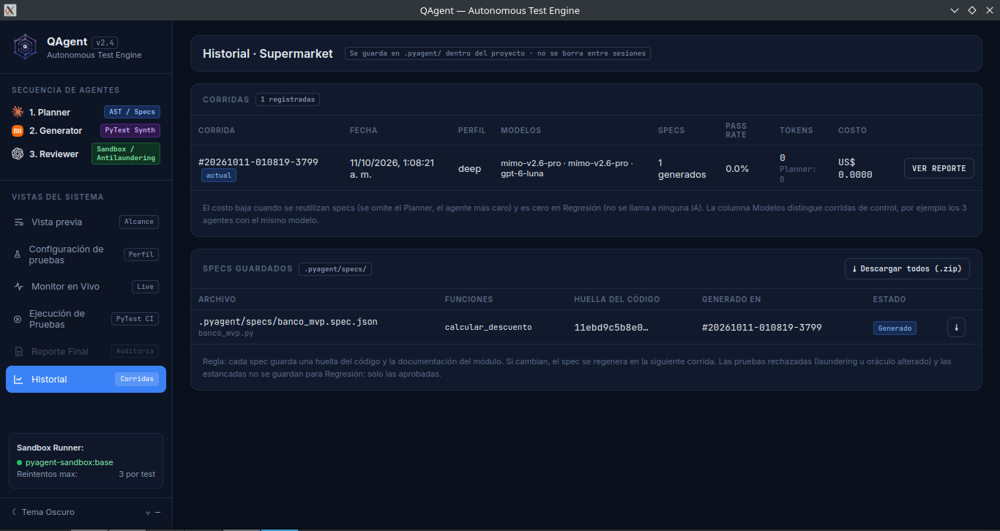
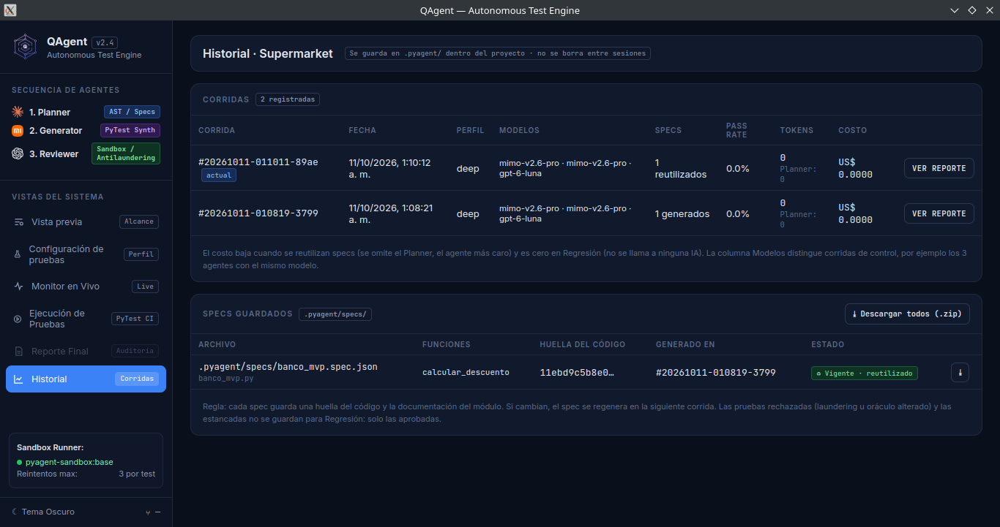
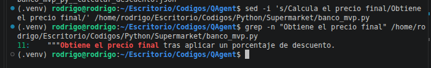
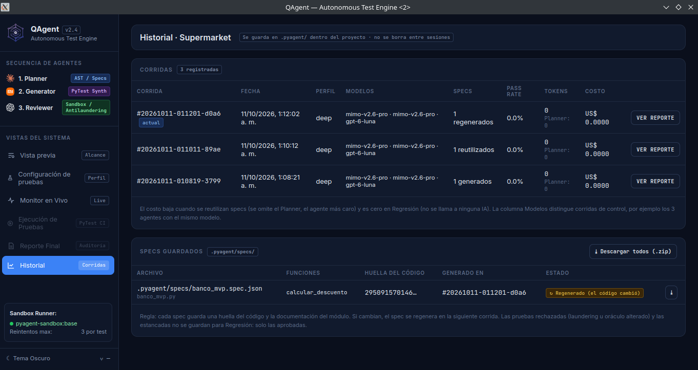
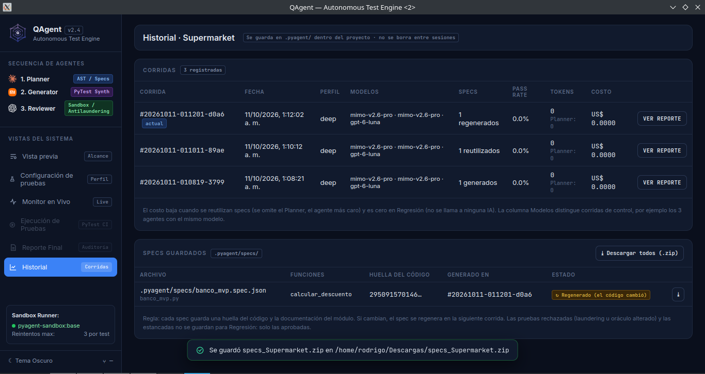
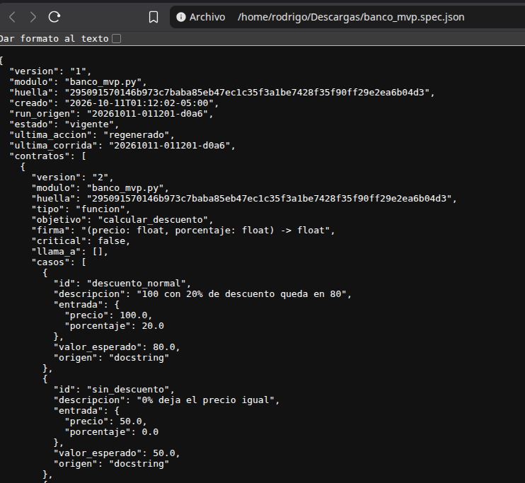

# HU-24 · Reutilizar specs cuando el código no cambió

## Ítem del Backlog

| Campo | Valor |
|---|---|
| Historia | HU-24 — Reutilizar specs cuando el código no cambió |
| Responsable | Rodríguez Malca, Rodrigo Abel |
| Épica | 8 |
| Sprint | 1 |
| Prioridad | Media |
| Estimación | 1 SP |
| Dependencias | EN-07 y Planner |

## Resumen del trabajo

QAgent ahora guarda el plan completo de cada módulo en `.pyagent/specs/` junto con su huella SHA-256. Cuando el archivo conserva la misma huella, la siguiente corrida reutiliza el plan y no llama nuevamente al Planner. Si cambia el código o solamente un docstring, vuelve a planificarlo y lo registra como `regenerado`.

El Historial muestra la huella, la corrida de origen y el último estado. Desde la misma pantalla se puede guardar una spec individual o todas las specs en ZIP usando el diálogo nativo de QAgent.

También se corrigieron dos casos encontrados durante la revisión: el plan se conserva completo aunque Generator, Reviewer o Docker fallen después del Planner, y los módulos con rutas parecidas ya no pueden terminar usando el mismo nombre de spec.

## Tipo de cambio

- [x] Optimización: evita repetir y pagar el análisis de un módulo que no cambió.
- [x] Nueva funcionalidad: agrega consulta y descarga de specs desde el Historial.
- [x] Corrección: impide guardar planes parciales y evita colisiones de nombres.

## Archivos modificados

| Archivo | Cambio |
|---|---|
| `src/pyagent/almacenamiento/proyecto.py` | Guarda, valida, busca, lista y comprime las specs modulares; genera nombres únicos. |
| `src/pyagent/almacenamiento/historial.py` | Prepara las corridas y specs persistidas para el Historial. |
| `src/pyagent/almacenamiento/__init__.py` | Expone las funciones nuevas de almacenamiento. |
| `src/pyagent/orchestrator/orquestador.py` | Permite usar un plan guardado sin Planner y conserva el plan completo. |
| `src/pyagent/orchestrator/corrida.py` | Decide entre generar, reutilizar o regenerar y registra el resultado. |
| `src/pyagent/app/desktop.py` | Expone Historial y descarga ZIP mediante el diálogo nativo. |
| `frontend/componentes/historial/historial.js` | Reemplaza datos de demostración por datos reales y conecta las descargas. |
| `tests/almacenamiento/test_hu24_specs.py` | Comprueba persistencia, reutilización, ZIP y nombres sin colisiones. |
| `tests/orchestrator/test_hu24_reutilizar_specs.py` | Comprueba las tres corridas, varios módulos y planes completos ante fallos. |
| `tests/app/test_desktop_historial.py` | Comprueba el puente de escritorio y el ZIP individual. |
| `tests/frontend/test_hu24_historial.py` | Comprueba la conexión del Historial con el backend. |

## Criterios de aceptación

| Criterio | Estado | Implementación y verificación |
|---|---|---|
| CA-01 · Guardar `.spec.json` con SHA-256 | Cumplido | Se reutiliza la huella del analizador y se guarda el plan completo por módulo. Una regresión comprueba que un fallo posterior no reduzca sus contratos. |
| CA-02 · Omitir Planner si no cambió | Cumplido | La segunda corrida carga los contratos persistidos. La prueba confirma que no hay llamadas ni tokens del Planner. |
| CA-03 · Regenerar si cambió | Cumplido | Los cambios de código y de docstring producen otra huella, llaman al Planner y registran `regenerado`. |
| CA-04 · Consultar y descargar | Cumplido | El Historial muestra huella, origen y estado. La prueba y las capturas comprueban el ZIP individual y general. |
| CA-05 · Evidencia de tres corridas | Cumplido | Se registraron una generación, una reutilización sin cambios y una regeneración después de cambiar el docstring. |

## Pruebas realizadas

```bash
.venv/bin/pytest tests/almacenamiento/test_hu24_specs.py \
  tests/app/test_desktop_historial.py \
  tests/frontend/test_hu24_historial.py \
  tests/orchestrator/test_hu24_reutilizar_specs.py -q
```

Resultado: **12 aprobadas**.

```bash
PYAGENT_FAKE_LLM=1 .venv/bin/python test.py --rapido
```

Resultado: **660 aprobadas y 14 excluidas** por necesitar Docker o red.

Las pruebas de Docker se activaron por separado y el entorno local rechazó sus montajes desde `/tmp`. Esa limitación también apareció en la ventana real después de que la spec ya había sido generada o reutilizada.

## Evidencia de funcionamiento

### Primera corrida

Se generó una spec nueva para `banco_mvp.py`.



### Segunda corrida sin cambios

Se conservó la misma huella, se reutilizó la spec y se omitió una llamada al Planner para ese módulo. La prueba automática confirma que la lista de llamadas del Planner queda vacía cuando todo el proyecto se reutiliza.



### Tercera corrida después de un cambio

Se modificó únicamente el docstring. La huella cambió y la spec apareció como `regenerado`.





### Descargas





## Checklist de integración

- [x] Se conservaron los contratos existentes entre agentes.
- [x] No se agregaron claves API ni secretos.
- [x] Los tests usan la IA simulada y no consumen tokens de pago.
- [x] Se reutiliza la huella que ya calculaba el analizador.
- [x] Las 12 pruebas de HU-24 pasan.
- [x] La suite rápida del proyecto pasa.
- [x] Las capturas y descargas reales están guardadas como evidencia.
- [ ] La suite con Docker depende de corregir el montaje de `/tmp` en el entorno local.
- [ ] Falta crear el commit y el Pull Request; no se hizo push ni merge.

## Problemas encontrados

- La descarga con `Blob` no guardaba archivos dentro de pywebview. Se reemplazó por el diálogo nativo de guardado.
- Docker rechaza los montajes temporales de este equipo. El almacenamiento y la reutilización ocurren antes de ese fallo y están cubiertos con un ejecutor simulado.
- La primera versión podía guardar únicamente el objetivo alcanzado antes de un fallo. Ahora `ResultadoCorrida` conserva el plan completo del Planner y una regresión exige los 6 contratos del banco.
- La primera versión podía asignar el mismo nombre a `a/b.py` y `a__b.py`. Las rutas anidadas o normalizadas ahora reciben un sufijo SHA-256 corto.

