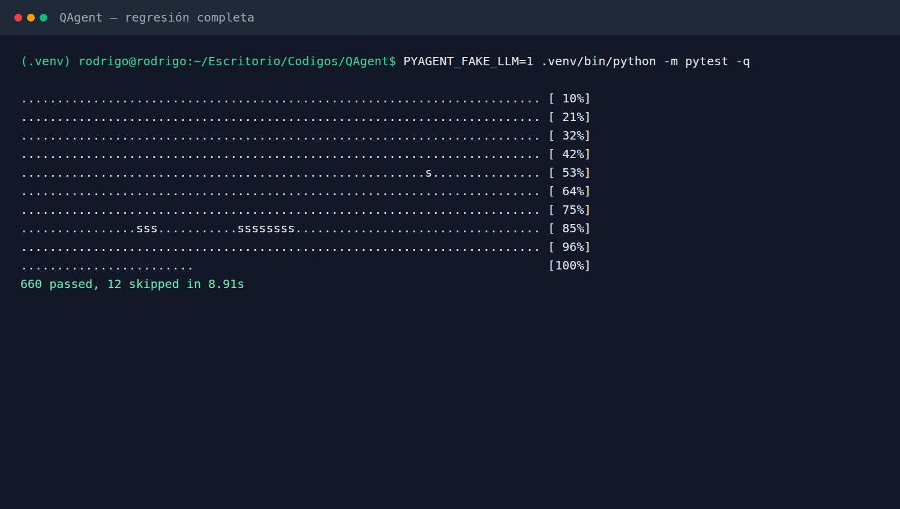
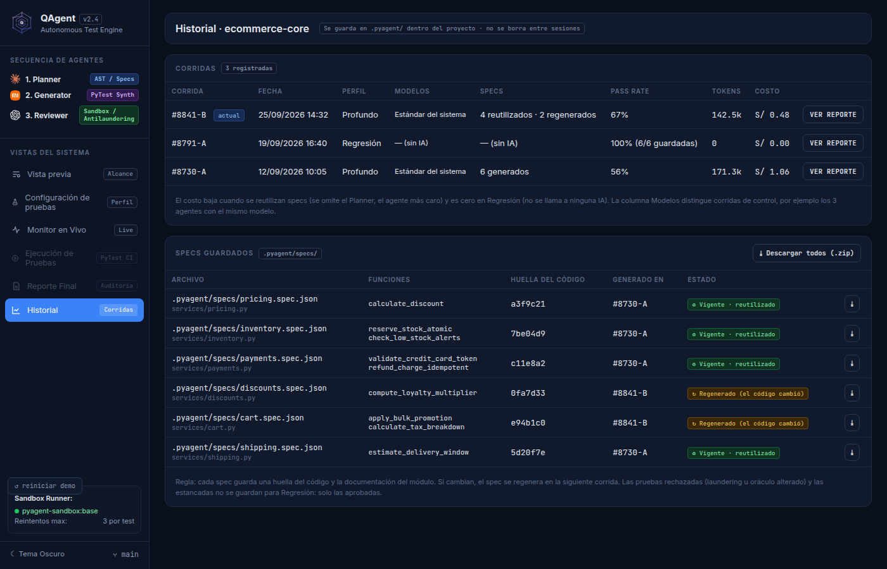
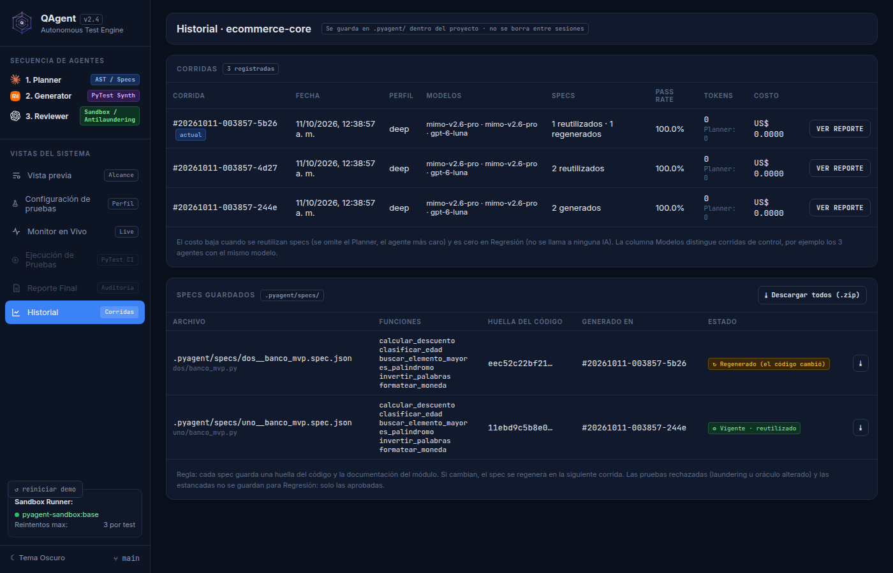
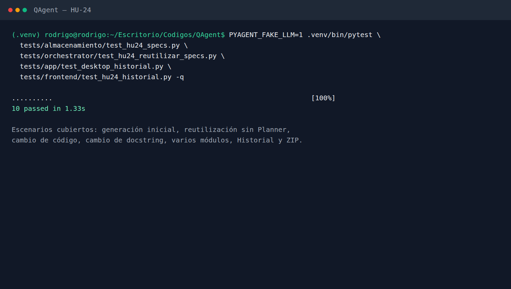
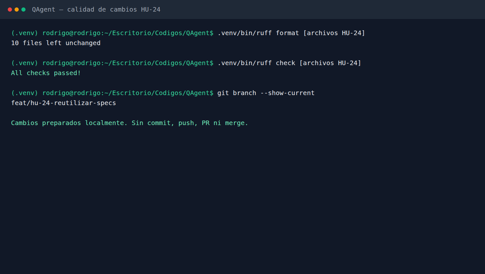
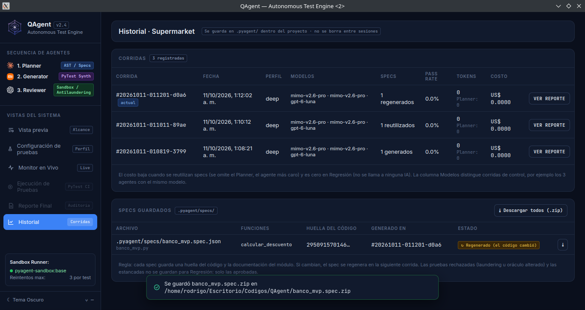
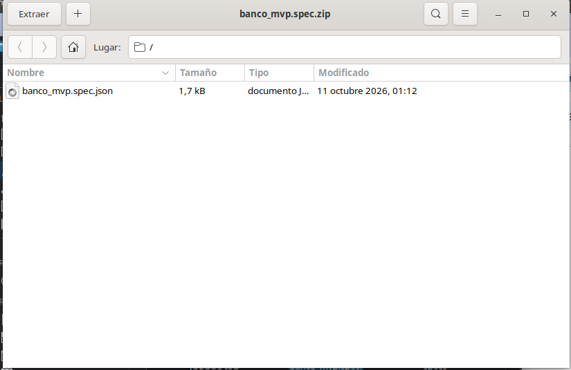

# HU-24 · Reutilizar specs cuando el código no cambió

**Informe de lo realizado** · 11 de octubre de 2026 · Responsable: Rodríguez Malca, Rodrigo Abel

## En pocas palabras

Antes, QAgent le pedía al Planner que analizara otra vez un archivo aunque nadie lo hubiera tocado. Eso repetía el mismo trabajo y, con una IA real, volvía a gastar tokens. Ahora guarda el plan de pruebas y una huella que funciona como el sello del archivo. Si el sello sigue igual, usa el plan guardado y se salta al Planner. Si alguien cambia el código o su documentación, crea un plan nuevo.

La pantalla «Historial» también muestra lo que ocurrió de verdad: qué planes se crearon, cuáles se reutilizaron y cuáles tuvieron que rehacerse. Desde ahí se puede descargar uno o todos en ZIP.

**Historia:** como equipo de QA, queremos reutilizar el plan de pruebas de un módulo que no cambió, para no pagar dos veces por el mismo análisis.

## Qué se revisó y qué se hizo

**1. Cómo saber si un archivo cambió.**
*Se revisó:* el analizador ya le pone a cada archivo una huella SHA-256. Esa huella cambia cuando cambia el código o un docstring.
*Se hizo:* se aprovechó esa misma huella, sin crear otro análisis ni ejecutar el código del usuario.

**2. Dónde queda guardado el plan.**
*Se revisó:* EN-07 ya guardaba información de cada prueba para usarla después.
*Se hizo:* eso se mantuvo tal como estaba y se agregó un archivo por módulo terminado en `.spec.json`. Por ejemplo, el plan de `banco_mvp.py` queda en `.pyagent/specs/banco_mvp.spec.json`. Las rutas anidadas reciben además un sufijo corto para evitar que dos módulos distintos terminen usando el mismo nombre. Allí se guarda la huella, todos los casos que propuso el Planner y la corrida donde nació.

**3. Evitar repetir el trabajo.**
*Se revisó:* todas las corridas empezaban llamando al Planner.
*Se hizo:* primero se busca un plan guardado con la misma huella. Si existe, se comprueba que tenga el formato correcto y la corrida pasa directamente al Generator y al Reviewer. El Planner no recibe ninguna llamada y en el Historial aparece con 0 tokens. El plan se guarda completo aunque Generator, Reviewer o Docker fallen después, para no perder las funciones que todavía no se habían procesado.

**4. Qué pasa cuando el archivo sí cambió.**
*Se revisó:* no quedaba claro si un plan era nuevo o si se había vuelto a crear por un cambio.
*Se hizo:* si la huella es distinta, QAgent vuelve a llamar al Planner y marca el plan como `regenerado`. Funciona igual si se cambia una línea del programa o solamente un docstring.

**5. Cada archivo se revisa por separado.**
*Se revisó:* un proyecto normalmente tiene varios módulos y no todos cambian al mismo tiempo.
*Se hizo:* si cambia uno de dos archivos, solo ese vuelve al Planner. El que sigue igual conserva su plan.

**6. Lo que se ve en el Historial.**
*Se revisó:* la pantalla tenía corridas y specs de ejemplo escritas a mano.
*Se hizo:* ahora lee los archivos que deja cada corrida. Muestra la huella, dónde se creó el plan y si fue generado, reutilizado o regenerado. También permite descargar un solo plan o todos juntos en ZIP.

**7. Pruebas automáticas.**
*Se revisó:* la ejecución rápida de referencia tenía 648 pruebas aprobadas y dejaba 14 fuera por usar el modo rápido.
*Se hizo:* se agregaron 12 pruebas para esta historia y todas pasan. La validación rápida actual terminó con 660 aprobadas y 14 excluidas por necesitar Docker o red. Al activar las pruebas de Docker en este equipo se encontró un problema de montaje de `/tmp` del entorno local; no corresponde a la lógica de HU-24.

## Criterios de aceptación

| # | Criterio | Cómo se cumple | Prueba |
|---|---|---|---|
| 1 | Guardar `.pyagent/specs/<modulo>.spec.json` con huella SHA-256 del código y docstrings | La spec modular guarda la huella existente del analizador, los contratos y sus datos de origen | 1, 3, 5, 6 |
| 2 | Si la huella no cambió, omitir Planner, reutilizar y registrar 0 tokens | La segunda corrida usa los contratos persistidos; la prueba comprueba que no existe ninguna llamada del Planner y que el Historial informa 0 tokens | 2, 3, 5 |
| 3 | Si el módulo cambió, regenerar su spec | Una huella distinta ejecuta nuevamente el Planner y registra `regenerado`, incluso si solo cambió el docstring | 2, 3, 5 |
| 4 | Consultar huella, corrida de origen y estado; descargar ZIP individual | El Historial real muestra esos campos y el backend guarda un ZIP válido con la spec seleccionada | 2, 3, 6 |
| 5 | Evidencia de dos corridas iguales y otra después de un cambio | Se hicieron tres corridas en la aplicación: generación, reutilización y regeneración; también se probó automáticamente un proyecto con dos módulos | 2, 3, 5 |

## Para qué se hizo

- No volver a pagar por el mismo análisis cuando un archivo sigue igual.
- Saber de qué corrida salió cada plan de pruebas.
- Rehacer solamente los planes de los archivos que cambiaron.
- Ver claramente en el Historial qué se creó, qué se reutilizó y qué se regeneró.
- Descargar los planes sin tener que buscarlos dentro de `.pyagent/`.

## Pruebas realizadas

### Prueba 1 · Resultados de las pruebas automáticas

Esta captura corresponde a una ejecución anterior con la IA simulada: 660 aprobadas y 12 omitidas. Después de la revisión se añadieron dos regresiones para impedir specs parciales y nombres repetidos. **Resultado actual:** las 12 pruebas de HU-24 pasan y `python test.py --rapido` termina con 660 aprobadas y 14 excluidas.

### Prueba 2 · El Historial antes y después

*Antes: la pantalla mostraba los datos de demostración escritos en el frontend.*

*Después: tres corridas reales realizadas sobre una copia temporal del banco.*

Se probaron dos módulos iguales. En la primera corrida se crearon los 2 planes. La segunda se hizo sin tocar nada y reutilizó ambos. Antes de la tercera se cambió solamente `dos/banco_mvp.py`. **Resultado:** el archivo intacto aparece como reutilizado y el modificado como regenerado. La segunda corrida muestra 0 tokens del Planner.

Los números de corrida y las huellas de la captura salieron de esa prueba. Como la IA simulada siempre registra 0 tokens, también se revisó directamente cuántas veces fue llamado el Planner: una vez al crear el plan, ninguna al reutilizarlo y una vez al regenerarlo.

### Prueba 3 · Casos obligatorios de reutilización y regeneración

La captura registra las 10 pruebas iniciales. Después se agregaron dos casos de regresión: conservar los 6 contratos aunque falle el Reviewer y evitar colisiones entre nombres de módulos. **Resultado actual:** 12 aprobadas. Revisan la primera corrida, una segunda sin cambios, cambios de código y docstring, varios módulos, fallos posteriores al Planner y la descarga ZIP.

En la segunda corrida la lista de llamadas del Planner queda vacía. Después de cambiar un módulo aparece una llamada y su estado queda como `regenerado`. Cuando hay dos módulos, solo vuelve a planificarse el que cambió.

### Prueba 4 · Formato, lint y rama de trabajo

Se revisó el formato del código con Ruff y el JavaScript con Node. **Resultado:** los archivos de HU-24 no tienen errores de formato, lint ni sintaxis. Todo sigue en `feat/hu-24-reutilizar-specs`; todavía no se hizo commit, push, pull request ni merge.

### Prueba 5 · Tres corridas desde la aplicación real

Se abrió QAgent con el proyecto `Supermarket` y se hicieron tres corridas sobre `banco_mvp.py`.

*Primera corrida: todavía no había una spec guardada, por eso se generó una nueva con la huella `11ebd9c5...`.*

*Segunda corrida: se ejecutó sin modificar el archivo. QAgent encontró la misma huella, reutilizó la spec anterior y conservó como origen la primera corrida.*

*Antes de la tercera corrida se cambió únicamente el docstring de «Calcula el precio final» a «Obtiene el precio final».*

*Tercera corrida: el cambio produjo la nueva huella `295091570146...`, así que la spec quedó marcada como regenerada y su corrida de origen se actualizó.*

Aunque el cliente simulado registra 0 tokens en todas las corridas, las llamadas muestran la diferencia: la primera y la tercera hicieron 11 llamadas al Planner; la segunda hizo 10 porque `banco_mvp.py` se saltó ese paso y usó su spec guardada.

### Prueba 6 · Descarga de las specs

Durante la prueba manual se detectó que crear un enlace con `Blob` no guardaba el archivo dentro de pywebview. Se corrigió para usar el diálogo nativo de guardado y se repitieron ambas descargas.

*Descarga general: QAgent confirmó que `specs_Supermarket.zip` quedó guardado en Descargas.*

*Descarga individual: el botón de `banco_mvp.py` también abrió y guardó su propio ZIP.*

*El ZIP individual se abrió y contiene solamente `banco_mvp.spec.json`.*

*Finalmente se abrió el JSON extraído. Allí aparecen la nueva huella completa, la tercera corrida como origen, el estado `vigente`, la acción `regenerado` y los contratos del Planner.*

