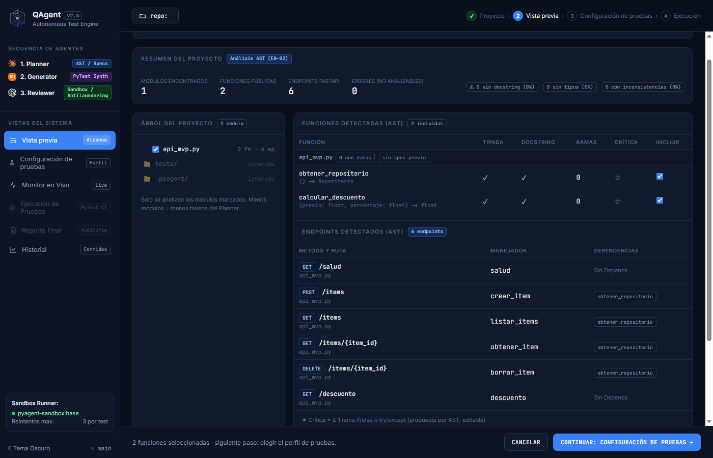
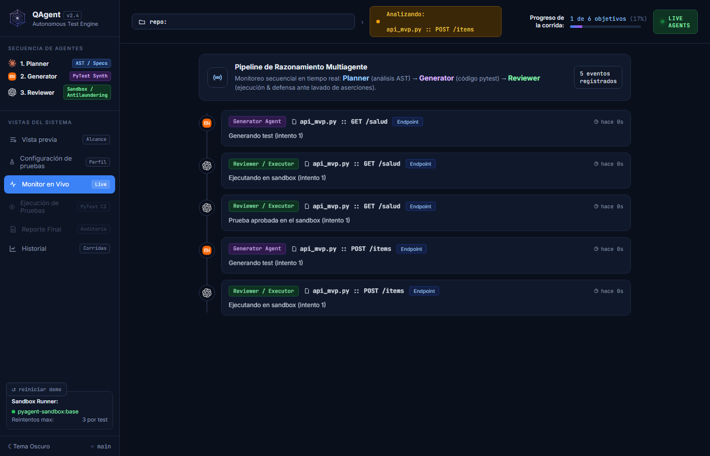
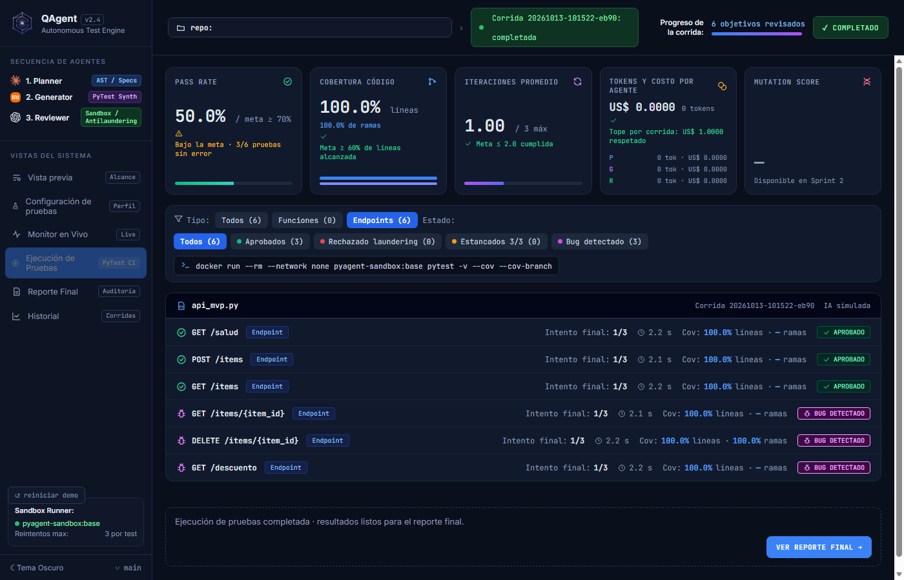
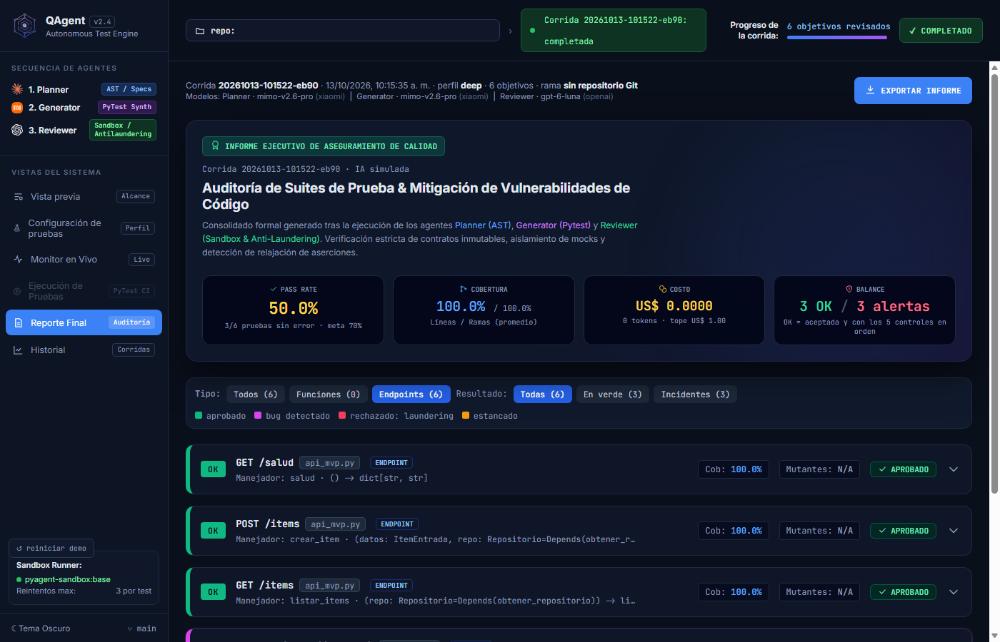
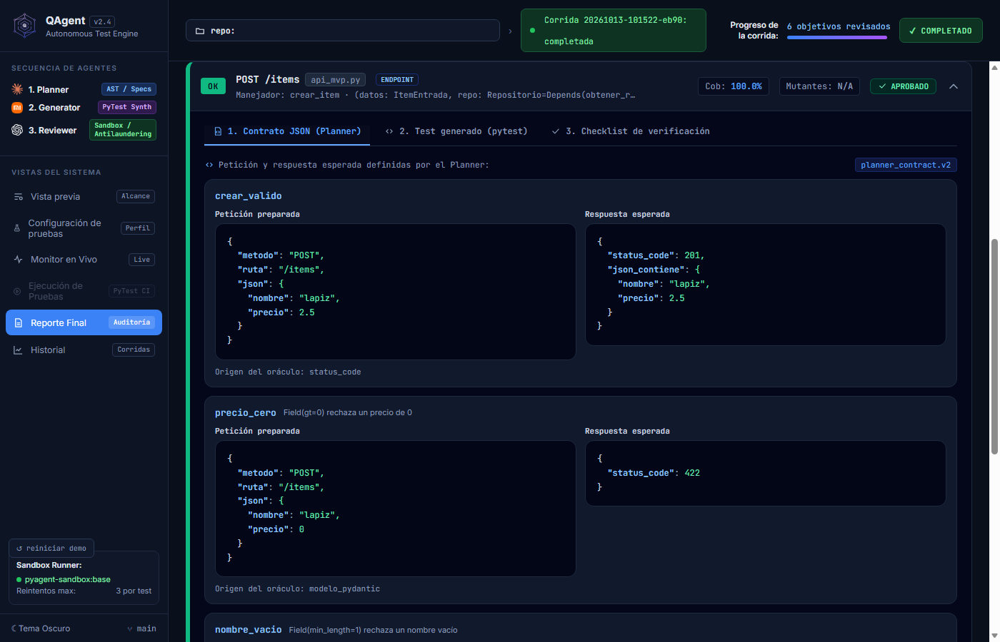
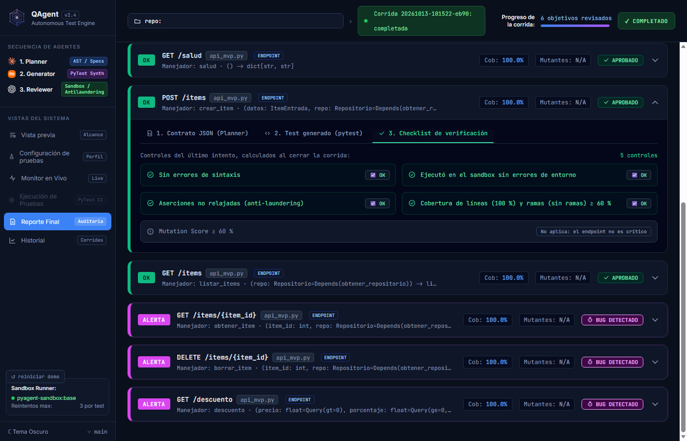
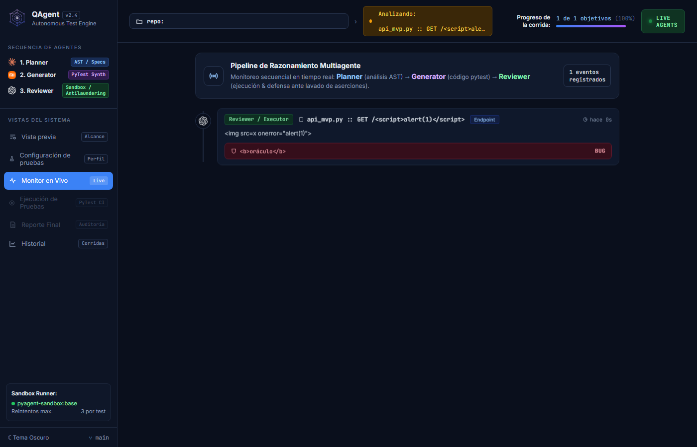
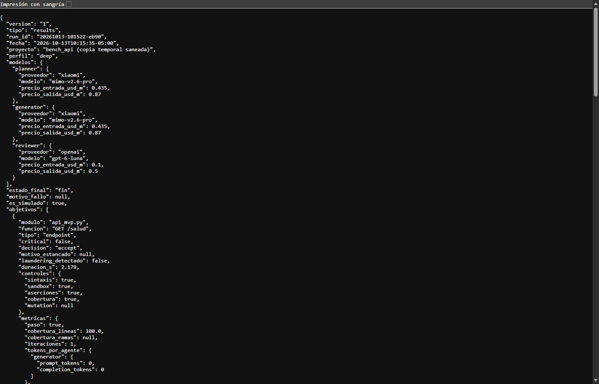

# HU-28 — Ver los endpoints en Ejecución y Reporte

Fecha de cierre técnico: 2026-10-13  
Rama: `feat/hu-28-endpoints-ejecucion-reporte`  
Responsable: Rodrigo Abel Rodríguez Malca  
Épica: 9 · Sprint: 1 · Prioridad: Alta  
Estado documentado: implementación y validación terminadas; commit, push y PR pendientes de autorización.

## 1. Ítem HU-28 del backlog

HU-28 solicita que QAgent permita al auditor ver los resultados de cada endpoint por su identidad HTTP —método y ruta— y diferenciarlos de las funciones Python convencionales en Vista previa, Monitor, Ejecución y Reporte.

## 2. Historia de usuario y objetivo

> Como auditor, quiero ver los resultados de cada endpoint con su método y ruta, separados de las funciones, para evaluar la calidad de la API sin revisar código a mano.

El objetivo técnico fue conservar la representación existente de funciones y añadir una representación coherente de endpoints como `POST /items`, usando datos reales del análisis, los contratos del Planner y `results.json`.

## 3. Criterios de aceptación originales

| Criterio | Definición |
|---|---|
| CA-01 | Vista previa, Monitor, Ejecución y Reporte muestran el endpoint como método/ruta. |
| CA-02 | Ejecución y Reporte ofrecen filtros Funciones / Endpoints con conteos. |
| CA-03 | El Reporte muestra petición, respuesta esperada y los cinco controles del endpoint. |
| CA-04 | Los textos no confiables se escapan y las cifras provienen del backend. |
| CA-05 | Existen capturas de una corrida sobre el banco y coinciden con el artefacto de resultados. |

El artefacto real del repositorio se llama `results.json`; no existe ni se creó un supuesto `sult.json`.

## 4. Estado inicial de las cuatro pantallas

- Vista previa recibía endpoints desde el analizador, pero solo representaba las funciones en su tabla principal.
- Monitor podía recibir el objetivo canónico de EN-15, pero no lo distinguía visualmente como endpoint y calculaba el porcentaje en JavaScript.
- Ejecución trataba todas las filas como funciones y no tenía filtro por tipo.
- Reporte trataba todos los objetivos como funciones; mostraba el contrato completo como JSON, sin separar petición y respuesta HTTP.

## 5. Diagnóstico de componentes y contratos

Los componentes reales son:

- `frontend/componentes/vista-previa/`;
- `frontend/componentes/monitor/`;
- `frontend/componentes/ejecucion/`;
- `frontend/componentes/informe/`;
- adaptadores Python `monitor_eventos.py`, `vista_ejecucion.py` y `vista_reporte.py`.

EN-15 y EN-16 ya dejaron disponible el discriminador `tipo` y usan como objetivo canónico de endpoint la cadena `MÉTODO /ruta`. El contrato del Planner conserva, dentro de cada caso, la entrada HTTP preparada, la salida esperada y el origen del oráculo. EN-16 guarda `tipo` en `results.json`. Para corridas antiguas sin ese campo, la vista conserva compatibilidad y clasifica el registro como función, sin inventar una ruta.

Los cinco controles oficiales se verificaron en `contracts/run_log.schema.json`, `src/pyagent/storage/registro.py`, la vista de reporte y sus pruebas: sintaxis, sandbox, aserciones/anti-laundering, cobertura y mutation score.

## 6. Dependencias con EN-15 y otras historias

EN-15 aporta Generator con `TestClient`, `dependency_overrides`, banco FastAPI y ejecución Docker. HU-27/EN-16 aportan descubrimiento y planificación de endpoints y el campo `tipo` persistido. Estas dependencias estaban integradas en `develop` antes de crear la rama HU-28.

HU-28 no modifica Planner, analizador AST ni contratos JSON. La única adaptación del orquestador añade el número de objetivos del plan a un evento ya existente para que el progreso visual use el plan efectivo y no el conteo preliminar del AST.

## 7. Diseño técnico de la solución

Se centralizó la interpretación en el backend:

1. `tipo_de()` resuelve `funcion` o `endpoint` con compatibilidad hacia atrás.
2. `identidad_de()` separa método y ruta únicamente cuando el objetivo canónico es verificable.
3. Las vistas Python entregan identidad, filtros, conteos, contrato HTTP y controles.
4. JavaScript renderiza esos datos y solo aplica filtros de presentación; no crea métricas.
5. Un endpoint incompleto se muestra como `Endpoint sin método/ruta`, sin etiqueta HTTP falsa.

## 8. Modificaciones en Vista previa

Vista previa ahora muestra el conteo de endpoints por separado, añade `fn` y `ep` al árbol de módulos y presenta una tabla específica con método/ruta, manejador y dependencias. Las funciones siguen en su tabla original.

## 9. Modificaciones en Monitor

Los eventos muestran la identidad canónica, una insignia `Endpoint` y el progreso calculado por Python. Durante la validación se detectó que el AST contaba dos helpers además de seis endpoints; el plan real solo contenía seis objetivos. El evento de planificación ahora comunica `objetivos_planificados`, y el progreso reemplaza la estimación del módulo por ese valor real.

## 10. Modificaciones en Ejecución

Cada fila recibe `tipo`, `identificador`, `metodo`, `ruta` e `identidad_completa`. Los endpoints se muestran como `GET /salud`, sin prefijo `test_` ni sufijo `()`. La barra superior usa el término neutral “objetivos revisados”. El estado vacío funciona también con combinaciones de filtros sin resultados.

## 11. Modificaciones en Reporte

El resumen y las tarjetas muestran método/ruta, badge de endpoint, manejador y firma. El reporte conserva los estados reales: tres aprobados y tres bugs detectados. La nota de mutation usa “el endpoint” cuando corresponde.

## 12. Implementación de filtros y conteos

Ejecución y Reporte reciben del backend:

| Filtro | Conteo real de la corrida |
|---|---:|
| Todos | 6 |
| Funciones | 0 |
| Endpoints | 6 |

El componente combina el filtro de tipo con el filtro de estado sin alterar ni duplicar resultados. Los conteos se generan en `vista_ejecucion.py` y `vista_reporte.py`; JavaScript no los recalcula.

## 13. Pestaña del contrato

Para endpoints, la pestaña presenta cada caso con:

- id y descripción disponibles;
- petición preparada por el contrato;
- respuesta esperada, incluido el estado y el cuerpo cuando existen;
- origen del oráculo declarado por el Planner.

No se infieren campos ausentes. Para funciones se mantiene la vista JSON anterior.

## 14. Checklist de cinco controles

El checklist usa los controles persistidos, en el orden oficial:

1. sin errores de sintaxis;
2. ejecución en sandbox sin errores de entorno;
3. aserciones no relajadas (anti-laundering);
4. cobertura de líneas y ramas frente a la meta;
5. mutation score, o `No aplica` si el endpoint no es crítico.

## 15. Seguridad y escapado de textos

Método, ruta, manejador, firma, descripciones, origen, contrato, feedback y trazas pasan por `escHtml()` o `jsonHL()`, que primero escapa el contenido. La prueba automatizada comprueba la presencia de esas barreras. La prueba visual inyectó de forma controlada `<script>`, `` y `<b>`: se mostraron literalmente y no se registraron excepciones ni ejecución de código.

CAP-08 es una prueba hostil controlada, no un dato de la corrida del banco.

## 16. Archivos creados y modificados

Código modificado:

- `src/pyagent/storage/vista_ejecucion.py`;
- `src/pyagent/storage/vista_reporte.py`;
- `src/pyagent/app/monitor_eventos.py`;
- `src/pyagent/orchestrator/corrida.py`;
- `src/pyagent/orchestrator/orquestador.py`;
- JavaScript y CSS de Vista previa, Monitor, Ejecución e Informe.

Pruebas modificadas o creadas:

- `tests/storage/test_vista_ejecucion.py`;
- `tests/storage/test_vista_reporte.py`;
- `tests/app/test_monitor_eventos.py`;
- `tests/app/test_desktop_vista_previa.py`;
- `tests/orchestrator/test_orquestador.py`;
- `tests/frontend/test_estructura.py`;
- `tests/frontend/test_hu28_endpoints.py`.

Evidencias creadas: este informe, `pruebas_ejecutadas.md`, `qa_visual.json`, `evidencias_sha256.json`, seis JSON saneados y diez imágenes.

## 17. Pruebas unitarias

Las pruebas cubren identidad HTTP, diferenciación de tipos, conteos, filtros, datos incompletos, corridas antiguas, contrato HTTP, cinco controles, seguridad, progreso y estructura frontend.

La suite focalizada terminó con `106 passed in 1.56s`. Ruff terminó con `All checks passed!` y `node --check` devolvió código 0 para los cuatro scripts modificados.

## 18. Pruebas de integración

La suite rápida completa terminó con `880 passed, 17 deselected in 13.66s`. Además, la prueba Docker `test_banco_api_generado_detecta_exactamente_los_tres_bugs` terminó con `1 passed in 14.77s`.

La corrida de evidencia usó el flujo real `ejecutar_corrida()` sobre una copia temporal de `bench_api`, IA simulada, Generator y Reviewer reales y sandbox Docker sin red. Resultado: 6 endpoints, 3 aceptados, 3 bugs, 0 errores técnicos, 0 estancados, 0 tokens y US$0.00, en 13.154 s.

## 19. Pruebas visuales

Se renderizó el frontend real en Microsoft Edge headless mediante CDP porque el plugin Browser no estaba disponible. Se revisaron 960 × 600, 1400 × 900 y 1920 × 1080. No se observaron desbordes que oculten controles, superposición de conteos ni pérdida de scroll; las pestañas, filtros y expansión de tarjetas funcionaron. El navegador registró cero excepciones o mensajes de consola.

Evidencias responsivas:

- [Ejecución a 960 × 600](img/RESP-960x600-ejecucion.png)
- [Reporte a 1920 × 1080](img/RESP-1920x1080-reporte.png)

## 20. Verificación de métricas con artefactos JSON

`results.saneado.json`, derivado de `results.json`, registra 6 objetivos, 3 aceptados, 3 bugs, pass rate 50 %, cobertura promedio 100 % y costo US$0.00. `vista_ejecucion.json` y `vista_reporte.json` exponen los mismos totales. Las rutas personales fueron sustituidas por una descripción saneada; no se alteraron resultados ni métricas.

Los hashes de los artefactos, capturas y resultado de QA visual están en [evidencias_sha256.json](evidencias_sha256.json).

## 21. Capturas y evidencias

| ID | Evidencia | Fuente |
|---|---|---|
| CAP-01 | [Vista previa](img/CAP-01-vista-previa-endpoints.png) | Análisis estático real de `bench_api`. |
| CAP-02 | [Monitor](img/CAP-02-monitor-endpoints.png) | Eventos de la corrida real. |
| CAP-03 | [Ejecución](img/CAP-03-ejecucion-filtro-endpoints.png) | Vista backend de la corrida real. |
| CAP-04 | [Reporte](img/CAP-04-reporte-endpoints.png) | Vista backend de la corrida real. |
| CAP-05 | [Contrato](img/CAP-05-contrato-http.png) | Contrato Planner persistido en el detalle real. |
| CAP-06 | [Checklist](img/CAP-06-checklist-cinco-controles.png) | Cinco controles persistidos. |
| CAP-07 | [JSON](img/CAP-07-results-json.png) | Copia saneada de `results.json`. |
| CAP-08 | [Seguridad](img/CAP-08-html-escapado.png) | Entrada hostil controlada, no corrida del banco. |

Artefactos inspeccionables: [results saneado](artefactos/results.saneado.json), [resumen](artefactos/resumen_ejecucion.json), [eventos](artefactos/eventos_monitor.json), [vista previa](artefactos/vista_previa.json), [vista de ejecución](artefactos/vista_ejecucion.json) y [vista de reporte](artefactos/vista_reporte.json).

## 22. Problemas encontrados y correcciones

1. Las cuatro pantallas heredaban lenguaje y formato de funciones. Se introdujo identidad tipada sin romper corridas antiguas.
2. El progreso inicial indicaba 8 elementos porque el AST detectaba dos helpers y seis endpoints, mientras el Planner descartaba los helpers. Se añadió al evento de plan el total efectivo; el Monitor queda en 6 desde que el plan está disponible.
3. El encabezado real conservaba “funciones revisadas”. Se cambió por “objetivos revisados”.
4. Mutation mostraba “la función” en una tarjeta de endpoint. La nota ahora selecciona el sujeto según `tipo`.
5. La primera captura visual evidenció estas inconsistencias; todas las capturas finales fueron regeneradas después de corregirlas.

## 23. Matriz de cumplimiento CA-01 a CA-05

| CA | Estado | Evidencia exacta |
|---|---|---|
| CA-01 | Cumplido | CAP-01 a CAP-04; pruebas de Vista previa, Monitor y vistas storage. |
| CA-02 | Cumplido | Filtros backend 0 funciones / 6 endpoints en CAP-03 y CAP-04; pruebas de conteos y listas vacías. |
| CA-03 | Cumplido | CAP-05, CAP-06 y prueba de `vista_reporte` que exige petición/respuesta y exactamente cinco controles. |
| CA-04 | Cumplido | Métricas desde backend; pruebas de escapado; CAP-08 sin ejecución HTML; cero errores de consola. |
| CA-05 | Cumplido | Corrida Docker real, CAP-03 a CAP-07 y JSON con 3 aprobados/3 bugs coincidentes. |

## 24. Riesgos y limitaciones

- Antes del evento del plan, el Monitor todavía puede mostrar el conteo preliminar del AST; desde la planificación usa el total real. Esto evita inventar un total antes de conocer el plan.
- La clasificación retrocompatible supone `funcion` cuando una corrida antigua no guardó `tipo`; no intenta adivinar endpoints antiguos.
- Las capturas se realizaron en Edge headless, no dentro de la ventana nativa pywebview. Se usaron el HTML, CSS y JavaScript reales y las vistas Python reales, pero conviene una comprobación manual de humo en la aplicación de escritorio antes del PR si el equipo la exige.
- IA simulada significa cero tokens y resultados deterministas; no demuestra comportamiento de un proveedor LLM real, que está fuera del alcance de esta HU.

## 25. Conclusiones

HU-28 queda técnicamente demostrada dentro de su alcance. QAgent diferencia funciones y endpoints, conserva la identidad HTTP en las cuatro pantallas, filtra y cuenta desde datos del backend, presenta el contrato y cinco controles reales, y protege los textos no confiables. La corrida completa del banco procesó automáticamente los seis endpoints en Docker y sus cifras coinciden con los artefactos saneados.

No se modificaron Planner, AST, contratos JSON ni la lógica de generación/revisión de EN-15. No se hizo commit, push ni Pull Request.

## 26. Resumen para Notion

| Descripción / Historia de Usuario / Objetivo | Criterios de Aceptación / Detalles Clave |
|---|---|
| Como auditor, quiero visualizar endpoints por método y ruta, diferenciados de las funciones Python. Se adaptaron Vista previa, Monitor, Ejecución y Reporte usando el tipo y contrato ya integrados por EN-15/EN-16. | CA-01 a CA-05 cumplidos. Corrida real: 6 endpoints, 3 aprobados, 3 bugs detectados, Docker sin red, 0 tokens y US$0.00. Hay filtros backend, contrato HTTP, cinco controles, escapado probado y ocho capturas principales. |

**Mensaje breve para el grupo:** HU-28 quedó implementada y validada sobre el banco FastAPI real. Las cuatro vistas muestran `MÉTODO /ruta`; Ejecución y Reporte separan funciones/endpoints con conteos del backend; el Reporte presenta petición, respuesta y cinco controles. La suite rápida dio 880 pruebas aprobadas y la prueba Docker del banco también aprobó. Quedan pendientes únicamente la revisión del equipo y, con autorización, commit, push y PR.
