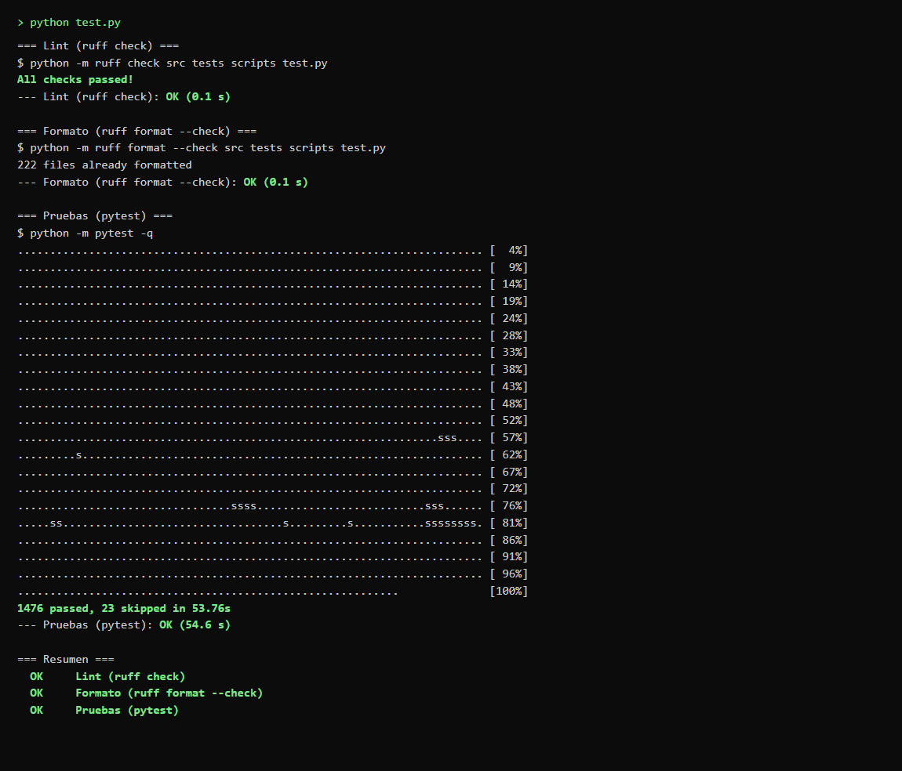
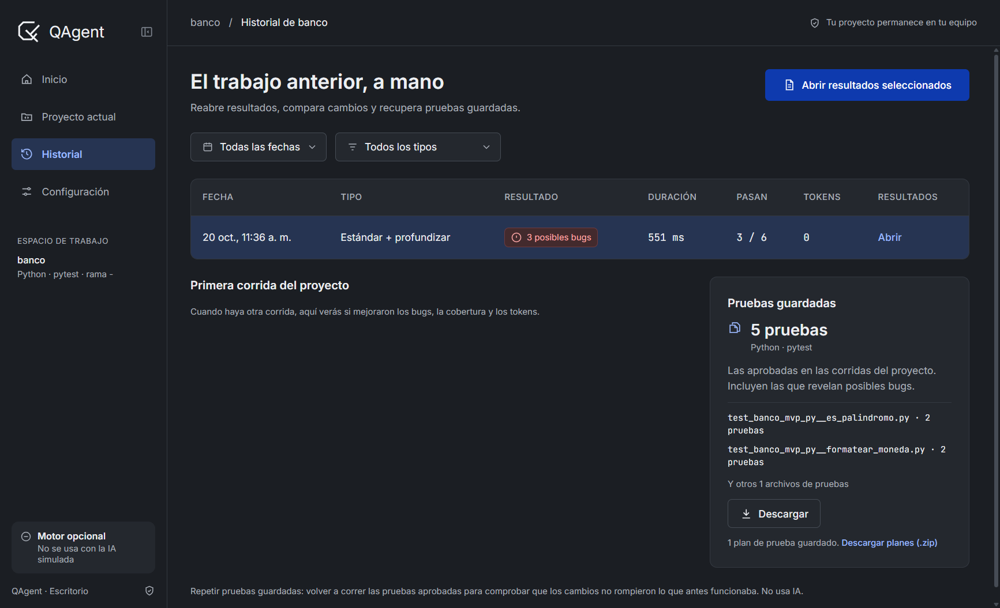
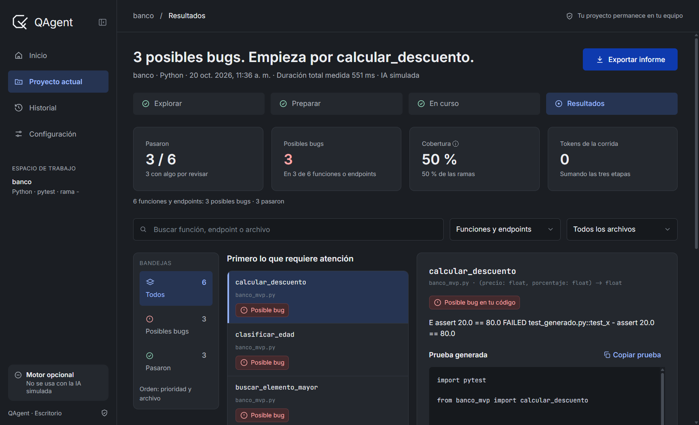
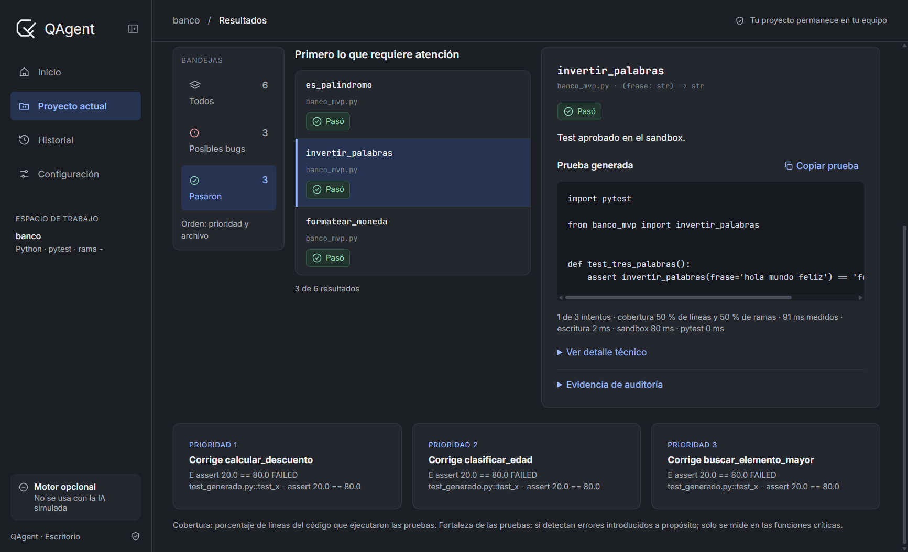

# issue-115 — Medición real de tiempos de la corrida

**Informe de lo realizado** — 20 de octubre de 2026 — Responsable: Rodrigo

- **Rama:** `feat/issue-115-tiempo-ejecucion`
- **Issue:** [#115](https://github.com/AngelOncoy/QAgent/issues/115)
- **Base:** `origin/develop` en `6c4bd50` (misma base que `HEAD`, sin commits nuevos)

## En pocas palabras

Antes, QAgent no medía cuánto tardaba una corrida ni en qué se iba el tiempo; el reloj del Monitor era
solo del navegador y no quedaba guardado. Ahora el backend mide con un reloj monótono la corrida completa,
cada función o endpoint, cada reintento y las etapas (Planner, Generator, Reviewer, sandbox y pytest), y
esos valores se ven en el Monitor, en Resultados, en los informes exportados y en una columna nueva del
Historial. Las corridas viejas no inventan una duración: muestran `—`.

## Qué se revisó y qué se hizo

**1. Punto de partida.**
*Se revisó:* la corrida no guardaba duración; el Monitor solo interpolaba con `Date.now()` y los informes
no tenían tiempo. No había medición por función ni por reintento.
*Se hizo:* se agregó un módulo de tiempos (`tiempos.py`) con reloj monótono y marcas UTC inyectables, y se
instrumentó el orquestador con `finally` para conservar la duración incluso cuando hay error, timeout o
cancelación.

**2. Corrida y funciones.**
*Se revisó:* solo existían estados y tokens; no había inicio, fin ni duración por objetivo.
*Se hizo:* `ResultadoCorrida` y `ResultadoObjetivo` ahora guardan inicio, fin, duración, duración por
etapa y el detalle de cada intento (generación, revisión, sandbox y pytest).

**3. Reintentos.**
*Se revisó:* un reintento se contaba como un intento más, pero su tiempo no se distinguía del total.
*Se hizo:* cada intento aporta su duración y sus tramos; el tiempo del reintento queda incluido una sola
vez en la función y en la corrida.

**4. Persistencia y compatibilidad.**
*Se revisó:* `run.json` y `results.json` no tenían campos de tiempo y el schema rechazaba propiedades
nuevas.
*Se hizo:* se agregaron campos opcionales al schema (sin tocar los contratos públicos existentes) y se
guardan en `run.json` y `results.json`. Una corrida anterior sigue siendo válida y el Historial devuelve
`duracion_s: null` en vez de deducirla de las fechas.

**5. Pantallas.**
*Se revisó:* el Monitor mostraba un contador local, Resultados no tenía total y el Historial no tenía
columna de tiempo.
*Se hizo:* el Monitor se reancla con el `transcurrido_s` del backend; Resultados muestra el total medido y
el desglose por caso; el Historial agrega la columna **Duración** (con `—` para datos viejos).

**6. Informes exportados.**
*Se revisó:* Markdown, HTML y PDF no incluían duración.
*Se hizo:* los tres formatos incluyen el total medido y el tiempo por etapa, con el mismo valor que la
pantalla.

**7. Pruebas automáticas.**
*Se revisó:* no había pruebas de tiempos y las suites existentes comparaban diccionarios exactos.
*Se hizo:* se agregaron 20 pruebas nuevas o ampliadas, con relojes falsos (sin `sleep`) en las de tiempo,
incluyendo compatibilidad de corridas viejas, schema, vistas, exportación y la interfaz. La suite completa
queda en **1476 aprobadas y 23 omitidas**.

## Para qué se hizo

- Saber cuánto tarda una corrida y en qué etapa se va el tiempo, sin mirar el reloj a mano.
- Comparar corridas con una cifra confiable y no con una estimación del navegador.
- Detectar si el costo está en la IA, en el sandbox o en pytest.
- Mantener el Historial honesto: si una corrida no se midió, se muestra `—` y no un número inventado.
- Conservar el tiempo aunque la corrida falle, se detenga o el sandbox se caiga.

## Pruebas realizadas

### Prueba 1 — Todo el proyecto sigue en orden

Se ejecutó la orden completa del repositorio (lint, formato y todas las pruebas) el 20 de octubre de 2026.

**Resultado:** `All checks passed!`, `222 files already formatted`, **1476 passed, 23 skipped**. Las 23
omitidas son las que requieren Docker o red, no disponibles en esta máquina.

### Prueba 2 — El Historial muestra la duración medida

Se generó una corrida real del flujo (IA simulada y sandbox simulado, 0 tokens) sobre el proyecto de
ejemplo `bench`, con **551 ms** medidos por el backend, y se abrió el Historial en la aplicación de
escritorio.

**Resultado:** la columna **Duración** aparece entre Resultado y Pasan y muestra **551 ms**, el valor
guardado por la corrida. Una corrida anterior sin medición mostraría `—`.

### Prueba 3 — Resultados muestra el total medido

Se abrió la misma corrida en la pantalla Resultados.

**Resultado:** la cabecera muestra **Duración total medida 551 ms**, además de la fecha y de la marca
`IA simulada`.

### Prueba 4 — El detalle por función muestra sus tramos

Se seleccionó una función aprobada de la misma corrida y se desplazó hasta sus datos.

**Resultado:** el detalle muestra **91 ms medidos**, **escritura 2 ms**, **sandbox 80 ms** y
**pytest 0 ms**. El `pytest 0 ms` es correcto en esta prueba porque el ejecutor simulado no produce el
reporte JUnit del que se lee ese tiempo; con Docker real se obtiene del archivo de resultados.

## Nota sobre las capturas

Las capturas 2, 3 y 3b son de la aplicación de escritorio real, abierta con su ventana real, sobre una
corrida del flujo real con agentes y sandbox simulados (sin claves ni llamadas a una API). La cifra de
551 ms y los tramos son mediciones de esa corrida, no valores escritos a mano. La captura 1 es la salida
real de la orden de pruebas convertida a imagen.

## Auditoría final recuperada

La auditoría se retomó sin repetir la implementación ni la suite completa. Se confirmó que ningún archivo
de código cambió después de la ejecución registrada de 1476 pruebas aprobadas, que no había otro proceso de
pytest activo y que `HEAD` y `origin/develop` seguían en `6c4bd50`.

Docker Desktop estuvo disponible durante la continuación. Los 23 tests marcados `docker` terminaron con
**22 aprobados y 1 fallo ambiental**: `test_timeout_mata_el_contenedor_y_lo_elimina` encontró el contenedor
detenido `1479dc75b035`, creado a las 12:09 por una ejecución anterior de `api_mvp`. La repetición aislada
encontró exactamente el mismo contenedor preexistente; los contenedores creados por la auditoría se
eliminaron correctamente. No se borró ese artefacto ajeno a #115.

Además se ejecutó una comprobación específica con el código de este worktree (`PYTHONPATH=src`) y Docker
real: un test pasó con **1.415 s** de sandbox y **0.254 s** informados por `junit.xml`. También se comprobó
con reloj inyectado que una corrida detenida por error conserva **0.5 s** en `run.json`, y se generaron
informes temporales: Markdown y HTML mostraron **12.3 s**, Markdown incluyó el desglose por etapa y el PDF
expuso **12.3 s** en el texto extraído. El registro completo está en `auditoria-final.txt`.

No se hizo commit, push ni PR: los cambios quedan en el árbol de trabajo de la rama
`feat/issue-115-tiempo-ejecucion` para revisión.
