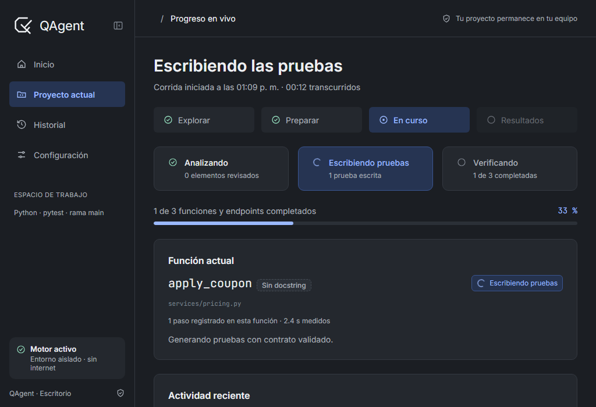
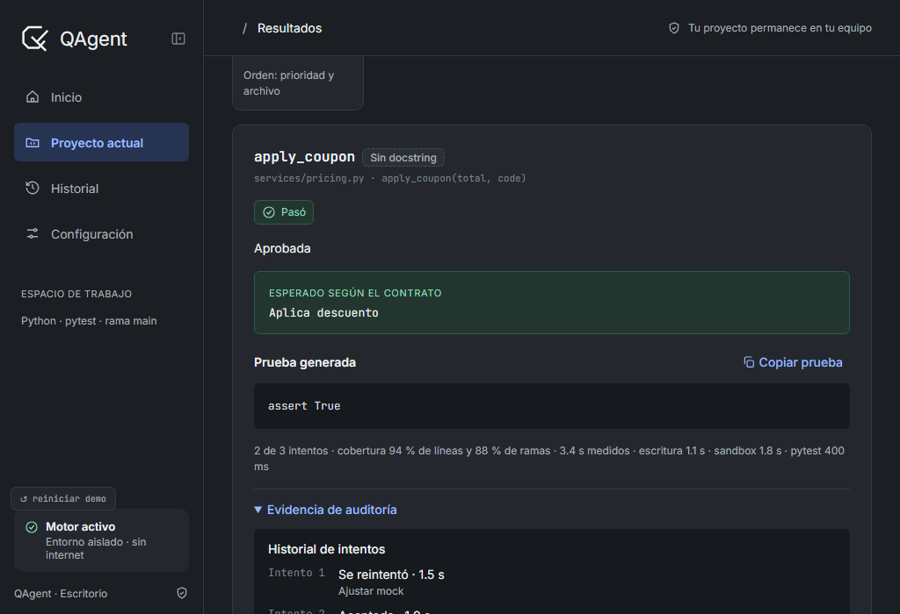
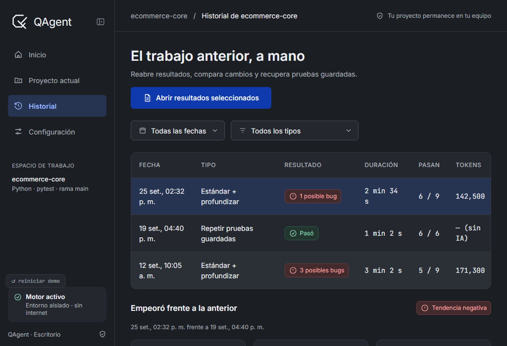
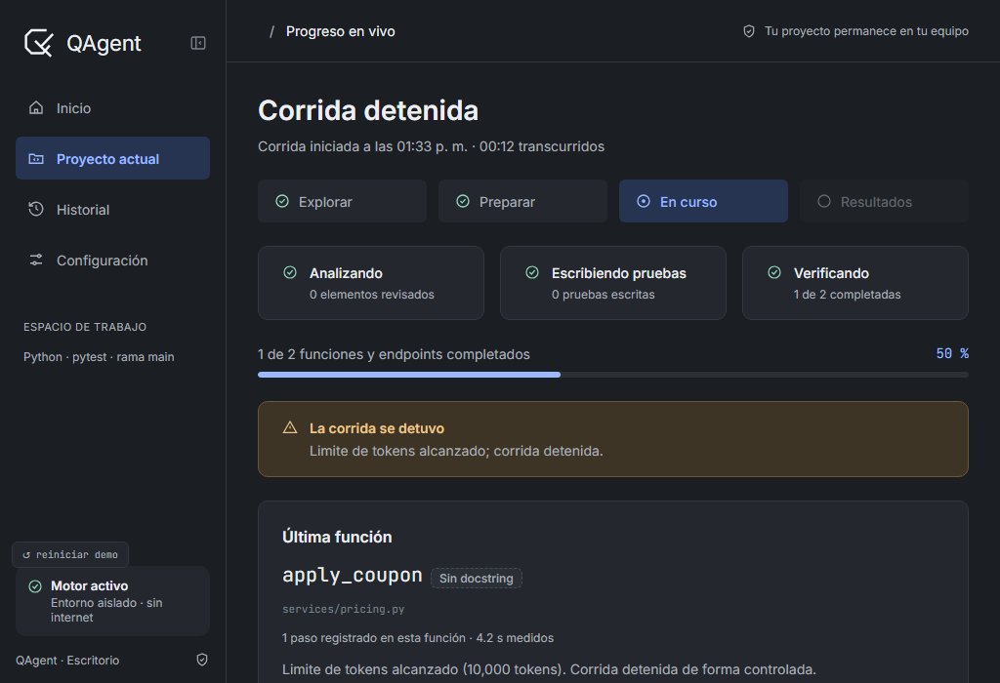
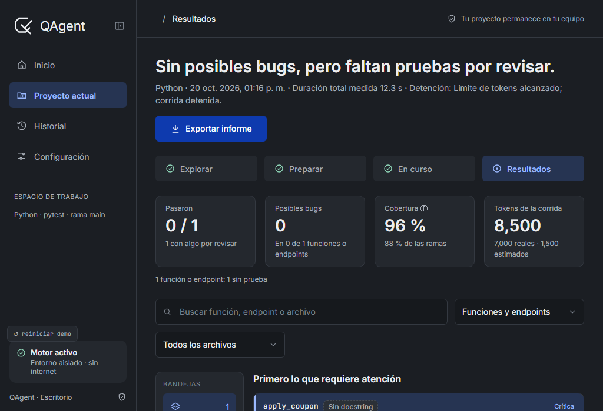
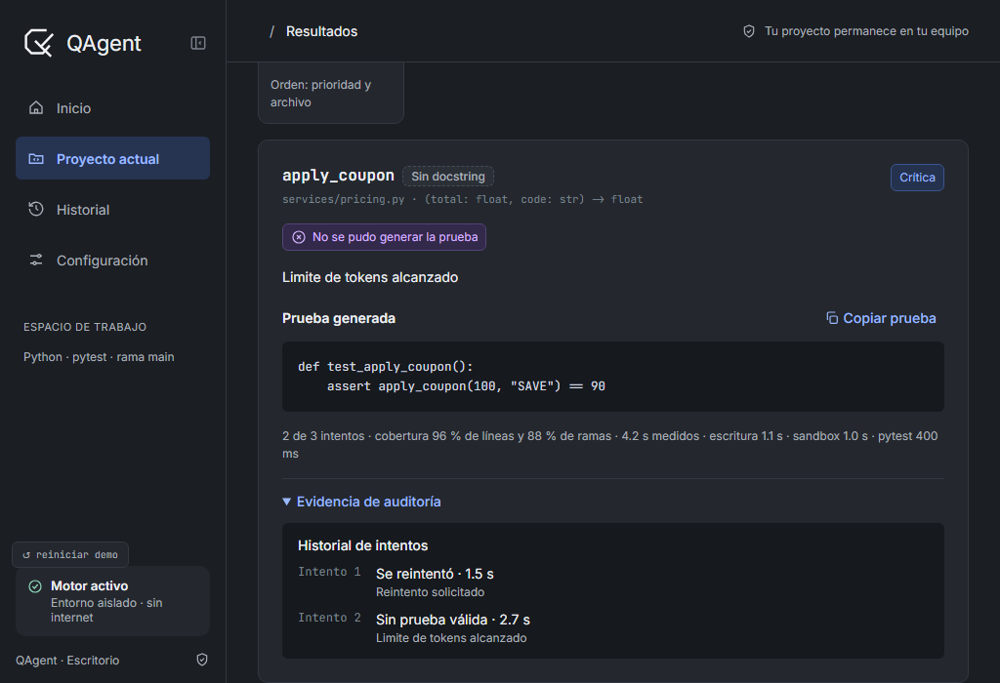
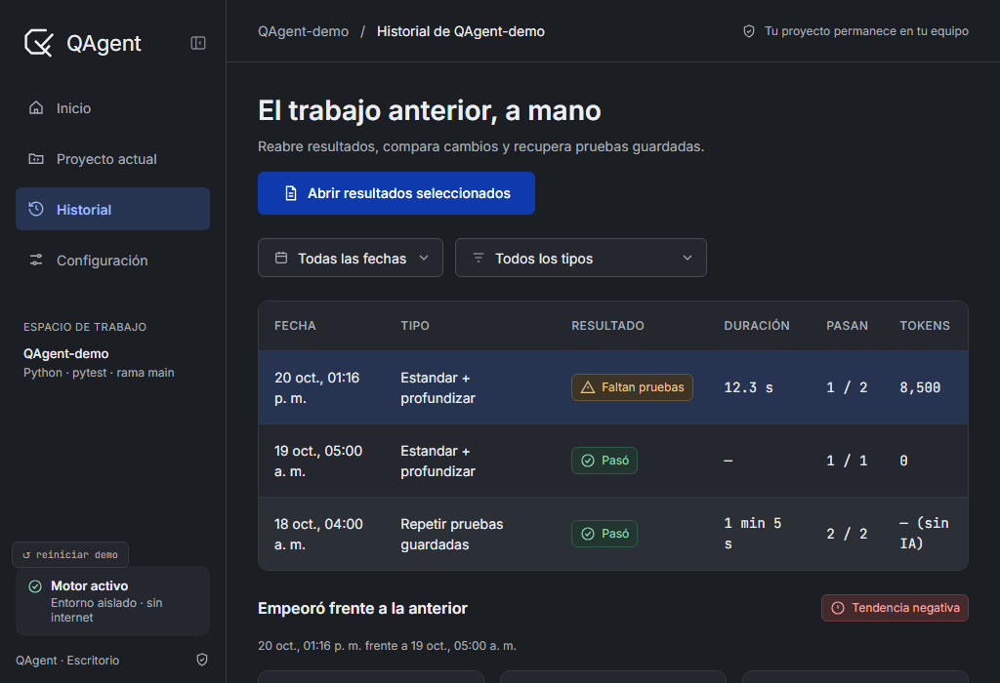

# Issue #115 — tiempos reales de ejecución

Informe técnico final e integración con issue #114 — 20 de octubre de 2026.

- Rama: `feat/issue-115-tiempo-ejecucion`
- Issue: https://github.com/AngelOncoy/QAgent/issues/115
- Commit de protección de #115: `de128450f3ca8e96a08ffc2efabcfb964650bd91`
- Develop incorporado: `24cf16a5860289ea975b885e002d5e148cb3fa3b` (PR #120, issue #114)
- Commit de integración: `562f7ed293a8233e3cc403af18474c2238902e25`

## Resultado

QAgent mide con reloj monotónico la duración total de la corrida, de cada función o
endpoint, de Planner, Generator y Reviewer, del sandbox y de pytest. Cada intento y
reintento conserva sus tramos. Las marcas y duraciones se persisten, se muestran en
Monitor, Resultados e Historial y se exportan a Markdown, HTML y PDF. Una corrida
antigua sin tiempos continúa siendo válida y muestra `—` en lugar de un valor inventado.

La integración con #114 conserva al mismo tiempo la etiqueta **Sin docstring**. El único
conflicto textual apareció en `ejecucion.js`; se resolvió manteniendo en el objeto real:

```javascript
sinDocstring: docstringDeObjetivo(m.modulo, p.funcion) === false,
duracionGeneracion: p.duracion_generacion_s,
duracionSandbox: p.duracion_sandbox_s,
duracionPytest: p.duracion_pytest_s,
```

No quedaron propiedades duplicadas ni marcadores de conflicto. `monitor.js` se fusionó
automáticamente y se auditó de forma manual: conserva la etiqueta de #114, el objetivo
actual, `transcurrido_s`, la duración del objetivo, la duración final del backend, la
detención del contador y la prevención de intervalos duplicados.

## Implementación auditada

- Medición: `src/qagent/orchestrator/tiempos.py`, `corrida.py`, `orquestador.py`,
  `regresion.py` y eventos del orquestador.
- Persistencia y compatibilidad: schemas `run_log`, `review_result` y `detalle`, registro,
  vistas de ejecución/reporte e Historial.
- Pytest y sandbox: lectura de duración desde JUnit y conservación del tiempo real.
- Interfaz: Monitor, Resultados e Historial; el contador visual no es la fuente de verdad.
- Exportación: informes Markdown, HTML y PDF con total y desglose disponibles.
- Errores y cancelaciones: el cierre en `finally` conserva fin y duración aun cuando la
  corrida se detiene o falla.

## Matriz de criterios de aceptación

| # | Criterio de la issue | Resultado | Evidencia principal |
|---|---|---|---|
| 1 | El Monitor muestra un contador de tiempo transcurrido | Cumple | evento con `transcurrido_s`, prueba frontend y captura de Monitor |
| 2 | Se registra el inicio y fin de la corrida | Cumple | modelos, persistencia y `test_issue115_tiempos.py` |
| 3 | Se registra la duración de cada objetivo | Cumple | resultado por función/endpoint y pruebas del orquestador/storage |
| 4 | Los reintentos se incluyen correctamente | Cumple | detalle por intento sin doble conteo y prueba de reintentos |
| 5 | Se registra el tiempo empleado en ejecutar las pruebas | Cumple | duración de sandbox y pytest desde JUnit |
| 6 | El Reporte muestra la duración total | Cumple | Markdown, HTML y PDF validados |
| 7 | Las corridas detenidas conservan el tiempo registrado | Cumple | error controlado persistió 0.5 s y marca de fin |
| 8 | Los datos se guardan en el historial cuando corresponde | Cumple | `run.json`, `results.json`, vista y captura de Historial |
| 9 | Las corridas antiguas sin duración siguen siendo compatibles | Cumple | campos opcionales y visualización `—` |
| 10 | No se confunde duración estimada con duración medida | Cumple | leyenda “Duración total medida” y datos del backend |
| 11 | Se agregan pruebas automatizadas | Cumple | pruebas nuevas de orchestrator, sandbox, storage y frontend |

Resultado: **11/11 criterios cumplidos después de integrar #114**.

## Validación automatizada posterior al merge

Todas las órdenes se ejecutaron con `QAGENT_FAKE_LLM=1`; no hubo llamadas reales a
proveedores.

- Frontend #114 + #115: **15 passed in 0.78s**.
- Suite focalizada (orquestador, persistencia, sandbox, vistas, reportes, Monitor,
  Historial y regresiones): **94 passed in 5.84s**.
- Sintaxis Node de `ejecucion.js`, `monitor.js`, `vista-previa.js` y `utils.js`: OK.
- `python test.py`: Ruff check OK, Ruff format check OK (`223 files already formatted`),
  **1511 passed in 182.52s**, 0 fallos y 0 omitidas; fase total de pruebas: 183.3 s.
- `git diff --check`: limpio antes de cerrar el merge.

La captura histórica `prueba-1-pruebas.png` corresponde al estado anterior a integrar
#114 (**1476 passed, 23 skipped**) y se conserva como antecedente. El resultado vigente
de la combinación es el de 1511 pruebas documentado en `pruebas.txt`.

## Docker

En la auditoría anterior, Docker real produjo **22 passed y 1 failed** por un contenedor
detenido preexistente (`1479dc75b035`), que no se eliminó. También se comprobó una
ejecución real aislada: sandbox 1.415 s, pytest 0.254 s, exit code 0.

En la suite posterior a la integración Docker estuvo disponible: no hubo omisiones y las
1511 pruebas pasaron. Al finalizar no quedó ningún contenedor con la etiqueta
`qagent=sandbox`. Durante esta integración no se ejecutó una eliminación manual del
contenedor preexistente.

## Validación visual

Se renderizó el `index.html` real del frontend a 1024 × 700 mediante Playwright, porque
el entorno no ofrecía el plugin de navegador ni se abrió una ventana pywebview. Se
inyectaron estado y eventos con la forma del backend para comprobar la combinación; por
tanto, estas tres capturas son auténticas del frontend integrado, pero sus cifras son
fixtures de QA y no una corrida productiva.

- Monitor: objetivo `apply_coupon`, etiqueta Sin docstring, 00:12 transcurridos y 2.4 s
  del objetivo; el contador se detuvo al finalizar.
- Resultados: etiqueta Sin docstring, total 12.3 s, Generator 1.1 s, sandbox 1.8 s,
  pytest 400 ms y reintentos de 1.5 s y 1.9 s.
- Historial: columna de duración con 2 min 34 s.
- Sin `undefined`, `NaN`, errores de consola, errores de página ni scroll horizontal.







Las capturas anteriores de la aplicación de escritorio se conservan como evidencia de la
implementación original de #115: Historial con 551 ms, Resultados con total medido y
detalle por función con sus tramos.

## Riesgos y limitaciones

- La validación visual integrada no recorrió el puente pywebview; cubrió el frontend real
  y la forma de sus datos/eventos mediante Playwright.
- La captura histórica de la suite no representa el conteo posterior al merge; el log
  textual sí registra el resultado vigente.
- No existe un informe separado para Notion dentro de este paquete de evidencias.

No se realizó push, no se creó Pull Request y no se modificó `develop` directamente.

## Actualización: integración con PR #121

Se incorporó `origin/develop` en `ba23ac511b2661547a97fab61a28902e16d6d144`
(PR #121, límites y alertas de consumo de tokens) mediante merge normal. El commit de
integración es `8f765496b62e8419de6b5d012ce526ff8c221ee0`.

Se resolvieron cinco conflictos conservando simultáneamente:

- los tiempos monotónicos de corrida, objetivo, etapas e intentos de #115;
- la etiqueta **Sin docstring** de #114;
- el consumo real/estimado, límite, alerta y detención controlada de #121.

También se auditaron los tres archivos compartidos fusionados automáticamente
(`ejecucion.js`, `registro.py` y `vista_ejecucion.py`). La auditoría detectó y corrigió
dos bordes semánticos: un límite alcanzado en el último objetivo ahora deja la corrida
global en fallo controlado, y una cancelación durante regresión ya no se pierde y
conserva los resultados parciales.

La validación focalizada combinada produjo **216 passed in 7.75s**. La validación
completa con `QAGENT_FAKE_LLM=1` produjo Ruff correcto, 226 archivos con formato
correcto y **1540 passed in 186.38s**, sin fallos ni omisiones; la fase total duró
187.1 s. Docker estuvo disponible y sus pruebas reales se ejecutaron dentro de esa
suite. No hubo llamadas LLM reales.

Los **11/11 criterios de aceptación de #115** siguen cumplidos. Los casos combinados
comprueban corrida normal, presupuesto suficiente, agotamiento, reintentos sin doble
conteo, persistencia/compatibilidad antigua, error técnico y cancelación.

La QA visual adicional renderizó el frontend real a 1024 × 700 con Playwright e
inyectó fixtures con la forma exacta de eventos/resultados del backend. Confirmó Monitor,
Resultados, detalle de reintentos e Historial con tiempos, **Sin docstring** y tokens;
la corrida antigua muestra `–`. No hubo `undefined`, `NaN`, errores de consola/página
ni desbordamiento horizontal. No se probó el puente pywebview en esta pasada.








