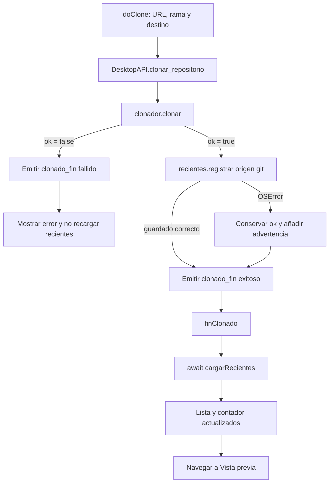
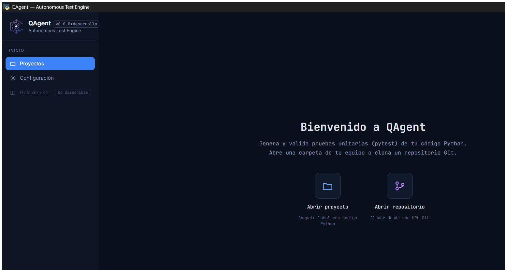
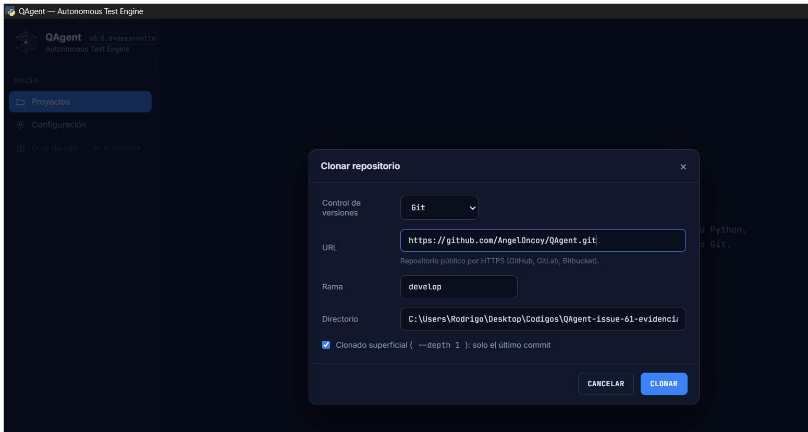
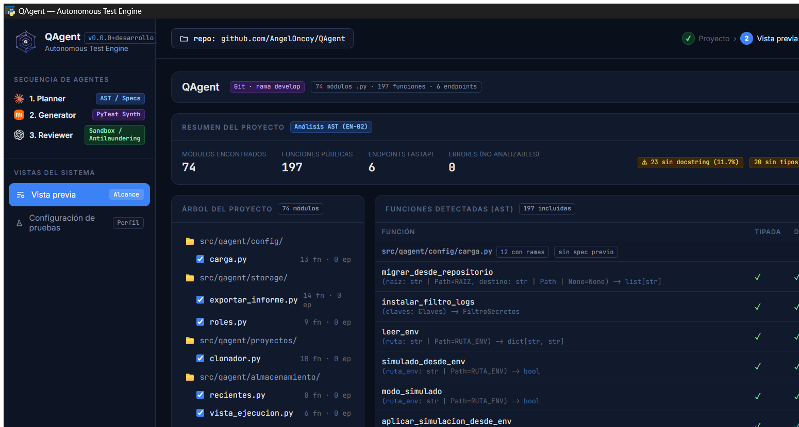
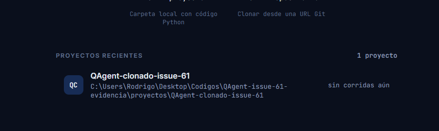
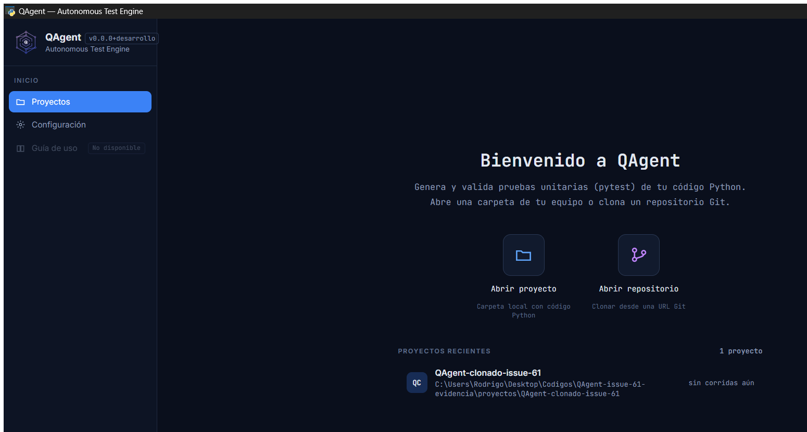
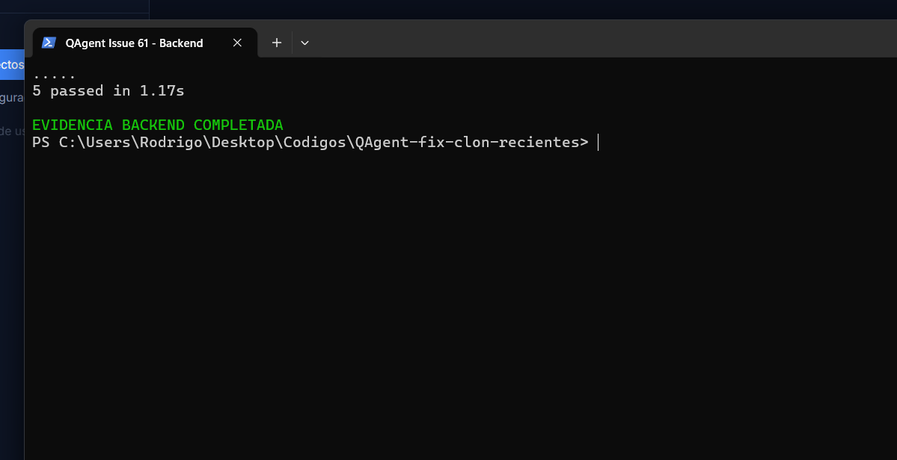
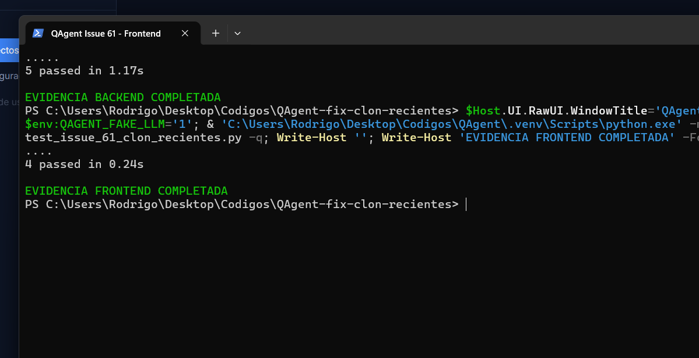
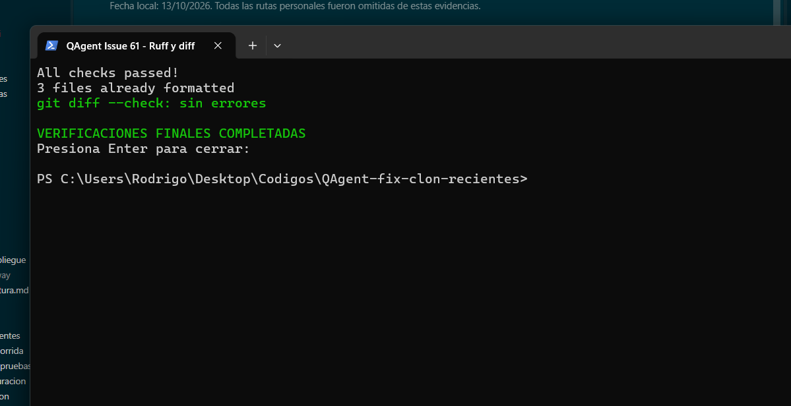

# QAgent — Informe técnico de la issue #61

## FIX — Repositorios clonados no aparecen automáticamente en Proyectos recientes

| Dato | Valor |
|---|---|
| Proyecto | QAgent |
| Issue | [#61 — FIX — Repositorios clonados no aparecen automáticamente en Proyectos recientes](https://github.com/AngelOncoy/QAgent/issues/61) |
| Responsable | Rodrigo Abel Rodríguez Malca |
| Sprint | Sprint 1 |
| Fecha de validación | 16 de octubre de 2026 |
| Rama de trabajo | `fix/issue-61-clon-recientes` |
| Rama de destino | `develop` |
| Commit base | `7dc800d73da6af5cc0a4de336bbc455809b8898d` |
| Estado | Implementación y validación terminadas; commit, push y Pull Request pendientes |
| Repositorio | [AngelOncoy/QAgent](https://github.com/AngelOncoy/QAgent) |

## 1. Introducción

QAgent es una aplicación de escritorio local construida con Python, pywebview y
JavaScript vanilla. Analiza estáticamente proyectos Python y coordina agentes para
generar y validar pruebas pytest. La pantalla **Inicio** es el punto de entrada para
abrir una carpeta local o clonar un repositorio Git. En esa pantalla, **Proyectos
recientes** evita que el usuario tenga que volver a localizar proyectos ya usados.

La issue #61 corrige una inconsistencia entre esos dos accesos. **Abrir proyecto**
registraba la carpeta validada en recientes, mientras que **Abrir repositorio**
terminaba la clonación y navegaba a Vista previa sin persistir el clon ni refrescar
Inicio. El repositorio existía correctamente en disco, pero solo aparecía en la lista
después de abrirlo manualmente como proyecto local.

## 2. Objetivos

### Objetivo general

Integrar el resultado exitoso de la clonación Git con el almacenamiento existente de
Proyectos recientes y con su representación inmediata en Inicio, sin alterar el
comportamiento previo de Abrir proyecto ni el flujo de análisis.

### Objetivos específicos

- Registrar automáticamente nombre, origen `git`, ruta local y URL del clon.
- Persistir el registro antes de notificar el fin de la clonación al frontend.
- Recargar la lista y su contador antes de navegar a Vista previa.
- Reutilizar la deduplicación por ruta del almacenamiento existente.
- Conservar el registro después de reiniciar QAgent.
- No registrar una clonación fallida, inválida o incompleta.
- Tratar un fallo exclusivo de persistencia como advertencia, sin convertir en fallo
  una clonación Git que sí terminó correctamente.
- Proteger los textos interpolados en la notificación mediante escape HTML.
- Añadir regresiones automatizadas backend y frontend y comprobar el flujo real en
  la aplicación de escritorio.

## 3. Descripción del problema

### Situación inicial

El flujo de clonación aceptaba la URL, la rama y el destino, ejecutaba `git clone` en
un hilo, emitía progreso y, al finalizar, enviaba `clonado_fin`. El frontend cerraba
el modal y abría Vista previa. Sin embargo, ningún punto del flujo llamaba a
`recientes.registrar()` ni volvía a consultar `listar_recientes()`.

### Pasos de reproducción del comportamiento reportado

1. Iniciar QAgent y seleccionar **Abrir repositorio**.
2. Introducir una URL Git pública, una rama válida y una carpeta destino.
3. Esperar a que la clonación termine y se abra Vista previa.
4. Volver a Inicio.
5. Observar que el clon no se incorporó a Proyectos recientes.
6. Elegir **Abrir proyecto** y seleccionar la carpeta clonada.
7. Comprobar que recién entonces aparece en recientes.

### Resultado observado y esperado

| Aspecto | Antes de la corrección | Resultado esperado |
|---|---|---|
| Clonación Git | Correcta | Correcta |
| Registro en recientes | Ausente | Automático tras éxito |
| Actualización de Inicio | No ocurría | Inmediata |
| Acción adicional | Abrir manualmente la carpeta | Ninguna |
| Persistencia entre sesiones | Solo después de Abrir proyecto | Desde la clonación |

El impacto era una experiencia incoherente: una operación exitosa no quedaba
reflejada en el historial de trabajo y obligaba a repetir una selección manual.

## 4. Análisis técnico y causa

### Flujo Abrir proyecto

`modal-abrir.js` obtiene una carpeta mediante
`window.pywebview.api.select_folder()`, solicita su inspección y, tras la confirmación,
llama a `DesktopAPI.abrir_proyecto()`. Ese método:

1. revalida la carpeta con `proyecto_local.inspeccionar_carpeta()`;
2. descarta carpetas sin código Python;
3. llama a `recientes.registrar(nombre, "local", ruta)`;
4. prepara el almacenamiento del proyecto;
5. devuelve los datos usados por `loadProject()` para abrir Vista previa.

La persistencia forma parte explícita de este flujo en
`src/qagent/app/desktop.py`, función `abrir_proyecto()`.

### Flujo Abrir repositorio

`doClone()` en `modal-clonar.js` llama a
`window.pywebview.api.clonar_repositorio(url, rama, dir, shallow)`. El backend ejecuta
`clonador.clonar()` en un hilo y comunica `clonado_avance` y `clonado_fin` mediante
`DesktopAPI.emit_event()`. `puente-python.js` entrega el evento final a
`finClonado()`.

Antes de la corrección, el backend emitía directamente:

```python
self.emit_event("clonado_fin", asdict(resultado))
```

Y el frontend navegaba directamente:

```javascript
setTimeout(() => {
  closeModal();
  loadProject(nombreRepo(url), 'git', url, br, r.destino);
  toast(`Repositorio clonado en <span class="mono">${r.destino}</span>`);
}, 600);
```

### Persistencia y renderizado existentes

`src/qagent/almacenamiento/recientes.py` ya proporcionaba todo lo necesario:

- `registrar()` escribe de forma atómica en `~/.qagent/recientes.json`;
- `_clave()` normaliza la ruta con `normpath()` y `normcase()`;
- al registrar, se elimina cualquier entrada anterior con la misma clave;
- `listar()` devuelve hasta diez entradas visibles y comprueba si la ruta existe.

En el frontend, `cargarRecientes()` consulta `DesktopAPI.listar_recientes()`, asigna
`RECIENTES` y llama a `renderRecientes()`. Este último reconstruye la lista y deriva
el contador con singular o plural desde `RECIENTES.length`.

### Causa comprobada

La causa estaba en ambos extremos de la integración:

- el backend de clonación no llamaba a `recientes.registrar()` después de un éxito;
- el frontend no llamaba a `cargarRecientes()` al recibir `clonado_fin` exitoso.

No faltaba un mecanismo de persistencia ni era necesario crear otro. Faltaban la
invocación en el momento correcto y la sincronización visual posterior.

## 5. Diseño de la solución

La corrección conserva responsabilidades: `clonador` determina el resultado Git,
`recientes` persiste y deduplica, `DesktopAPI` coordina, e Inicio renderiza.



La condición `resultado.ok` es la frontera de seguridad: una clonación fallida no
entra al registro. Si Git tuvo éxito pero la escritura de recientes lanza `OSError`,
el evento conserva `ok: true` y agrega `advertencia`. Así se comunica con precisión
qué operación falló.

## 6. Implementación del backend

Archivo: `src/qagent/app/desktop.py`.

El resultado se convierte primero en un diccionario mutable. Solo cuando
`resultado.ok` es verdadero se obtiene el nombre desde la carpeta destino y se usa
el almacenamiento existente:

```python
datos = asdict(resultado)
if resultado.ok:
    nombre = Path(resultado.destino).name or clonador.nombre_repositorio(url)
    try:
        recientes.registrar(nombre, "git", resultado.destino, url=url)
    except OSError as exc:
        bitacora.registro.warning(
            "El repositorio se clonó, pero no se pudo registrar en recientes: %s",
            exc,
        )
        datos["advertencia"] = (
            "El repositorio se clonó correctamente, pero no se pudo guardar "
            "en Proyectos recientes."
        )
self.emit_event("clonado_fin", datos)
```

Aspectos relevantes:

- **Nombre:** se toma de `Path(resultado.destino).name`; existe respaldo con
  `nombre_repositorio(url)`.
- **Origen:** se registra explícitamente como `git`.
- **Identidad persistida:** nombre, ruta local, URL y fecha quedan en el formato ya
  utilizado por `recientes.json`.
- **Orden:** el intento de persistencia ocurre antes de `clonado_fin`. La prueba
  backend verifica literalmente el orden `registrar → evento`.
- **Errores:** no se captura el error de Git como error de almacenamiento ni
  viceversa. Un `OSError` al guardar se registra en bitácora y viaja como advertencia.
- **Fallos Git:** cuando `resultado.ok` es falso no se ejecuta `registrar()`.

No se cambió `clonador.py`, su validación de URL/rama, la limpieza de destinos
creados por un clon fallido ni el flujo de Abrir proyecto.

## 7. Implementación del frontend

Archivo: `src/qagent/frontend/componentes/inicio/modal-clonar.js`.

`finClonado()` pasó a ser asíncrona. La rama de error conserva el retorno temprano;
la rama exitosa espera la actualización de recientes antes de navegar:

```javascript
async function finClonado(r){
  clonando = false; $('cloneCancel').disabled = false;
  if(!r.ok){
    $('cloneErrTxt').textContent = r.error || 'Error desconocido al clonar.';
    $('cloneErr').classList.remove('hide');
    $('cloneForm').classList.remove('hide');
    $('cloneProg').classList.add('hide');
    vUrl(); return;
  }
  $('cloneTitle').textContent = 'Listo';
  $('cloneBar').style.width = '100%';
  const url = $('url').value, br = $('branch').value;
  await cargarRecientes();
  setTimeout(() => {
    closeModal(); loadProject(nombreRepo(url), 'git', url, br, r.destino);
    const mensaje = `Repositorio clonado en <span class="mono">${escHtml(r.destino)}</span>`;
    if(r.advertencia) toast(`${mensaje}<br>Advertencia: ${escHtml(r.advertencia)}`, I('alertc','var(--amber-400)',16), 8000);
    else toast(mensaje);
  }, 600);
}
```

`cargarRecientes()` consulta nuevamente Python y llama a `renderRecientes()`. El
contador no se incrementa manualmente: se vuelve a derivar de la lista real:

```javascript
$('recCount').textContent = RECIENTES.length
  + (RECIENTES.length===1 ? ' proyecto' : ' proyectos');
```

La navegación a Vista previa se conserva después de la recarga. Tanto el destino
como la advertencia pasan por `escHtml()` antes de insertarse en el `toast`, evitando
interpretar contenido externo como HTML.

## 8. Archivos modificados

| Archivo | Tipo de cambio | Función involucrada | Explicación | Justificación |
|---|---|---|---|---|
| `src/qagent/app/desktop.py` | Modificado | `DesktopAPI.clonar_repositorio()` | Registra clones exitosos y diferencia errores de persistencia | Integrar Git con el almacenamiento existente |
| `src/qagent/frontend/componentes/inicio/modal-clonar.js` | Modificado | `finClonado()` | Recarga recientes antes de Vista previa y muestra advertencias escapadas | Actualización inmediata de lista y contador |
| `tests/app/test_desktop_clonado_recientes.py` | Creado | Cinco pruebas de regresión | Cubre orden, persistencia, deduplicación, fallos, advertencia y rama específica | Proteger el contrato backend y el uso real de Git local |
| `tests/frontend/test_issue_61_clon_recientes.py` | Creado | Cuatro pruebas de contrato frontend | Verifica recarga, rama de error, advertencia y contador | Evitar regresiones en JavaScript vanilla |

Los archivos de documentación y evidencias se detallan aparte porque no forman parte
de la implementación funcional.

## 9. Pruebas automatizadas

Las cifras siguientes corresponden a ejecuciones reales ya registradas. Las suites
se superponen; por ello no se suman entre sí.

| Alcance | Comando registrado | Resultado |
|---|---|---|
| Backend específico | `python -m pytest tests/app/test_desktop_clonado_recientes.py -q` | `5 passed in 1.17s` |
| Frontend específico | `python -m pytest tests/frontend/test_issue_61_clon_recientes.py -q` | `4 passed in 0.24s` |
| Frontend completo | `python -m pytest tests/frontend -q` | `80 passed in 1.12s` |
| Suite rápida sin Docker/red | `python -m pytest -q -m "not docker and not red"` | `1033 passed, 19 deselected in 25.29s` |
| Ruff lint | `python -m ruff check <archivos Python de la issue>` | `All checks passed!` |
| Ruff format | `python -m ruff format --check <archivos Python de la issue>` | `3 files already formatted` |
| Integridad del diff | `git diff --check` | Sin errores |

Las cinco pruebas backend comprueban:

1. registro antes del evento y persistencia del nombre, origen, ruta y URL;
2. ausencia de duplicados al registrar dos veces el mismo destino;
3. ausencia de registro ante clonación fallida;
4. advertencia de almacenamiento sin falso fallo de Git;
5. clonación real y offline de `feature/demo` desde un repositorio Git local.

Las cuatro pruebas frontend comprueban que la recarga ocurre antes de
`loadProject()`, que la rama fallida no recarga, que la advertencia no bloquea la
navegación y se escapa, y que Inicio actualiza lista y contador. La suite general
también conserva las pruebas previas del clonador, incluida la eliminación de la
carpeta residual creada por Git en un fallo y la protección de destinos existentes.

Todas las pruebas del sistema se ejecutaron con `QAGENT_FAKE_LLM=1`; no hubo llamadas
a proveedores LLM reales.

## 10. Validación funcional en escritorio

La comprobación usó QAgent real mediante pywebview en Windows, con un perfil aislado
en `C:\Users\Rodrigo\Desktop\Codigos\QAgent-issue-61-evidencia`. El archivo personal
normal de recientes no fue modificado.

| Paso | Resultado real | Estado |
|---|---|---|
| Inicio con perfil vacío | El repositorio de prueba no aparecía; la sección vacía se oculta por diseño | Aprobado |
| Configuración | URL oficial, rama `develop` y destino aislado | Aprobado |
| Clonación | Git terminó y se abrió Vista previa con rama `develop` | Aprobado |
| Registro automático | Al volver a Inicio apareció `QAgent-clonado-issue-61` sin usar Abrir proyecto | Aprobado |
| Contador | Pasó del estado vacío a `1 proyecto` | Aprobado |
| Persistencia | Después de cerrar y reiniciar QAgent continuó la entrada | Aprobado |
| Duplicados | Abrir manualmente la misma carpeta mantuvo una sola entrada | Aprobado |
| Cierre | La aplicación fue cerrada correctamente | Aprobado |

El clon real quedó en la rama `develop` y `origin` apuntó a
`https://github.com/AngelOncoy/QAgent.git`. Los fallos de clonación y almacenamiento
no se provocaron manualmente; se validaron de forma automatizada para evitar cambios
destructivos.

## 11. Evidencias fotográficas

### CAP-01 — Inicio antes de la clonación



Muestra el perfil aislado antes de agregar el repositorio. La interfaz oculta la
sección de recientes cuando la lista tiene cero elementos. Demuestra la línea base y
que el proyecto de prueba aún no existía en Inicio. Criterio relacionado: registro
automático y actualización inmediata.

### CAP-02 — Configuración de clonación



Muestra la URL pública, la rama `develop`, el destino estable y el clonado
superficial. Demuestra que la validación usó una rama elegida y una ruta controlada.
Criterios relacionados: rama diferente, nombre y ubicación local.

### CAP-03 — Clonación exitosa



Vista previa real del repositorio clonado, identificada como Git y rama `develop`.
Demuestra que la navegación posterior al clon se conservó. Criterio relacionado:
mantener el flujo de análisis y las funcionalidades existentes.

### CAP-04 — Proyecto registrado automáticamente


Evidencia principal: el proyecto aparece en recientes al volver a Inicio sin haber
usado Abrir proyecto. Se muestran nombre y ruta local. Criterios relacionados:
registro automático, actualización inmediata y datos correctos.

### CAP-05 — Contador actualizado



Recorte de la lista que permite leer `1 proyecto` junto a una única entrada.
Demuestra coherencia entre listado y contador. Criterio relacionado: actualización
inmediata de la interfaz.

### CAP-06 — Persistencia después del reinicio


Inicio después de cerrar y volver a iniciar QAgent con el mismo perfil aislado. La
entrada continúa visible. Criterio relacionado: conservación entre sesiones.

### CAP-07 — Sin duplicados



Inicio después de seleccionar la misma carpeta mediante Abrir proyecto. Continúan
una entrada y el contador `1 proyecto`. Criterio relacionado: deduplicación por ruta.

### CAP-08 — Pruebas backend



Terminal con `5 passed in 1.17s`. Demuestra la regresión backend específica,
incluidos éxito, persistencia, rama, duplicados, fallo y error de almacenamiento.

### CAP-09 — Pruebas frontend



Terminal con `4 passed in 0.24s` y `QAGENT_FAKE_LLM=1`. Demuestra el contrato de
recarga, navegación, advertencia y contador.

### CAP-10 — Verificaciones finales



Terminal con `All checks passed!`, `3 files already formatted` y
`git diff --check: sin errores`. Demuestra lint, formato e integridad mecánica del
diff.

Los hashes y tamaños originales están en
[`evidencias_sha256.json`](evidencias_sha256.json). CAP-04, CAP-06 y CAP-07 tienen el
mismo SHA-256 porque el estado final renderizado es idéntico: una entrada y contador
igual a uno. Las tres capturas corresponden a momentos distintos del procedimiento,
pero la interfaz determinista no muestra marcas temporales.

## 12. Problemas encontrados y soluciones

| Problema | Causa comprobada | Solución aplicada | Resultado |
|---|---|---|---|
| El clon no aparecía en recientes | `clonar_repositorio()` no llamaba a `recientes.registrar()` | Registrar únicamente después de `resultado.ok` | El clon queda persistido como `git` |
| Inicio no cambiaba tras clonar | `finClonado()` navegaba sin recargar | Convertirla en `async` y ejecutar `await cargarRecientes()` | Lista y contador se actualizan antes de Vista previa |
| Un fallo al guardar podía confundirse con fallo Git | No existía tratamiento separado en el flujo de clonación | Capturar `OSError`, mantener `ok: true` y adjuntar advertencia | El usuario recibe un diagnóstico correcto |
| Riesgo de contenido no confiable en el toast | Ruta y advertencia se interpolan en HTML | Aplicar `escHtml()` a ambos valores | Se conserva la barrera de escape |
| Python global sin `jsonschema` durante la preparación | El intérprete global no tenía todas las dependencias de desarrollo | Usar el entorno virtual existente del repositorio | Pruebas ejecutadas con dependencias completas, sin instalar herramientas nuevas |
| Ruff solicitó ajustes mecánicos | Formato/importaciones de los tests nuevos no coincidían inicialmente con la configuración del proyecto | Aplicar el formateador configurado, sin cambios semánticos | Lint y formato aprobados |
| Browser plugin y Playwright no disponibles | Capacidades ausentes en la sesión y prohibición de instalar herramientas externas | Validación sobre pywebview real con automatización nativa de Windows | Diez capturas auténticas obtenidas |
| El cursor no coincidía con la interfaz | Escalado DPI de Windows | Ajustar coordenadas y revisar visualmente cada PNG | Interacciones y capturas correctas |
| Primera ubicación bajo `Temp` no era adecuada para la evidencia final | La ruta no era estable para revisión posterior | Repetir desde cero en `QAgent-issue-61-evidencia` | Evidencias finales con ruta estable; entorno conservado |

## 13. Cumplimiento de criterios de aceptación

Los criterios se consultaron en la issue #61 abierta en GitHub el 16 de octubre de
2026.

| Criterio oficial | Implementación | Prueba | Captura | Estado |
|---|---|---|---|---|
| Registrar todo clon exitoso, independientemente de la rama | Guardia `resultado.ok` y `registrar(..., "git", ...)` | Clon exitoso y clon local de `feature/demo` | CAP-02, CAP-03, CAP-04 | Cumplido |
| Actualizar inmediatamente lista y contador | `await cargarRecientes()` antes de `loadProject()` | Contrato frontend de orden y renderizado | CAP-04, CAP-05 | Cumplido |
| Mostrar nombre y ruta local correctos | Nombre desde destino; ruta persistida | Asersiones del JSON de recientes | CAP-04, CAP-05 | Cumplido |
| Reutilizar persistencia y conservar entre sesiones | `recientes.registrar()` y JSON atómico existente | Test de persistencia y reinicio visual | CAP-06 | Cumplido |
| Evitar duplicados por la misma ruta | Normalización y reemplazo en `registrar()` | Registrar dos veces y apertura manual | CAP-07 | Cumplido |
| No registrar clones fallidos, cancelados o incompletos | Solo se registra con `resultado.ok`; el clonador limpia destinos nuevos fallidos | Test fallido de la issue y pruebas previas de `clonador` | CAP-08 | Cumplido |
| Registrar correctamente una rama diferente | Se conserva `rama` para Git; identidad por destino | Git local real con `feature/demo`; visual con `develop` | CAP-02, CAP-03 | Cumplido |
| Mantener Abrir proyecto, análisis y demás funciones | No se modificaron esos módulos | Suite de 1033 pruebas y apertura manual real | CAP-03, CAP-07 | Cumplido |
| Incorporar pruebas de éxito, fallo, persistencia, duplicados e interfaz | Dos archivos nuevos con nueve pruebas específicas | 5 backend + 4 frontend; suites generales | CAP-08, CAP-09, CAP-10 | Cumplido |
| Adjuntar capturas auténticas del estado inicial y la corrección | Validación real en pywebview | Inspección visual y manifiesto SHA-256 | CAP-01 a CAP-10 | Cumplido |

No se simuló una cancelación interactiva durante `git clone`: mientras clona, el
botón de cancelación está deshabilitado. La garantía relevante para el registro es
que cualquier resultado no exitoso queda fuera de `recientes.registrar()`; los
directorios residuales fallidos están cubiertos por las pruebas existentes del
clonador.

## 14. Observaciones y limitaciones

- Cuando el repositorio clonado se vuelve a abrir mediante **Abrir proyecto**, el
  almacenamiento mantiene una sola entrada por ruta, pero la reemplaza con los datos
  del flujo local; por ello el origen puede pasar de `git` a `local` y la URL a
  `null`. Es comportamiento existente, no genera duplicados y no afecta el objetivo
  principal. Puede evaluarse como mejora posterior sin ampliar esta issue.
- CAP-01 es una línea base auténtica previa a la operación sobre la versión corregida;
  no es una captura histórica de una compilación anterior defectuosa. La causa
  anterior queda demostrada por el diff y el análisis del flujo.
- Los errores de clonación y persistencia se validaron automáticamente y no mediante
  fallos destructivos en la interfaz.
- No se ejecutaron Docker, pruebas marcadas `docker` o `red`, ni proveedores LLM
  reales. Las 19 pruebas omitidas corresponden a los marcadores excluidos.
- La validación visual se realizó en Windows con pywebview. No se comprobó la ventana
  nativa en Linux o macOS.
- El entorno de evidencia debe conservarse intacto hasta autorizar su eliminación.

## 15. Conclusiones

La issue #61 queda corregida dentro de su alcance. Una clonación Git exitosa se
registra ahora antes del evento final, reutiliza el almacenamiento atómico existente
y aparece inmediatamente en Inicio con un contador derivado de la lista real. La
navegación a Vista previa se conserva y un problema exclusivo de persistencia se
comunica como advertencia sin falsear el resultado de Git.

La solución fue comprobada con nueve pruebas específicas, la suite frontend, la
suite rápida de 1033 pruebas, Ruff, `git diff --check` y una ejecución real de
pywebview. La prueba funcional confirmó clonación desde `develop`, contador de cero a
uno, persistencia tras reinicio y ausencia de duplicados al abrir la misma carpeta.

La mejora para el usuario es directa: ya no necesita localizar y abrir manualmente
la carpeta recién clonada para incorporarla a sus proyectos. Permanecen fuera de
alcance el cambio de metadatos al reabrir como proyecto local, la cancelación activa
de Git y la validación multiplataforma. La rama está preparada para revisión mediante
un Pull Request hacia `develop`, pero dicho PR aún no fue creado ni aprobado.

## 16. Referencias

- Repositorio: [https://github.com/AngelOncoy/QAgent](https://github.com/AngelOncoy/QAgent)
- Issue: [https://github.com/AngelOncoy/QAgent/issues/61](https://github.com/AngelOncoy/QAgent/issues/61)
- Rama de trabajo: `fix/issue-61-clon-recientes`
- Rama de destino: `develop`
- Commit base: `7dc800d73da6af5cc0a4de336bbc455809b8898d`
- Backend: `src/qagent/app/desktop.py`
- Persistencia: `src/qagent/almacenamiento/recientes.py`
- Clonador: `src/qagent/proyectos/clonador.py`
- Frontend: `src/qagent/frontend/componentes/inicio/modal-clonar.js`
- Inicio: `src/qagent/frontend/componentes/inicio/inicio.js`
- Pruebas backend: `tests/app/test_desktop_clonado_recientes.py`
- Pruebas frontend: `tests/frontend/test_issue_61_clon_recientes.py`
- Registro detallado: [`pruebas_ejecutadas.md`](pruebas_ejecutadas.md)
- Integridad de evidencias: [`evidencias_sha256.json`](evidencias_sha256.json)
- Pull Request hacia `develop`: pendiente de creación y autorización.
