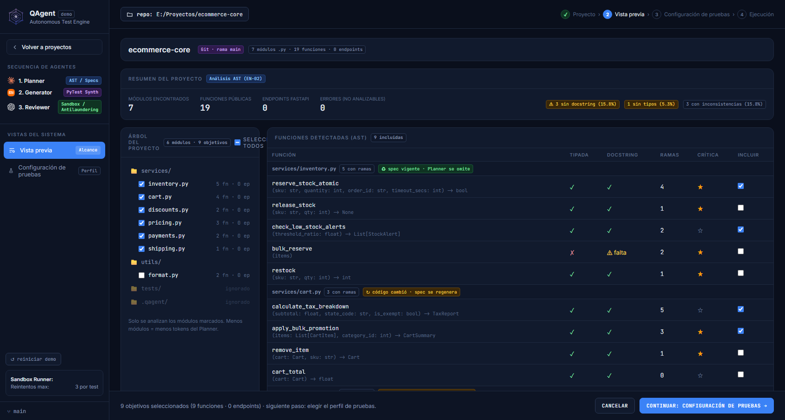
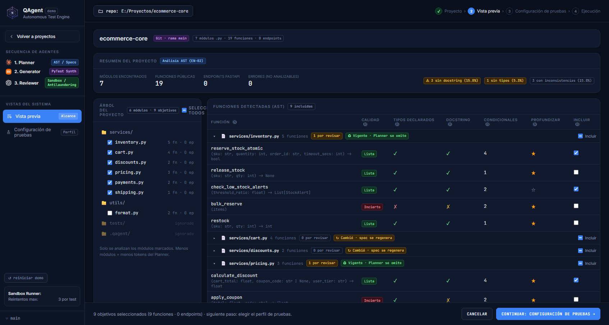
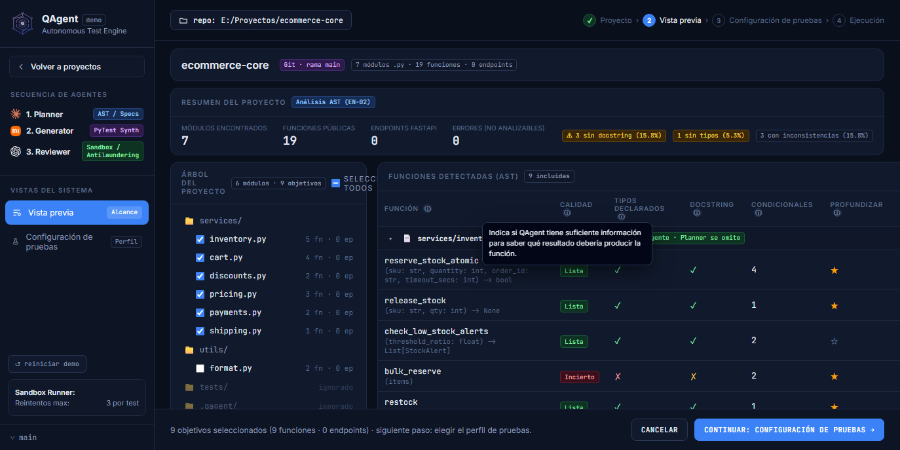
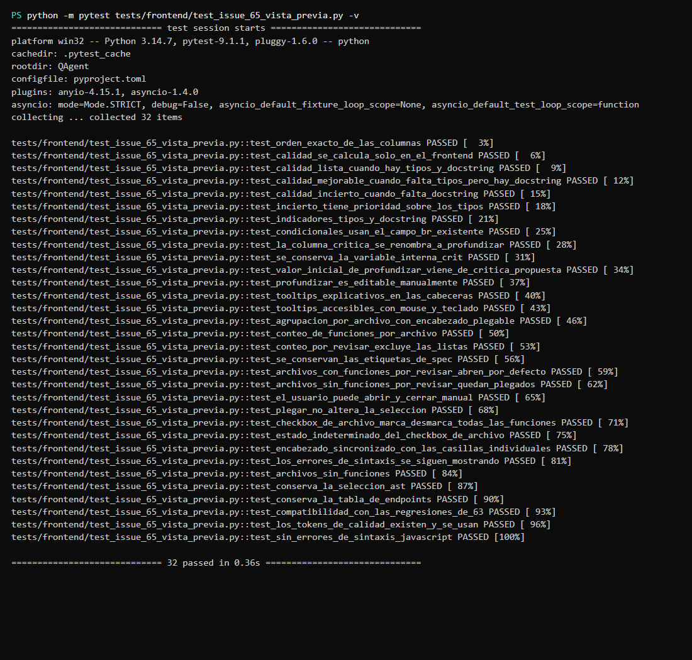
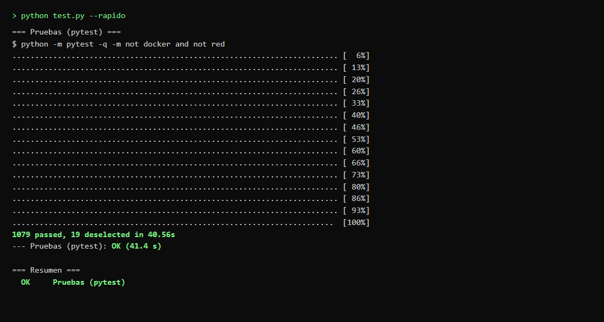
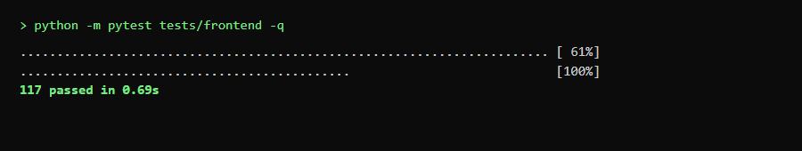
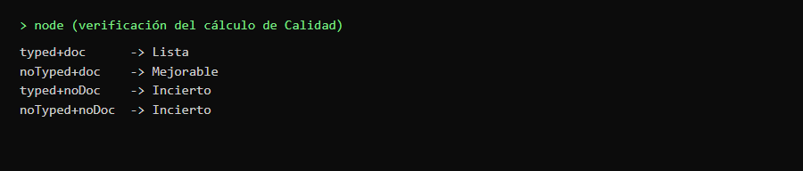

# Issue #65 · Nueva vista de Vista previa

**Informe de lo realizado** · 16 de octubre de 2026 · Responsable: bel001

## En pocas palabras

La pantalla «Vista previa» mostraba las funciones en una tabla plana: costaba saber de un vistazo qué
archivo tenía problemas y no había forma de plegar los archivos largos. Se rediseñó esa tabla para que cada
archivo sea un bloque que se abre y se cierra, con un semáforo de **Calidad** que dice si el sistema tiene
suficiente información para saber qué resultado debería dar cada función. La pestaña de endpoints y todo lo
demás quedaron igual.

Trabajo hecho sobre la rama `feat/issue-65-nueva-vista-previa`, creada desde el último `origin/develop`
(commit base `6d990da`). No se tocó el backend, ni los contratos de datos, ni los trabajos de las otras
issues (#63, #67, #71, #72).

## Qué se revisó y qué se hizo

**1. Las columnas de la tabla de funciones.**
*Se revisó:* la tabla tenía 6 columnas (Función, Tipada, Docstring, Ramas, Crítica, Incluir) y solo se veían
las funciones de los archivos marcados en el árbol de la izquierda.
*Se hizo:* ahora tiene 7 columnas, en este orden: **Función, Calidad, Tipos declarados, Docstring,
Condicionales, Profundizar, Incluir**. Todos los archivos aparecen agrupados y se ven aunque no estén
marcados, para poder incluirlos desde la propia tabla.

**2. El semáforo de Calidad.**
*Se revisó:* no existía; había que leer dos columnas por separado (tipos y docstring) para saber si la
función era confiable.
*Se hizo:* una etiqueta que se calcula solo en la pantalla, sin cambiar el backend: **Lista** (tiene tipos y
descripción), **Mejorable** (le faltan los tipos) e **Incierto** (le falta la descripción; este manda aunque
tenga tipos). Cada estado lleva color **y texto**, para que se entienda aunque no se distingan los colores.

**3. El nombre de la columna «Crítica».**
*Se revisó:* la columna se llamaba «Crítica», un término que confundía con las pruebas de mutación, que el
backend todavía no ejecuta.
*Se hizo:* se renombró a **Profundizar**. Por dentro se conserva igual la variable (`crit`), el valor inicial
propuesto por el análisis (`critica_propuesta`) y el mecanismo de selección que ya existía. Marcar Profundizar
no cambia Incluir.

**4. La agrupación por archivo.**
*Se revisó:* cada archivo aparecía como una fila de encabezado simple, sin plegar y sin control propio.
*Se hizo:* cada archivo es un encabezado plegable con ícono, ruta, número de funciones, número «por revisar»,
la etiqueta de spec que ya existía (Vigente / Cambió / Sin spec previo), un control **Incluir** y la flecha de
abrir/cerrar.

**5. El plegado inicial.**
*Se revisó:* no había plegado.
*Se hizo:* al abrir la pantalla, los archivos con al menos una función «por revisar» (Mejorable o Incierto)
aparecen **desplegados**, y los demás **plegados**. El usuario puede abrir o cerrar a mano y esa decisión se
respeta al volver a dibujar la tabla. Plegar nunca cambia la selección.

**6. El control «Incluir» del archivo.**
*Se revisó:* no existía.
*Se hizo:* una casilla por archivo que marca o desmarca todas sus funciones y muestra el estado
**indeterminado** (guion) cuando solo algunas están marcadas. Se usa la propiedad real del navegador
(`indeterminate`), no solo un cambio de apariencia.

**7. Los textos de ayuda (tooltips).**
*Se revisó:* las cabeceras no explicaban qué significaba cada cosa.
*Se hizo:* un ícono **ⓘ** en cada cabecera que muestra una explicación en lenguaje sencillo, visible con el
mouse y con el teclado (al enfocar con Tab), sin agrandar la tabla ni tapar datos importantes.

**8. El aspecto visual.**
*Se revisó:* los estilos estaban dentro de la pantalla, con colores repetidos.
*Se hizo:* los colores nuevos del semáforo y de los avisos quedaron en un solo lugar (`css/tokens.css`, que es
la fuente única de colores del proyecto) y se usan por nombre (`var(--token)`), como pide la guía ADR-003.

## Para qué se hizo

- Saber **de un vistazo** qué archivos necesitan atención, sin revisar función por función.
- Entender **si el sistema tiene información suficiente** para probar bien una función (semáforo de Calidad).
- Trabajar con proyectos grandes **sin perderse**: cada archivo se pliega y se abre cuando hace falta.
- Incluir o quitar **un archivo completo con un clic**, con la seguridad de que el estado intermedio se ve
  claro (indeterminado).
- **No romper** nada de lo anterior: siguen funcionando el árbol de módulos, la selección, los contadores, la
  tabla de endpoints y el manejo de archivos con errores.

## Pruebas realizadas

### Prueba 1 · La tabla cambió de forma visible (antes / después)

*Antes* (versión de `origin/develop`, mismos pasos):

*Después* (rama de la issue #65, mismos pasos):

Se abrió la pantalla de Vista previa en modo demostración y se recorrió la misma ruta en las dos versiones.
**Resultado:** la versión anterior mostraba 6 columnas planas (Función, Tipada, Docstring, Ramas, Crítica,
Incluir) y una fila de archivo sin plegar; la nueva muestra 7 columnas con Calidad, los archivos como
encabezados plegables con «por revisar», y las etiquetas de spec que ya existían.

### Prueba 2 · Los archivos se agrupan, se pliegan y explican sus columnas

En la primera imagen se ven las 7 columnas y varios archivos (unos desplegados, otros plegados). En la
segunda se pasó el mouse por el ícono **ⓘ** de «Calidad». **Resultado:** `services/inventory.py` aparece
desplegado porque tiene «1 por revisar»; `services/cart.py` y `services/discounts.py` aparecen plegados porque
tienen «0 por revisar»; el tooltip muestra «Indica si QAgent tiene suficiente información para saber qué
resultado debería producir la función.».

### Prueba 3 · Las pruebas automáticas pasan

Se ejecutaron las pruebas de la pantalla, las de toda la interfaz y luego la suite rápida del proyecto.
**Resultado:** las 32 pruebas nuevas pasan, las 117 pruebas de la interfaz pasan y la suite rápida pasa con
**1079 pruebas** (19 omitidas por estar marcadas como Docker o red).

### Prueba 4 · El cálculo de Calidad hace lo que debe

Se evaluó la función real de Calidad con los cuatro casos posibles. **Resultado:** con tipos y descripción da
**Lista**; sin tipos pero con descripción da **Mejorable**; sin descripción da **Incierto** (tenga o no tipos).

## Pendiente (otra tarea)

- **Validación manual en la aplicación de escritorio.** Las capturas se hicieron abriendo la pantalla en un
  navegador en modo demostración (frontend real en Edge, sin ventana). Falta abrir la aplicación real
  (`qagent`), cargar un proyecto Python real y repetir los pasos a mano. La guía está en `bitacora-pruebas.md`.
- **Aviso de entorno (no relacionado con esta issue).** El comando completo `python test.py` falla en el paso
  de formato por el archivo `src/qagent/app/desktop.py`, que **no forma parte de este cambio** y que la versión
  actual de Ruff (0.17.1) quiere reordenar (una línea en blanco). Se comprobó que el mismo fallo ocurre sobre la
  versión base de `origin/develop` (el archivo es idéntico: mismo contenido, sin cambios en esta rama), por lo
  que es una incidencia **preexistente** y ajena a la issue. No se tocó por estar fuera del alcance (backend) y
  para no mezclar cambios ajenos. Las 1098 pruebas del proyecto sí pasan.
