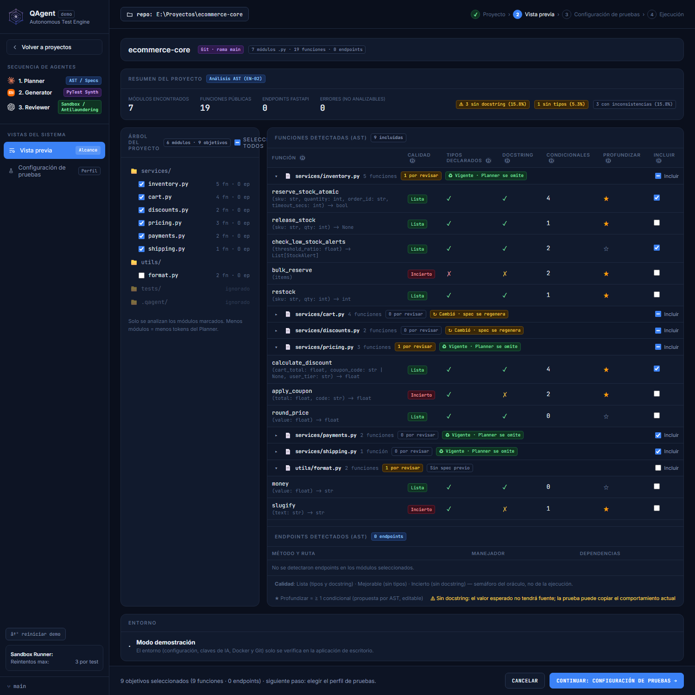
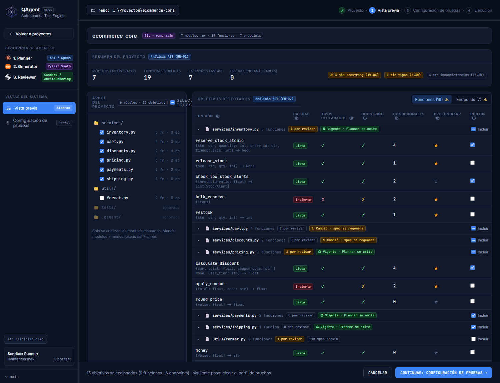
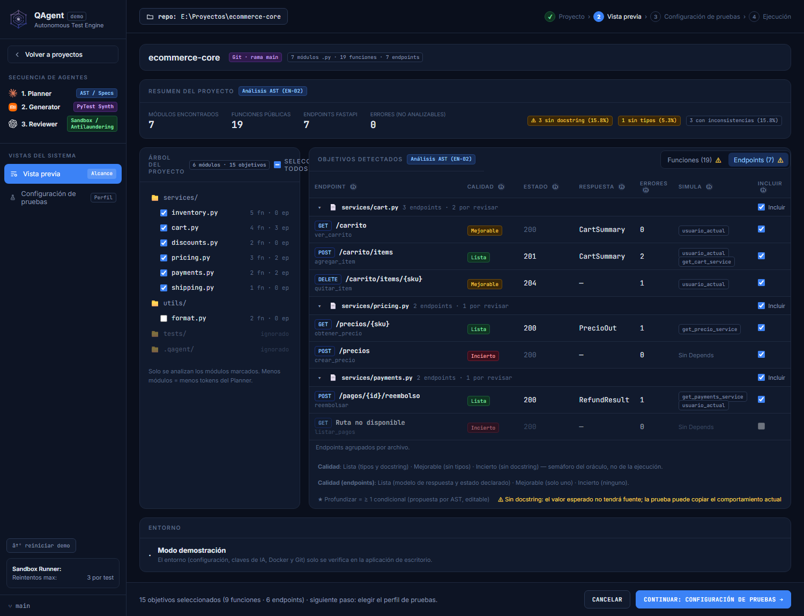
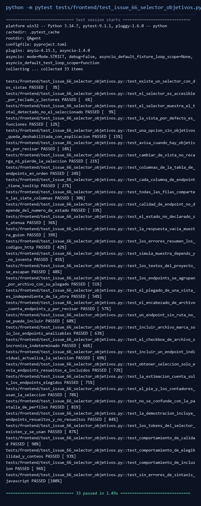
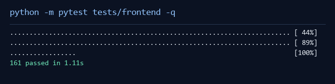
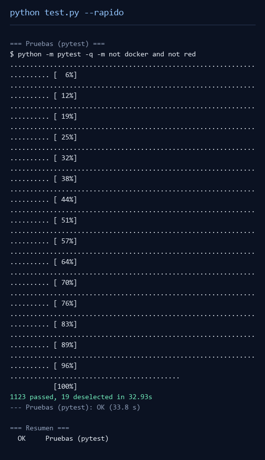
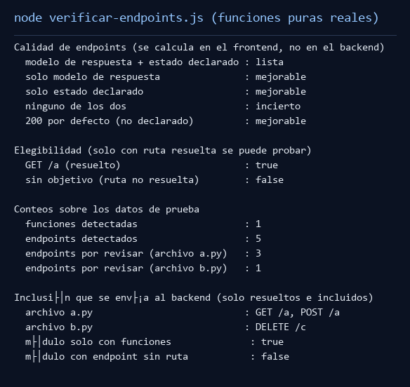

# Issue #66 · Cambiar entre funciones y endpoints en la Vista previa

**Informe de lo realizado** · 17 de octubre de 2026 · Responsable: bel001

## 1. En pocas palabras

La pantalla «Vista previa» mostraba **dos tablas una debajo de la otra**: arriba las funciones
(ya agrupadas por archivo desde la issue #65) y abajo los endpoints, en una tabla plana de solo
tres columnas. Cuando el proyecto tenía endpoints, había que bajar hasta el final y el endpoint no
se podía elegir de a uno: la tabla mostraba «Método y ruta · Manejador · Dependencias» y poco más.

Se agregó un **selector** para cambiar entre **Funciones** y **Endpoints**, y una **nueva tabla de
endpoints** con siete columnas, agrupada por archivo y con selección por archivo y por endpoint,
igual que la tabla de funciones. Los endpoints cuya ruta no se pudo resolver se muestran, pero no
se pueden probar. Nada de esto toca el backend ni los contratos de datos.

Trabajo hecho sobre la rama `feat/issue-66-selector-funciones-endpoints`, creada desde el último
`origin/develop` (commit base `756eafe`, que ya incluye la issue #65 y PR #78). No se tocó el
backend, ni los contratos, ni el trabajo de otras issues (#63, #67, #69, #71, #72).

## 2. Cómo estaba antes

- **Funciones:** 7 columnas, agrupadas por archivo y plegables (issue #65).
- **Endpoints:** una tabla aparte, debajo, de **3 columnas** (Método y ruta · Manejador ·
  Dependencias), sin agrupar, sin plegar y sin poder incluir endpoints de a uno. Los totales por
  archivo no decían cuántos endpoints había.
- No había forma de **mirar solo los endpoints**: siempre había que bajar por debajo de las
  funciones.

## 3. Qué se hizo · Selector Funciones / Endpoints

*Se revisó:* las dos tablas vivían apiladas y los contadores mostraban solo las funciones incluidas.
*Se hizo:* un selector arriba de las tablas con dos botones, **Funciones (N)** y **Endpoints (N)**,
donde **N es el total detectado** en el análisis (no lo seleccionado).

- La vista por defecto es **Funciones** cuando hay funciones.
- Si una opción tiene **0 objetivos**, queda **deshabilitada** y su tooltip explica por qué
  («No se detectaron endpoints en el proyecto» / «No se detectaron funciones en el proyecto»).
- Cada botón muestra un **⚠** cuando en esa vista hay objetivos «por revisar» (Mejorable o Incierto).
- Cambiar de pestaña **no recarga el proyecto ni pierde la selección**: solo muestra u oculta la
  tabla correspondiente.
- El pie de pantalla y el resumen siguen contando **lo seleccionado** (no el total detectado).

## 4. Qué se hizo · Nueva tabla de endpoints

*Se revisó:* la tabla tenía 3 columnas y una fila por endpoint, sin agrupar.
*Se hizo:* una tabla con **7 columnas, en este orden**:

**Endpoint · Calidad · Estado · Respuesta · Errores · Simula · Incluir**

| Columna | Qué muestra |
|---|---|
| Endpoint | Insignia del método (GET/POST/…) y la ruta completa; debajo, el nombre del manejador |
| Calidad | Semáforo: **Lista** / **Mejorable** / **Incierto** (se explica en la sección 5) |
| Estado | Código HTTP que devolverá; en **gris** si es el 200 por defecto (no declarado) |
| Respuesta | Modelo de datos declarado (`response_model`) o «—» si no lo hay |
| Errores | Cuántos errores HTTP (`HTTPException`) puede lanzar; el tooltip lista los códigos |
| Simula | Dependencias de `Depends()` que QAgent simula al probar |
| Incluir | Casilla para elegir el endpoint |

Cada columna tiene un ícono **ⓘ** con ayuda en lenguaje sencillo, visible con el mouse y con el
teclado (al enfocar con Tab). No se inventan datos: si el backend no entrega un campo, se muestra «—».

## 5. Calidad de endpoints

*Se revisó:* no existía un indicador; había que adivinar si faltaba el modelo de respuesta o el
código de estado.
*Se hizo:* un semáforo calculado **solo en la pantalla** a partir de lo que ya entrega el análisis
(`response_model` y `status_code_declarado`):

- **Lista:** declara el **modelo de respuesta** y el **código de estado**.
- **Mejorable:** declara **solo uno** de los dos.
- **Incierto:** no declara **ninguno**.

Es importante: un **200 por defecto no cuenta como estado declarado**. Aunque el código sea 200, si
el endpoint no lo declaró explícitamente, no se considera «Lista». Por eso el semáforo usa
`status_code_declarado`, no el número. Cada estado lleva color **y texto**.

## 6. Agrupación, plegado y selección

*Se revisó:* los endpoints no estaban agrupados y no se podían incluir de a uno.
*Se hizo:* cada archivo es un **encabezado plegable** (ícono, ruta, «N endpoints · M por revisar» y
casilla **Incluir**) y cada endpoint tiene su propia casilla:

- La casilla del archivo marca/desmarca **solo los endpoints analizables** y muestra el estado
  **indeterminado** (real, del navegador) cuando solo algunos están marcados.
- El **plegado de endpoints es independiente** del plegado de funciones: abrir o cerrar un archivo
  en una vista no cambia la otra.
- Al desplegar, los archivos con endpoints «por revisar» salen **abiertos** por defecto.

## 7. Endpoints sin ruta resuelta

*Se revisó:* un endpoint cuya ruta no se pudo resolver no aparecía.
*Se hizo:* se **muestra** (para que se sepa que existe), pero:

- su casilla **Incluir** queda **deshabilitada** con el tooltip «Ruta no disponible: no se puede
  probar»;
- no entra en la casilla «Incluir» del archivo;
- **nunca se envía al backend** ni cuenta como seleccionado.
- Nunca se inventa una ruta.

## 8. Selección enviada al backend

`obtenerSeleccionObjetivos()` ahora envía **solo los endpoints resueltos e incluidos**, y la
estimación de la corrida (`estFor`) y el pie (`renderPieVistaPrevia`) cuentan **solo esos**. Antes
se enviaban todos los endpoints del módulo, aunque no estuvieran marcados. Si no queda ningún
objetivo válido, no se deja continuar.

## 9. Aspecto visual y accesibilidad

*Se revisó:* los estilos de la vieja tabla de endpoints ya no hacen falta.
*Se hizo:* los estilos del selector y de la nueva tabla usan **solo tokens** (`var(--token)`), sin
colores escritos a mano, porque `css/tokens.css` es la fuente única de colores del proyecto
(ADR-003). El selector usa roles ARIA de pestañas (`role="tablist"`, `role="tab"`, `aria-selected`,
`aria-controls`) para que funcione con teclado y lectores de pantalla.

## 10. Para qué se hizo

- **Mirar solo lo que interesa**: funciones o endpoints, sin bajar por una página larga.
- **Decidir con información**: saber si a un endpoint le falta el modelo de respuesta o el estado.
- **Elegir fine-grained**: incluir/excluir un endpoint o un archivo completo, con estado intermedio
  claro (indeterminado).
- **No probar lo imposible**: los endpoints sin ruta quedan visibles pero fuera de la corrida.
- **No romper** nada de la issue #65: la tabla de funciones, su plegado y su selección siguen igual.

## 11. Pruebas realizadas

### Prueba 1 · Antes y después (capturas reales)

*Antes* (versión base `origin/develop`, mismos pasos): dos tablas apiladas, la de endpoints con
3 columnas y el texto «No se detectaron endpoints en los módulos seleccionados».



*Después* (rama de la issue #66): selector **Funciones (19) / Endpoints (7)** y la nueva tabla.





**Resultado:** la versión anterior no tenía selector y mostraba los endpoints en 3 columnas planas;
la nueva tiene el selector y muestra los endpoints con 7 columnas, agrupados por archivo
(`services/cart.py` con «3 endpoints · 2 por revisar», etc.), con Calidad, Estado, Respuesta,
Errores, Simula e Incluir. En el pie se ve «15 objetivos seleccionados (9 funciones · 6 endpoints)»:
el endpoint sin ruta (`GET Ruta no disponible`) queda **fuera** de la cuenta (aparece con la casilla
deshabilitada).

### Prueba 2 · Las pruebas automáticas pasan







**Resultado:** las **33 pruebas** de la issue pasan; las **161 pruebas** de la interfaz pasan; la
suite rápida pasa con **1123 pruebas** (19 omitidas por estar marcadas como Docker o red).

### Prueba 3 · El cálculo real hace lo que debe (Node)



Se ejecutaron las **funciones reales** de la pantalla con Node sobre datos simulados.
**Resultado:** «modelo + estado declarado» → **Lista**; «solo modelo» y «solo estado» → **Mejorable**;
«ninguno» → **Incierto**; «200 por defecto sin declarar» → **Mejorable**. Solo se envían los
endpoints con ruta resuelta e incluidos.

## 12. Matriz de aceptación (lo pedido → prueba)

Verificado por `tests/frontend/test_issue_66_selector_objetivos.py` (estructura + comportamiento real):

| Punto | Test |
|---|---|
| Selector con dos vistas | `test_existe_un_selector_con_dos_vistas` |
| Accesibilidad del selector | `test_el_selector_es_accesible_por_teclado_y_lectores` |
| Total detectado (no seleccionado) | `test_el_selector_muestra_el_total_detectado_no_el_seleccionado` |
| Vista por defecto = Funciones | `test_la_vista_por_defecto_es_funciones` |
| Opción sin objetivos deshabilitada | `test_una_opcion_sin_objetivos_queda_deshabilitada_con_explicacion` |
| Aviso ⚠ por revisar | `test_avisa_cuando_hay_objetivos_por_revisar` |
| Cambiar de vista no recarga ni pierde selección | `test_cambiar_de_vista_no_recarga_ni_pierde_la_seleccion` |
| 7 columnas en orden | `test_columnas_de_la_tabla_de_endpoints_en_orden` |
| Tooltip por columna | `test_cada_columna_de_endpoint_tiene_tooltip` |
| Calidad de endpoints | `test_calidad_de_endpoint_no_depende_del_numero_de_estado` + prueba Node |
| Estado atenuado | `test_el_estado_no_declarado_se_atenua` |
| Respuesta / Errores / Simula | `test_la_respuesta_vacia_muestra_guion`, `test_los_errores_resumen_los_codigos_http`, `test_simula_muestra_depends_y_no_inventa` |
| Escape de textos del proyecto | `test_los_textos_del_proyecto_se_escapan` |
| Agrupación y plegado propio | `test_los_endpoints_se_agrupan_por_archivo_con_su_plegado`, `test_el_plegado_de_una_vista_es_independiente_de_la_otra` |
| Endpoint sin ruta | `test_un_endpoint_sin_ruta_no_se_puede_incluir` |
| Incluir por archivo / individual | `test_incluir_archivo_marca_solo_los_endpoints_analizables`, `test_el_checkbox_de_archivo_sincroniza_indeterminado`, `test_incluir_un_endpoint_individual_actualiza_la_seleccion` |
| Envío al backend filtrado | `test_obtener_seleccion_solo_envia_endpoints_resueltos_e_incluidos`, `test_la_estimacion_cuenta_solo_los_endpoints_elegidos` |
| Sin confundir con perfiles | `test_no_se_confunde_con_la_pantalla_de_perfiles` |
| Datos demo y tokens | `test_la_demostracion_incluye_endpoints_resueltos_y_no_resueltos`, `test_los_tokens_del_selector_existen_y_se_usan` |
| Comportamiento real | `test_comportamiento_de_calidad`, `test_comportamiento_de_elegibilidad_y_conteos`, `test_comportamiento_de_inclusion` |
| Sin errores de sintaxis JS | `test_sin_errores_de_sintaxis_javascript` |

## 13. Pendiente (otra tarea)

- **Validación manual en la aplicación de escritorio.** Las capturas se hicieron abriendo la
  pantalla **real** del frontend en un navegador **Edge sin ventana (headless)**, en **modo
  demostración** (sin Python). Falta abrir la aplicación real (`qagent`), cargar un proyecto Python
  real y repetir los pasos a mano. La guía está en `bitacora-pruebas.md`.
- **Un test antiguo se ajustó.** `test_issue_65_vista_previa.py::test_conserva_la_tabla_de_endpoints`
  verificaba el texto «Método y ruta» de la tabla vieja, que esta issue reemplaza. Se actualizó para
  comprobar que la tabla de endpoints (`endpointTable`) y su render (`renderEndpoints`) siguen
  existiendo. No se borró ninguna prueba para «hacer pasar» nada: es un cambio de contrato pedido
  por la propia issue #66.

## 14. Cómo reproducir

```bash
python -m pytest tests/frontend/test_issue_66_selector_objetivos.py -v
python -m pytest tests/frontend -q
python test.py --rapido        # lint + formato + pruebas sin Docker ni red
node docs/evidencias/issue-66-selector-funciones-endpoints/verificar-endpoints.js \
  src/qagent/frontend/componentes/vista-previa/vista-previa.js
```

Las salidas completas están en esta carpeta (`salida-*.txt`) y el `manifiesto-sha256.txt` registra
los hashes de los archivos de este cambio.

## 15. Limitaciones y notas

- Las capturas muestran datos de la **demostración** del propio QAgent (proyecto `ecommerce-core`).
  Los endpoints de ejemplo se agregaron a `js/estado.js` **solo para la demostración**; están
  marcados como simulados y no son datos de un proyecto real.
- No se modificó el backend (`src/qagent/analysis`, `src/qagent/proyectos`): la pantalla ya recibía
  `response_model`, `status_code`, `status_code_declarado` y `excepciones_http` del análisis.
- No hay llamadas reales a proveedores de IA: todas las pruebas usan la IA simulada.
- **Limitación pendiente:** la validación manual en la aplicación de escritorio (pywebview) no se
  automatizó; las capturas de interfaz provienen de Edge en modo sin ventana, no de la app. Vea la
  sección 13 para los pasos.

## 16. Conclusiones

- La Vista previa ahora tiene un **selector Funciones/Endpoints** y una **tabla de endpoints de
  7 columnas** que reemplaza la tabla plana de 3 columnas, sin tocar el backend ni los contratos.
- La **Calidad de endpoints** se calcula solo con lo que declara el proyecto (`response_model` y
  `status_code_declarado`); un 200 por defecto no se considera declarado.
- La **selección** funciona por endpoint y por archivo, con estado indeterminado real; los endpoints
  sin ruta se muestran pero no se pueden incluir y **nunca** se envían al backend.
- Se **conservó** todo el comportamiento de la issue #65 (tabla de funciones, plegado y selección):
  solo se ajustó un test que verificaba el texto de la tabla vieja.
- **Estado:** implementación y pruebas verificadas (33 + 161 pruebas en verde, regresiones OK, lint
  y formato OK); evidencias auténticas y manifiesto SHA-256 con **22/22 hashes coincidentes**.
  Queda **pendiente** únicamente la validación manual en la app de escritorio (pywebview).
